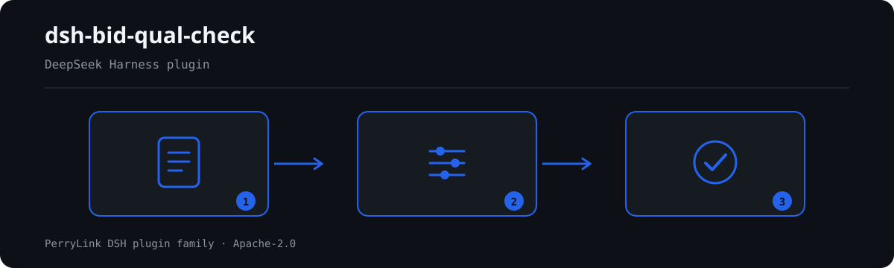

# dsh-bid-qual-check — 投标人资格条件核对

[English](README.md) · [简体中文](README-zh.md) · [Español](README-es.md) · [Português](README-pt.md) · [हिन्दी](README-hi.md)

<!-- topblock:v1 -->
> **这是什么**　投标人资格条件核对。输出一份「哪一行、哪一栏、差什么」的清单。
> **给谁用**　投标专员、招标代理、资格审查辅助人员；不用懂命令行。
> **你交什么**　这项核对用到的原始材料（表格、清单或文书）；不改原件。Excel 可先转成 JSON/YAML，对话里也能代转。
> **它不做什么**　不判合规、不认定责任、不替代审核人；只列材料内部能逐条指认的差异。
> **怎么开始**　在 WorkBuddy / 扣子搜「投标合规核对包」（本检查是其中一项；上架以商城为准）；或命令行：
> `dsh plugin --profile <name> add dsh-bid-qual-check`
<!-- /topblock:v1 -->

[](https://dsh.market/)
[](https://dshfind.com/en/plugins/PerryLink/dsh-bid-qual-check?ref=badge)

`dsh-bid-qual-check` 读取一份投标人资格条件核对表——表头加每条资格条件一行——核对这张核对表自身的逐条闭环：每条资格条件是否填写了要求内容、是否记录了投标人实际情况、是否附证明材料、核对结论是否使用本机构口径的取值、标记为否决项的行是否同时记录了实际情况、证明材料与结论、表头是否写明项目与投标人、资格条件序号是否唯一、要求内容栏是否残留未替换的占位符。

## Install

```sh
dsh plugin --profile <name> add dsh-bid-qual-check
dsh --profile <name> --dump-config | grep 'dsh-bid-qual-check'
```

## 实际输出长什么样



*工作流概览：文档 → 规则包 → 核对结果。下面的示例使用实际命令面。*


本插件对自己 `BQ-002` 测试夹具的**真实输出**，不是示意图。规则库不伪造引文：每条发现都会写明所引条款，以及该条 excerpt 是逐字引文还是原则性推论。

## 它回答什么问题

### 示例

下表是示例集：第一行是详细走查，其余行是简短案例。


#### 详细输出

**工具** `bid_qual_check`

**输入**

~~~json
{"rows":[{"序号":"1","资格条件":"","类别":"资格条件","要求内容":"", ...}]}
~~~
 
**输出**

~~~json
{
  "id": "dsh-bid-qual-check.BQ-001.de09b5a6",
  "ruleId": "BQ-001",
  "severity": "warn",
  "locator": {
    "row": 1,
    "field": "required"
  },
  "found": "第 1 行 required、criterion 都为空",
  "expected": "required、criterion 至少应填写一项",
  "fix": "补填资格条件与要求内容；本条只核对是否填写，不判断该条件是否应当设置"
}
~~~

*来源 `dsh-bid-qual-check/tests/fixtures/BQ-001/BQ-001-unsafe.json; dsh-bid-qual-check/tests/fixtures/BQ-001/cases.json; dsh-bid-qual-check/rules/bid-qual-check.yaml; dsh-bid-qual-check/tests/index.test.ts`*

| 你会问 | 它怎么答 |
|---|---|
| 某一行的「资格条件」与「要求内容」两栏都是空的，会报出来吗？ | 会。`BQ-001` 要求每行在这两栏中至少填一栏，两栏皆空时逐行报出。它只核对是否填写，不判断该资格条件本身是否合法、是否应当设置——那是对招标文件本身的审查。 |
| 某条资格条件的「投标人情况」栏空着，「证明材料」栏也空着。 | 会报出两处：`BQ-002` 报出 `投标人情况`（`actual`）为空的行，`BQ-003` 报出 `证明材料`（`evidence`）为空的行。两条都只核对这一栏是否填写，既不判断实际情况是否满足要求，也不判断证明材料是否有效、是否过期、是否与原件一致——那需要核对原件，属于资格审查委员会的判断。栏位在册但整栏为空，仍会逐行报出；材料里根本没有这一栏时，这两条进入 `skipped` 并说明不适用，而不是静默通过。 |
| 「核对结论」栏空着，`BQ-004` 会报吗？ | 不会——`BQ-004` 只看已经填写的取值，空格跳过。本条规则的 `values` 出厂为空，因此默认它自己进入 `skipped`；把本机构的结论口径（如 `符合` / `不符合` / `需澄清`）配置进 `values` 之后，不在册的取值会逐行报出。它只核对取值是否在册，不判断结论是否正确，也不会因为出现某个取值就认定投标无效。本条封顶 `info`，因为结论口径由本机构规定。 |
| 某一行的「是否否决项」写的是 `是`，但「投标人情况」或「证明材料」没填。 | `BQ-005` 要求凡「是否否决项」栏命中配置判定值（默认 `是`、`Y`、`yes`、`true`、`否决项`、`√`）的行，必须同时填写 `投标人情况`、`证明材料` 与 `核对结论`，缺哪项就报出哪项。哪些条件属于否决项完全取决于本项目招标文件与这一栏，不来自任何内置清单。若没有任何一行带这类标记，本条报告不适用并进入 `skipped`，而不是静默通过；它只核对清单闭环，不判断该投标人是否应当被否决。 |
| 核对表表头写了招标编号，但没有项目名称和投标人。 | `BQ-006` 会报出一次表头缺失，并指出缺的是 `project`（项目名称）还是 `bidder`（投标人名称）。它只核对表头是否声明了这两个主体信息，不核对招标编号与核对日期；把结论口径加进这条规则的字段也不会有帮助——那由 `BQ-004` 的 `values` 控制。 |
| 这张核对表是照模板抄的：两行的序号都是 `3`，还有一处「要求内容」写着 `待填`。 | `BQ-007` 会报出重复的 `序号`（比对时忽略空白字符，`3` 与 ` 3 ` 视为同一个号）；若没有任何一行填了序号，本条进入 `skipped` 并说明不适用，而不是静默通过。`BQ-008` 会报出「要求内容」里残留的占位符——`【`、`】`、`{{`、`}}`、`XXX`、`待填`、`待补充`、`TBD`、`示例` 等 `terms` 词表，词表可按本机构模板收窄。两条都只做字面核对：都不判断要求内容本身是否正确，逐字抄录而恰好含有 `XXX` 的要求也会被报出。 |

## 依据的标准

| 文件 | 文号 | 引用它的规则 |
|---|---|---|
| 《中华人民共和国招标投标法》 | 1999年8月30日通过，2017年12月27日修正（全国人大常委会《关于修改〈中华人民共和国招标投标法〉、〈中华人民共和国计量法〉的决定》），本法自2000年1月1日起施行 | BQ-001, BQ-002, BQ-003, BQ-004, BQ-006, BQ-007, BQ-008 |
| 《中华人民共和国招标投标法实施条例》 | 国务院令第613号（2011 年 12 月 20 日公布，2017 年 3 月 1 日修订，自 2012 年 2 月 1 日起施行） | BQ-005 |

**边界（中文译文，以英文原文为准）：** 本插件核对一份 **投标人资格条件核对表** 在核对表层面可以要求到的闭环——每项条件是否记录了要求内容与投标人实际情况，是否附有证明材料，核对结论是否取自你的取值口径，**否决项**是否同时记录投标人实际情况、证明材料与核对结论，表格是否写明项目与投标人，编号是否唯一，以及是否残留占位符。它**不**判定投标人是否具备资格、资格审查是否不通过，也不判定投标是否应当被否决。**那是资格审查委员会的判断，须对照证明材料原件与招标文件规定的条件作出。**

> ### ⚠️ 在采信报告中的引文之前，请先读这一段
>
> **每条 `excerpt` 的状态逐条不同，不是统一的。** 有的规则引用逐字条文（`kind: direct`），有的按条文原则推导（`kind: derived-from-principle`，最高 `warn`），有的阈值由本机构配置（`kind: institutional-configuration`，最高 `info`）。规则包从不概括引文：取不到原文时，`excerpt` 会如实写明，推理写在 `note` 里；并有测试断言没有任何规则声称拥有它并不拥有的引文。**对仍标为「未取得原文」的规则，取得文本后必须把 `excerpt` 换成真实条款，并把 `kind` 提升为 `direct`。**
>
> 结论性判断留给审核人：本插件只列出材料内部可以逐条指认的差异，不判断事实真伪，也不评价合规性。

## Compatibility

| 项目 | 状态 |
|---|---|
| Harness | 对等版本范围 `>=0.1.2-rc.1 <0.2.0 \|\| >=0.2.0-0 <0.3.0` —— 已实测同时接受 `0.2.0-rc.2` 与 `0.2.1-rc.2`。**已声明 `engines.dsh`**：0.2.1 起由宿主单独裁决，范围为 `>=0.2.1-0 <0.3.0` |
| Node | `^22.19.0 || >=24.0.0` |
| 平台 | 全平台（纯 ESM；无原生代码、无联网、不调用模型） |
| 工具模式 | `native` / `ptc` 均可；批量校验整个目录时建议 `ptc`，schema 成本只付一次 |

## What it does

规则表、字段说明与行为细节见 [README.md](README.md#what-it-does)（英文主版本）。本插件只列出材料与所引条款之间的字面差异，并对无法执行的检查在 `skipped` 中逐项说明。

## Configuration

全部可调参数都在 `src/config.ts` 的 Schemastery schema 中，只改 `cordis.yml` 即可生效，无需改代码；逐条阈值在 `rules/` 下的规则库文件里。

| 键 | 类型 | 默认值 | 说明 |
|---|---|---|---|
| `rulesFile` | string | `rules/bid-qual-check.yaml` | 规则库文件路径，相对插件包根目录 |
| `disabledRules` | string[] | `[]` | 要停用的规则 id 列表；每条都会出现在 `skipped` 中 |
| `onlyRules` | string[] | `[]` | 只执行这些规则 id；留空表示执行全部规则 |
| `skipNotes` | string | `""` | 附加到每条 `skipped` 说明后的备注 |
| `timeoutMs` | number | `120000` | 工具协作式超时预算（毫秒） |

## Material format

支持 JSON 与 YAML。完整字段示例见 [README.md](README.md#material-format)（英文主版本）。字段在读取层是可选的，由检查引擎校验，因此部分导出的材料会产生"缺项"类差异，而不是让程序崩溃。

## Rule sources

规则数据与代码分离，每条规则都带文件名、文号、按原文自身编号体系的条款号、逐字摘录与来源地址。加载期强制：摘录必须是真实引文且不少于八个字符；依据仅为原则性条款（`kind: derived-from-principle`，严重级上限 `warn`）或本机构配置（`kind: institutional-configuration`，上限 `info`）的检查不得标为 `error`。夸大依据的规则库会在加载期失败，而不会产出一份看起来很有底气的报告。

核验中确认的边界与"刻意没有作出的结论"见 [README.md](README.md#rule-sources)（英文主版本）与随包的 `rules/evidence/` 目录。

## Troubleshooting

- **插件装上了但工具不出现**：确认 `main` 指向 `lib/index.mjs` 且 `pnpm run build` 已生成该文件；`main` 写错会让加载器静默跳过该条目。
- **`dsh plugin add` 报版本不兼容**：peer 范围覆盖 `0.1.x` 与 `0.2.x`；若运行时在其之外，可显式豁免：`dsh plugin --profile <name> allow-version <包名@版本> --dsh-version <runtime> --accept-risk`
- **某条规则没有执行**：查看 `skipped` 数组，其中写明了规则 id 与原因。
- **`check` 报 `manifest-peers` 失败**：静态检查器比对的是一份早于 0.2 世代的硬编码 peer 范围；安装期的 peer 校验以运行时为准。这是 `dsh-plugin-dev` 的已知上游问题。
- **时间看起来偏移**：全部计算都是对输入字符串做墙上时钟运算，不做时区换算。

## Development

```sh
pnpm install
pnpm run typecheck
pnpm test
pnpm run build
node ../scripts/sync-shared.mjs dsh-bid-qual-check
```

第 4 项把 `../_shared` 的共享件同步进 `src/shared/`；每次改动共享件后都要重跑。

## PerryLink DSH Plugin Family

完整清单（62 个核查器 + 通用插件）见 [按材料选核查器](https://perrylink.github.io/zh/checkers/choose/)；本仓只是其中一个。

## License

[Apache License 2.0](LICENSE) © 2026 dsh-bid-qual-check contributors.
