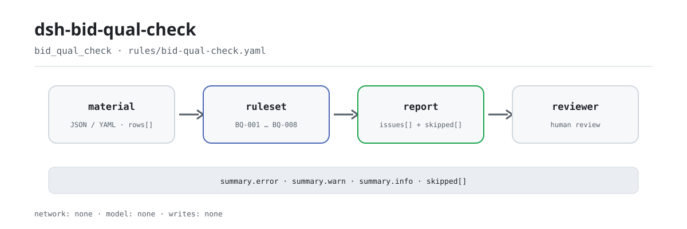

<div align="center">

<picture>
  <source media="(prefers-color-scheme: dark)" srcset="docs/assets/dsh-bid-qual-check-flow-dark.svg">
  
</picture>

# dsh-bid-qual-check

**Walk a bidder qualification condition register row by row and point at exactly which row and column do not close the loop.**

For bid specialists, tender agents and qualification reviewers: hand it a JSON/YAML register and get back a difference list you can review line by line — the original is never modified, no compliance verdict is issued.

[Install](#three-step-setup) · [Configuration](#configuration) · [FAQ](#faq) · [简体中文](README.md) · [English](README.en.md) · [Español](README.es.md) · [Português](README.pt.md) · [हिन्दी](README.hi.md)

[](LICENSE)
[](#compatibility)
[](https://www.npmjs.com/package/dsh-bid-qual-check)
[](https://github.com/PerryLink/dsh-bid-qual-check/actions/workflows/ci.yml)
[](#compatibility)

[](https://github.com/PerryLink/dsh-bid-qual-check/stargazers)
[](https://www.npmjs.com/package/dsh-bid-qual-check)
[](https://dshfind.com/plugins/PerryLink/dsh-bid-qual-check?ref=badge)
[](https://securityscorecards.dev/viewer/?uri=github.com/PerryLink/dsh-bid-qual-check)
[](https://dsh.market/)
[](https://gitee.com/perrylink/dsh-bid-qual-check)

```sh
dsh plugin --profile <name> add dsh-bid-qual-check
```

</div>

<sub>Community plugin, not affiliated with DeepSeek. Canonical repository: <https://github.com/PerryLink/dsh-bid-qual-check> (Gitee is a mirror).</sub>

## What it is

`dsh-bid-qual-check` reads one bidder qualification condition register — a header plus one row per qualification condition — and checks that register's own closed loop: that each condition records its requirement, that the bidder's actual position is recorded, that evidence is attached, that the verdict comes from your vocabulary, that a pass/fail item records all three, that the register names its project and bidder, that condition numbers are unique, and that no unreplaced placeholder survives in the requirement column. The output is a difference list: which row, which column, what is missing, how to fix it.

It does not decide compliance, qualification or the validity of evidence originals; it lists differences a reviewer can point to in the material and leaves the conclusion to that reviewer.

A one-minute sample ships with the repository: build, then run `node samples/quickstart/run.mjs`. The input is in `samples/quickstart/input/` and the expected result in `samples/quickstart/expected/result.json`.

## Three-step setup

1. **Install** (pick one channel):

   ```sh
   # git channel (latest main; equivalent to git+https://github.com/PerryLink/dsh-bid-qual-check.git)
   dsh plugin --profile <name> add github:PerryLink/dsh-bid-qual-check
   # npm channel (published release 0.2.12)
   dsh plugin --profile <name> add dsh-bid-qual-check
   # tarball channel: pnpm pack in this repo, then
   dsh plugin --profile <name> add ./dsh-bid-qual-check-<version>.tgz
   ```

   The npm package already contains the built `lib/`; from source, run `pnpm install && pnpm run build` first.

   The check is also part of the "Tender Compliance Suite" on WorkBuddy / Coze (availability as listed).

2. **Minimal config** (the defaults work; the rule pack ships with the package):

   ```yaml
   - insert:
       - id: dsh-bid-qual-check
         name: dsh-bid-qual-check
   ```

   To narrow the rule set or swap the pack, override `onlyRules`, `disabledRules` or `rulesFile` as shown under Configuration.

3. **Verify it mounts**:

   ```sh
   dsh --profile <name> --dump-config | grep 'dsh-bid-qual-check'
   ```

   Call `bid_qual_check` in a session with `file` (a material path) or `material` (inline JSON/YAML). Or run the bundled sample:

   ```sh
   pnpm install && pnpm run build
   node samples/quickstart/run.mjs
   ```

   ```text
   bid_qual_check: 1 issue(s) — error 0, warn 1, info 0
   skipped: 1
   ```

   The expected result is in `samples/quickstart/expected/result.json`; `skipped: 1` is `BQ-004` (the verdict vocabulary ships empty), which is expected.

**Uninstall**: `dsh plugin --profile <name> remove dsh-bid-qual-check` (or remove the row from the profile patch).

## Core capabilities

`dsh-bid-qual-check` does one thing: it walks the register row by row against the rule pack and returns locatable differences. Eight rules cover the closed loop a register can check on its own:

- **Row-by-row closure** — `BQ-001` through `BQ-008` cover requirement, actual position, evidence, verdict vocabulary, the three-part pass/fail record, header parties, unique numbers and residual placeholders.
- **Located, not vague** — every finding carries `ruleId`, `locator` (row/field), `found`, `expected` and `fix`; the report groups them under `error`, `warn` and `info`.
- **An empty result is not a clean bill** — every check that cannot run is listed in `skipped` with its reason; `disabledRules`, `onlyRules` and an empty `values` all show up explicitly in the report.
- **The rule pack is data** — rules live in `rules/bid-qual-check.yaml`; swapping the YAML swaps the rule set, and load-time validation enforces unique ids and severity ceilings.
- **No fabricated citations** — every rule carries `document`, `number`, `clause`, `excerpt`, `kind` and `source`; only a verbatim quotation is `direct`, a principle-derived check is capped at `warn`, and a locally configured threshold is capped at `info`.
- **Offline and read-only** — no network, no model call, no file writes; it only reads the `file` or `material` you pass.

### Rule reference

| Rule | Check | Severity | Basis kind |
|---|---|---|---|
| `BQ-001` | every condition records its requirement | warn | direct |
| `BQ-002` | every condition records the bidder's actual position | warn | direct |
| `BQ-003` | every condition attaches evidence | warn | direct |
| `BQ-004` | the verdict comes from your vocabulary | info | institutional configuration |
| `BQ-005` | a pass/fail item records position, evidence and verdict | warn | principle |
| `BQ-006` | the register names its project and bidder | warn | principle |
| `BQ-007` | condition numbers are unique | warn | principle |
| `BQ-008` | the requirement column holds no unreplaced placeholder | warn | principle |

### Example

This is the rule pack's real output for its own `BQ-001` fixture.

**Input** (excerpt; the full sample is `samples/quickstart/input/BQ-001-unsafe.json`):

```json
{"project":"某某工程施工招标","bidder":"某某建设有限公司","rows":[{"序号":"1","资格条件":"","要求内容":"","投标人情况":"持有建筑工程施工总承包二级资质，证书在有效期内","证明材料":"资质证书复印件，资格文件第 12 页","核对结论":"符合","是否否决项":"是"}]}
```

**Output** (one `warn` finding, excerpt):

```json
{
  "id": "dsh-bid-qual-check.BQ-001.97d9cf2f",
  "ruleId": "BQ-001",
  "severity": "warn",
  "locator": {
    "column": "required",
    "row": 1
  },
  "found": "第 1 行 required、criterion 都为空",
  "expected": "required、criterion 至少应填写一项",
  "fix": "补填资格条件与要求内容；本条只核对是否填写，不判断该条件是否应当设置"
}
```

*Observed from `tests/fixtures/BQ-001/BQ-001-unsafe.json; tests/fixtures/BQ-001/cases.json; rules/bid-qual-check.yaml; tests/index.test.ts`*

### Rule Q&A

| You ask | What it answers |
|---|---|
| A row has both the `criterion` and `required` cells blank. Is that reported? | Yes. `BQ-001` holds every row to at least one of those two columns and reports the row when both are empty. It checks that something was written, not whether that condition is lawful or should have been set at all — that is a review of the tender document itself. |
| A condition has its `actual` cell empty, and no `evidence` either. | Two findings: `BQ-002` reports the row for the blank actual position and `BQ-003` for the blank evidence. Both check only that the cell is filled — not whether the position satisfies the condition, nor whether the document is valid, current or matches the original, which needs the originals and the committee's call. A column that is present with every cell blank is still reported row by row; a material without that column puts the rule in `skipped` instead of passing silently. |
| The `verdict` cell is blank on a row. Does `BQ-004` report it? | No — `BQ-004` tests only the values that are written and skips blank cells. Its `values` list ships empty, so out of the box the rule reports itself in `skipped`; once you configure your institution's verdict vocabulary in `values`, a value outside that list is reported row by row. It checks that the value is in your vocabulary, not that the conclusion is correct, and no value ever invalidates a bid. The rule is capped at `info`, because the vocabulary is your institution's to set. |
| A row is marked as a pass/fail item, but its actual position or evidence is missing. | `BQ-005` requires the actual position, the evidence and the verdict together on every row whose pass/fail cell matches the configured marks (`Y`, `yes`, `true`, `√` and the other defaults declared in the rule pack) and reports the row with what is missing. Which conditions count as pass/fail comes entirely from the tender document and from that column, never from a built-in list. If no row carries such a mark, the rule reports itself in `skipped` instead of passing — and it never decides whether the bid should be rejected. |
| The register's header names the tender number, but not the project or the bidder. | `BQ-006` reports the header once and names what is missing: `project` (the project name) or `bidder` (the bidder name). It only checks that the header declares those two parties — it does not check the tender number or the check date, and adding the verdict vocabulary to this rule would not help, because that is controlled by `BQ-004`'s `values`. |
| This register was copied from a template: two rows share the number `3`, and one requirement cell still reads `XXX`. | `BQ-007` reports the repeated `seq` (the comparison ignores whitespace, so `3` and ` 3 ` are the same number), and if no row carries a number at all it reports itself in `skipped` instead of passing. `BQ-008` reports the residual placeholder in `required` — `【`, `】`, `{{`, `}}`, `XXX`, `TBD` and the rest of its `terms` list, which you can narrow. Both checks are literal: neither judges whether the requirement itself is right, and a requirement genuinely quoted with an `XXX` in it is reported too. |

The register's Chinese column names map to canonical fields (the aliases are declared in `src/model.ts`):

```text
序号 → seq · 资格条件 → criterion · 类别 → category · 要求内容 → required
投标人情况 → actual · 证明材料 → evidence · 核对结论 → verdict
是否否决项 → isPassFail · 核对人 → checkedBy · 备注 → note
project · tenderNo · bidder · checkedAt · verdicts   (header fields)
```

## Standards it follows

| Document | Number | Cited by rules |
|---|---|---|
| Tendering and Bidding Law of the People's Republic of China | Adopted 30 August 1999; amended 27 December 2017 by the Standing Committee of the National People's Congress Decision amending the Tendering and Bidding Law and the Metrology Law; effective 1 January 2000 | BQ-001, BQ-002, BQ-003, BQ-004, BQ-006, BQ-007, BQ-008 |
| Implementing Regulations for the Tendering and Bidding Law of the People's Republic of China | State Council Order No. 613 (promulgated 20 December 2011; amended 1 March 2017; effective 1 February 2012) | BQ-005 |

**Boundary:** this plugin checks a **bidder qualification condition register** for the closed loop a checklist can be held to — that every condition records its requirement and the bidder's actual position, that evidence is attached, that verdicts come from your vocabulary, that a **pass/fail item** records all three, that the table names its project and bidder, that numbers are unique, and that no placeholder survives. It does **not** decide whether a bidder is qualified, whether qualification fails, or whether a bid should be rejected. **That is the qualification committee's call, made against the evidence originals and the tender document's conditions.**

> **Read this before trusting a citation in the report.**
>
> **`excerpt` status is per rule, not uniform.** Some rules quote the clause verbatim (`kind: direct`), some are derived from the principle of the cited articles (`kind: derived-from-principle`, capped at `warn`), and some use thresholds your institution configures (`kind: institutional-configuration`, capped at `info`). The pack never paraphrases a quotation: when the text was not obtained, the `excerpt` field says so and the reasoning lives in `note`; the `check:citations` gate traces every excerpt segment back to the records under `rules/evidence/` (the baseline is empty). **For any rule still marked as not obtained, replace the `excerpt` with the real clause and raise `kind` to `direct` once the text is in hand.**
>
> The conclusion is the reviewer's: this plugin lists differences it can point to in the material and does not decide facts or compliance.

Rule data is separated from code. Load-time validation requires every rule to carry `document`, `number`, `clause`, `excerpt`, `kind` and `source`, an `excerpt` of at least eight characters, unique rule ids, and a `severity` no stronger than its basis kind allows (`direct` up to `error`, `derived-from-principle` up to `warn`, `institutional-configuration` up to `info`). The length check cannot tell a quotation from a paraphrase, so verbatim status is backed by the verification records under `rules/evidence/` and by tests: no `direct` rule may claim its text was not obtained, and every referenced evidence file must exist. The pack header and each rule's `note` also state the citation status and gap; the verified boundaries and the conclusions deliberately not drawn are recorded under `rules/evidence/`.

## Configuration

All tunables live in the Schemastery schema in `src/config.ts`, so `cordis.yml` changes them without touching code; per-rule thresholds live in the rule pack under `rules/`.

| Key | Type | Default | Description |
|---|---|---|---|
| `rulesFile` | string | `rules/bid-qual-check.yaml` | Rule-pack path, relative to the package root |
| `disabledRules` | string[] | `[]` | Rule ids to stop running; each appears in `skipped` |
| `onlyRules` | string[] | `[]` | Run only these rule ids; empty runs every rule |
| `skipNotes` | string | `""` | Note appended to every `skipped` reason |
| `timeoutMs` | number | `120000` | Cooperative tool timeout budget |

### Rule-level parameters

These live under `params` in the rule-pack YAML, not among the plugin `Config` keys:

- `BQ-004` `values` — your verdict vocabulary, e.g. three pass/fail/clarify labels; empty by default, and the rule reports itself in `skipped` until configured.
- `BQ-005` `conditionValues` — the values in the pass/fail column that mark an item as pass/fail; the defaults are declared in the rule pack.
- `BQ-008` `terms` — the placeholders to look for; the default list is declared in the rule pack and can be narrowed.

The shipped defaults for those three parameters, quoted from `rules/bid-qual-check.yaml`:

```text
BQ-004 values: []
BQ-005 conditionValues: [是, Y, yes, true, 否决项, √]
BQ-008 terms: ['【', '】', '{{', '}}', 'XXX', 'xxx', '待填', '待补充', 'TBD', 'todo', '示例']
```

### Material format

JSON or YAML. The top level lists rows under `rows` (also `items` and `criteria`); the header fields `project`, `tenderNo`, `bidder` and `checkedAt` accept Chinese aliases too. Column names are matched case-insensitively and ignoring spaces (including the full-width space), underscores and hyphens; the register's own column names are kept, so a finding names the column it read:

```yaml
project: 某某工程施工招标
tenderNo: ZB-2026-018
bidder: 某某建设有限公司
rows:
  - { 序号: '1', 资格条件: 施工资质等级, 要求内容: 建筑工程施工总承包二级及以上,
      投标人情况: 持有建筑工程施工总承包二级资质，证书在有效期内,
      证明材料: 资质证书复印件，资格文件第 12 页, 核对结论: 符合, 是否否决项: 是, 核对人: 李工 }
```

Fields are optional at the reader layer and validated by the check engine, so a partial export produces "missing field" findings instead of a crash. Empty material, an empty row list, or material with no recognizable field raises a reader error that names the columns it saw — it never carries on with the wrong columns.

## FAQ

<details>
<summary>Is the material uploaded or stored?</summary>

No. This is an offline checker: it reads the `file` or `material` you pass, makes no network request, calls no model, writes no file and keeps no copy of the material (see `SECURITY.md`).

</details>

<details>
<summary>The report is empty — does that mean the register is clean?</summary>

No. An empty result only means the checks **that ran** found no difference; every check that could not run is listed in `skipped` with its rule id and reason. Read `issueCount` and `skippedCount` together. Also, empty material, an empty row list, or material with no recognizable field raises an error rather than returning an empty report.

</details>

<details>
<summary>Why are `BQ-004` or `BQ-005` always `skipped`?</summary>

`BQ-004` ships with an empty `values` list, so it does not run until you configure your institution's verdict vocabulary. `BQ-005` runs only when at least one pass/fail cell matches `conditionValues`. Both depend on your project and your institution; the plugin does not guess. Configure them and run again.

</details>

<details>
<summary>Does it support Excel or Word?</summary>

Only JSON or YAML. Convert Excel to JSON/YAML first (this can be done in chat), and extract a table structure from Word/PDF first; the plugin does not parse binary documents and performs no OCR.

</details>

<details>
<summary>How big is the performance overhead?</summary>

The check is an in-memory table walk: no network, no model call, no file reads beyond the rule pack; cost scales with rows × eight rules and is usually negligible. `timeoutMs` defaults to 120000 and is enforced by the host as a cooperative timeout; the tool declares itself concurrency-safe, so several materials can be checked in parallel.

</details>

## Security boundaries

- **Offline and read-only.** No network requests, no model calls, no file writes; it reads only `file` or `material`. `SECURITY.md` states the same: an offline checker that makes no network calls and no model calls, and stores nothing.
- **No adjudicating verdict.** It lists literal differences it can point to in the material; it does not decide qualification, rejection, or the validity of originals. The conclusion belongs to the qualification committee and the reviewer, and every report ends with the disclaimer.
- **No fabricated citations.** Every rule's `excerpt` is either a verbatim quotation or an explicit gap marked by `kind` and `note`; `derived-from-principle` is capped at `warn` and `institutional-configuration` at `info`; a pack that exceeds those ceilings fails at load.
- **Fail loud.** When the rule-pack file is missing, resolution walks the absolute path, module ancestors and the working directory, then throws and lists every location tried — it never falls back silently to another pack. Material parse errors, an empty row list and unknown rule ids also throw.
- **Registration is an effect.** `ctx.tools.register` returns a disposer, so stopping or hot-reloading the plugin removes the `bid_qual_check` tool.

## Known limitations

- **JSON/YAML only.** No Excel/Word/PDF parsing and no OCR; convert the material first.
- **The register's own closed loop only.** It does not judge whether a qualification condition is lawful, whether the bidder satisfies it, whether evidence is authentic or current, or whether the bid should be rejected.
- **`BQ-004` is off out of the box.** An empty `values` means `skipped` by design: the verdict vocabulary belongs to your institution, and the plugin hard-codes no list.
- **`BQ-005` depends on the register's own marks.** Which conditions are pass/fail comes entirely from the tender document and the register's pass/fail column; the plugin ships no list, and reports itself in `skipped` when no row carries a mark.
- **`BQ-008` is literal.** A requirement that genuinely contains `XXX` or `TBD` is reported too; narrow `terms` to your institution's template, but do not delete terms merely to make a report green.
- **Column names must be aliases.** Matching ignores case, spaces, underscores and hyphens, but it is not semantic; a completely different name counts as a missing column and leads to `skipped` or a reader error.
- **Rule-pack version is decoupled from code version.** `rulesFile` may point at any pack, and `rulesetVersion` in the report comes from the YAML's `version`; pointing at another pack gives you another rule set.

## Interoperability with other DSH plugins

The plugin registers exactly one tool and declares only `tools` in `inject`; it does nothing else:

- **No tool-name collision.** The tool id is `bid_qual_check`, registered only when the `tools` service exists; no bare name owned by a built-in or third-party plugin is used.
- **No service-key collision.** It provides no service key at all.
- **No slot or HTTP route collision.** There is no client directory, no client slot registration, and no `webServer` prefix.
- **No shared-event listener.** It listens to no shared event such as `agent/pre-step` or `tools/post-execute`, so it takes no part in those listener chains.
- **No patch-layer collision.** The bundle patch only `insert`s its own row; it never overrides a built-in row's or another plugin's `config`.
- **No global mutation.** It does not patch prototypes, rewrite `process.env`, or replace the global fetch.

All of the above can be checked directly in `src/index.ts` and `cordis.patch.yml`; no untested compatibility claim is made.

## Compatibility

| Surface | Status |
|---|---|
| Harness | Peer range `>=0.1.2-rc.1 <0.2.0 \|\| >=0.2.0-0 <0.3.0` — verified to accept both `0.2.0-rc.2` and `0.2.1-rc.2`. `engines.dsh` is declared as `>=0.2.1-0 <0.3.0` and is enforced by the host since 0.2.1 |
| Node | `^22.19.0 \|\| >=24.0.0` |
| Platforms | All (plain ESM; no native code, no network, no model call) |
| Tool mode | Works in `native` and `ptc`; for a whole directory use `ptc`, so the schema cost is paid once |

## Troubleshooting

- **The plugin installs but the tool never appears.** Check that `main` resolves to `lib/index.mjs` and that `pnpm run build` produced it; a wrong `main` makes the loader skip the entry silently.
- **`dsh plugin add` refuses the package as incompatible.** The peer range covers `0.1.x` and `0.2.x`; if your runtime sits outside it, grant an explicit exemption: `dsh plugin --profile <name> allow-version dsh-bid-qual-check@0.2.12 --dsh-version <runtime> --accept-risk`.
- **A rule did not run.** Read the `skipped` array; it names the rule id and the reason.
- **`check` reports `manifest-peers` as failed.** The static checker compares against a hard-coded peer range that predates the 0.2 line. The runtime enforces peer compatibility at install time, so the declared range is the correct one; this is a known upstream issue in `dsh-plugin-dev`.
- **`BQ-002` fires on a condition I consider self-evident.** A blank actual-position cell means "not checked" — the one state a qualification register must never be in. Record the position, even if it is obvious.
- **`BQ-005` fires on a pass/fail item missing evidence.** That is the check: a pass/fail item without all three records cannot be defended after the fact.
- **`BQ-008` fires on a requirement I copied verbatim.** The cell really does contain `XXX` or `TBD`; narrow `terms` or fix the register.
- **The `file` path cannot be read.** It is resolved against the current working directory; on `ENOENT`, use an absolute path or pass the content inline as `material`.

## Ecosystem & quality

- [Gitee mirror](https://gitee.com/perrylink/dsh-bid-qual-check) (sync mirror; GitHub is canonical)
- [dshfind plugin page](https://dshfind.com/plugins/PerryLink/dsh-bid-qual-check) (installs and ranking)
- [OpenSSF Scorecard report](https://securityscorecards.dev/viewer/?uri=github.com/PerryLink/dsh-bid-qual-check) (driven by [.github/workflows/scorecard.yml](.github/workflows/scorecard.yml))
- [DSH Market](https://dsh.market/) (listed)

## Development

```sh
pnpm install
pnpm run typecheck   # tsc --noEmit
pnpm test            # vitest, the shared table suite plus paired fixtures per rule
pnpm run build       # tsdown -> lib/index.mjs + lib/index.d.mts
pnpm run check:readmes
node ../scripts/sync-shared.mjs dsh-bid-qual-check   # refresh src/shared from ../_shared
```

The plugin is **data-driven**: `src/model.ts` declares the table shape, the shared kit supplies the reader and the check engine, and the rule pack declares every check. README images are generated programmatically by [`scripts/gen-readme-assets.py`](scripts/gen-readme-assets.py) (Python 3 standard library, writes SVG directly) and are safe to re-run.

Topics: `dsh`, `dsh-plugin`, `deepseek-harness`, `deepseek`, `cordis`, `bid`, `qual`

## Family & thanks

This project is part of the DeepSeek Harness plugin family from [PerryLink](https://github.com/PerryLink) (all Apache-2.0). If it is useful, **a star helps the next person find it** — nothing is gated behind it. Full index: [choose a checker by material](https://perrylink.github.io/zh/checkers/choose/) and [all plugins](https://github.com/PerryLink).

- [@PerryLink](https://github.com/PerryLink) — creator and maintainer: the rule pack, the closed-loop checks, and the five-language docs.

<details>
<summary>Expand all plugins</summary>

| Plugin | Status |
|---|---|
| **[dsh-aqua-input-check](https://github.com/PerryLink/dsh-aqua-input-check)** |  |
| **[dsh-archive-check](https://github.com/PerryLink/dsh-archive-check)** |  |
| **[dsh-auto-review](https://github.com/PerryLink/dsh-auto-review)** |  |
| **[dsh-autotier](https://github.com/PerryLink/dsh-autotier)** | 🧊 FROZEN — see the repo README |
| **[dsh-bid-ca-precheck](https://github.com/PerryLink/dsh-bid-ca-precheck)** |  |
| **[dsh-bid-qual-check](https://github.com/PerryLink/dsh-bid-qual-check)** |  |
| **[dsh-cert-mcp](https://github.com/PerryLink/dsh-cert-mcp)** | 🧊 FROZEN — see the repo README |
| **[dsh-checkpoint-rewind](https://github.com/PerryLink/dsh-checkpoint-rewind)** |  |
| **[dsh-click](https://github.com/PerryLink/dsh-click)** |  |
| **[dsh-composer-history](https://github.com/PerryLink/dsh-composer-history)** |  |
| **[dsh-contract-stance](https://github.com/PerryLink/dsh-contract-stance)** |  |
| **[dsh-customs-doc-check](https://github.com/PerryLink/dsh-customs-doc-check)** |  |
| **[dsh-data-quality](https://github.com/PerryLink/dsh-data-quality)** | 🧊 FROZEN — see the repo README |
| **[dsh-demurrage-ledger](https://github.com/PerryLink/dsh-demurrage-ledger)** |  |
| **[dsh-doublecheck](https://github.com/PerryLink/dsh-doublecheck)** |  |
| **[dsh-drill-script-check](https://github.com/PerryLink/dsh-drill-script-check)** |  |
| **[dsh-eia-guide-check](https://github.com/PerryLink/dsh-eia-guide-check)** |  |
| **[dsh-emergency-plan](https://github.com/PerryLink/dsh-emergency-plan)** |  |
| **[dsh-essay-rubric-check](https://github.com/PerryLink/dsh-essay-rubric-check)** |  |
| **[dsh-evidence-check](https://github.com/PerryLink/dsh-evidence-check)** |  |
| **[dsh-export-ctl-check](https://github.com/PerryLink/dsh-export-ctl-check)** |  |
| **[dsh-fast](https://github.com/PerryLink/dsh-fast)** |  |
| **[dsh-fmea-table-check](https://github.com/PerryLink/dsh-fmea-table-check)** |  |
| **[dsh-forecast-penalty](https://github.com/PerryLink/dsh-forecast-penalty)** |  |
| **[dsh-fund-research](https://github.com/PerryLink/dsh-fund-research)** |  |
| **[dsh-github](https://github.com/PerryLink/dsh-github)** |  |
| **[dsh-gongwen-flow-check](https://github.com/PerryLink/dsh-gongwen-flow-check)** |  |
| **[dsh-gongwen-word-check](https://github.com/PerryLink/dsh-gongwen-word-check)** |  |
| **[dsh-guard-plan-qc](https://github.com/PerryLink/dsh-guard-plan-qc)** |  |
| **[dsh-hazchem-check](https://github.com/PerryLink/dsh-hazchem-check)** |  |
| **[dsh-hazplan-check](https://github.com/PerryLink/dsh-hazplan-check)** |  |
| **[dsh-hidden-risk-map](https://github.com/PerryLink/dsh-hidden-risk-map)** |  |
| **[dsh-hs-classify](https://github.com/PerryLink/dsh-hs-classify)** |  |
| **[dsh-icd-rule-check](https://github.com/PerryLink/dsh-icd-rule-check)** |  |
| **[dsh-industry-research](https://github.com/PerryLink/dsh-industry-research)** |  |
| **[dsh-lawcite-adapter](https://github.com/PerryLink/dsh-lawcite-adapter)** |  |
| **[dsh-laya](https://github.com/PerryLink/dsh-laya)** |  |
| **[dsh-lc-doc-check](https://github.com/PerryLink/dsh-lc-doc-check)** |  |
| **[dsh-learning-gap-check](https://github.com/PerryLink/dsh-learning-gap-check)** |  |
| **[dsh-library](https://github.com/PerryLink/dsh-library)** |  |
| **[dsh-local-ai](https://github.com/PerryLink/dsh-local-ai)** |  |
| **[dsh-lsp-actions](https://github.com/PerryLink/dsh-lsp-actions)** |  |
| **[dsh-mask](https://github.com/PerryLink/dsh-mask)** |  |
| **[dsh-mcp-panel](https://github.com/PerryLink/dsh-mcp-panel)** |  |
| **[dsh-medrec-qc](https://github.com/PerryLink/dsh-medrec-qc)** |  |
| **[dsh-memento](https://github.com/PerryLink/dsh-memento)** | 🧊 FROZEN — see the repo README |
| **[dsh-nsfc-form-check](https://github.com/PerryLink/dsh-nsfc-form-check)** |  |
| **[dsh-nurse-record-check](https://github.com/PerryLink/dsh-nurse-record-check)** |  |
| **[dsh-observe](https://github.com/PerryLink/dsh-observe)** |  |
| **[dsh-origin-rvc-check](https://github.com/PerryLink/dsh-origin-rvc-check)** |  |
| **[dsh-ota-review-check](https://github.com/PerryLink/dsh-ota-review-check)** |  |
| **[dsh-output-styles](https://github.com/PerryLink/dsh-output-styles)** |  |
| **[dsh-paper-doc-adapter](https://github.com/PerryLink/dsh-paper-doc-adapter)** |  |
| **[dsh-permission-rules](https://github.com/PerryLink/dsh-permission-rules)** |  |
| **[dsh-permit-report-check](https://github.com/PerryLink/dsh-permit-report-check)** |  |
| **[dsh-pipeline-check](https://github.com/PerryLink/dsh-pipeline-check)** |  |
| **[dsh-pleading-draft](https://github.com/PerryLink/dsh-pleading-draft)** |  |
| **[dsh-plugin-doctor](https://github.com/PerryLink/dsh-plugin-doctor)** | 🚫 RETIRED (repo archived) |
| **[dsh-plugin-guide](https://github.com/PerryLink/dsh-plugin-guide)** |  |
| **[dsh-plugin-kit](https://github.com/PerryLink/dsh-plugin-kit)** | 🚫 RETIRED (repo archived) |
| **[dsh-plugin-upgrade](https://github.com/PerryLink/dsh-plugin-upgrade)** | 🚫 RETIRED (repo archived) |
| **[dsh-policy-brief-draft](https://github.com/PerryLink/dsh-policy-brief-draft)** |  |
| **[dsh-power-loss-split](https://github.com/PerryLink/dsh-power-loss-split)** |  |
| **[dsh-power-ticket-check](https://github.com/PerryLink/dsh-power-ticket-check)** |  |
| **[dsh-ppap-check](https://github.com/PerryLink/dsh-ppap-check)** |  |
| **[dsh-protest-deadline](https://github.com/PerryLink/dsh-protest-deadline)** |  |
| **[dsh-railway-window](https://github.com/PerryLink/dsh-railway-window)** |  |
| **[dsh-repair-order-qc](https://github.com/PerryLink/dsh-repair-order-qc)** |  |
| **[dsh-research-report](https://github.com/PerryLink/dsh-research-report)** |  |
| **[dsh-review-reply-check](https://github.com/PerryLink/dsh-review-reply-check)** |  |
| **[dsh-rulefile-check](https://github.com/PerryLink/dsh-rulefile-check)** |  |
| **[dsh-safety-brief-check](https://github.com/PerryLink/dsh-safety-brief-check)** |  |
| **[dsh-score](https://github.com/PerryLink/dsh-score)** | 🧊 FROZEN — see the repo README |
| **[dsh-session-sync](https://github.com/PerryLink/dsh-session-sync)** |  |
| **[dsh-site-log-check](https://github.com/PerryLink/dsh-site-log-check)** |  |
| **[dsh-skill-pack-security](https://github.com/PerryLink/dsh-skill-pack-security)** |  |
| **[dsh-soe-decision-check](https://github.com/PerryLink/dsh-soe-decision-check)** |  |
| **[dsh-soilwater-check](https://github.com/PerryLink/dsh-soilwater-check)** |  |
| **[dsh-sop-sync-check](https://github.com/PerryLink/dsh-sop-sync-check)** |  |
| **[dsh-spc-gbt-adapter](https://github.com/PerryLink/dsh-spc-gbt-adapter)** |  |
| **[dsh-talk](https://github.com/PerryLink/dsh-talk)** |  |
| **[dsh-tender-extract](https://github.com/PerryLink/dsh-tender-extract)** |  |
| **[dsh-tender-matrix](https://github.com/PerryLink/dsh-tender-matrix)** |  |
| **[dsh-test-drive](https://github.com/PerryLink/dsh-test-drive)** |  |
| **[dsh-ticktick](https://github.com/PerryLink/dsh-ticktick)** | 🚫 RETIRED (repo archived) |
| **[dsh-translate](https://github.com/PerryLink/dsh-translate)** |  |
| **[dsh-warranty-calc](https://github.com/PerryLink/dsh-warranty-calc)** |  |
| **[dsh-budget](https://github.com/PerryLink/dsh-budget)** | 🧊 FROZEN — see the repo README |
| **[dsh-claude-move](https://github.com/PerryLink/dsh-claude-move)** | 🧊 FROZEN — see the repo README |
| **[dsh-defend](https://github.com/PerryLink/dsh-defend)** | 🧊 FROZEN — see the repo README |
| **[dsh-draw](https://github.com/PerryLink/dsh-draw)** | 🧊 FROZEN — see the repo README |
| **[dsh-reach](https://github.com/PerryLink/dsh-reach)** | 🧊 FROZEN — see the repo README |
| **[dsh-background-agents](https://github.com/PerryLink/dsh-background-agents)** | 🚫 RETIRED (repo archived) |
| **[dsh-session-pin](https://github.com/PerryLink/dsh-session-pin)** | 🚫 RETIRED (repo archived) |
| **[dsh-team-rooms](https://github.com/PerryLink/dsh-team-rooms)** | 🚫 RETIRED (repo archived) |

</details>

## License

[LICENSE](LICENSE) (Apache License 2.0) © 2026 dsh-bid-qual-check contributors

<p align="center"><sub>Apache-2.0 · Community plugin, not affiliated with DeepSeek.</sub></p>
