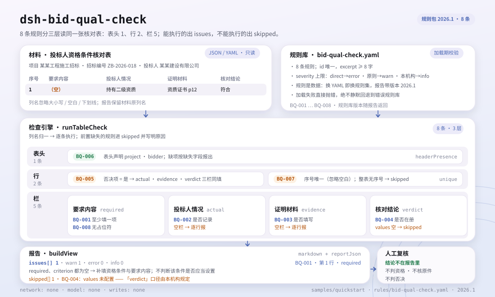

<div align="center">

<picture>
  <source media="(prefers-color-scheme: dark)" srcset="docs/assets/dsh-bid-qual-check-hero-en-dark.webp">
  
</picture>

# dsh-bid-qual-check

**Recorra un registro de condiciones de cualificación del licitante fila por fila y señale exactamente qué fila y qué columna no cierran el circuito.**

Para especialistas en licitaciones, agentes de contratación y revisores de cualificación: reciba un registro JSON/YAML y obtenga una lista de diferencias revisable línea por línea; el original no se modifica y no se emite un veredicto de cumplimiento.

[Instalación](#instalación-en-tres-pasos) · [Configuración](#configuración) · [FAQ](#faq) · [简体中文](README.md) · [English](README.en.md) · [Español](README.es.md) · [Português](README.pt.md) · [हिन्दी](README.hi.md)

[](LICENSE)
[](#compatibilidad)
[](https://www.npmjs.com/package/dsh-bid-qual-check)
[](https://github.com/PerryLink/dsh-bid-qual-check/actions/workflows/ci.yml)
[](#compatibilidad)

[](https://github.com/PerryLink/dsh-bid-qual-check/stargazers)
[](https://www.npmjs.com/package/dsh-bid-qual-check)
[](https://dshfind.com/plugins/PerryLink/dsh-bid-qual-check?ref=badge)
[](https://securityscorecards.dev/viewer/?uri=github.com/PerryLink/dsh-bid-qual-check)
[](https://dsh.market/)
[](https://gitee.com/perrylink/dsh-bid-qual-check)

```sh
dsh plugin --profile <name> add dsh-bid-qual-check
```

</div>

<sub>Plugin de la comunidad, no afiliado a DeepSeek. Repositorio canónico: <https://github.com/PerryLink/dsh-bid-qual-check> (Gitee es un espejo).</sub>

## Qué es

`dsh-bid-qual-check` lee un **registro de condiciones de cualificación del licitante** —una cabecera más una fila por condición— y comprueba el cierre interno de ese propio registro: que cada condición registre su requisito, que quede registrada la situación real del licitante, que se adjunte la prueba documental, que el veredicto proceda de su vocabulario, que una partida eliminatoria registre a la vez situación, prueba y veredicto, que el registro nombre su proyecto y su licitante, que los números de condición sean únicos y que no quede ningún marcador de plantilla sin sustituir en la columna del requisito. La salida es una lista de diferencias: qué fila, qué columna, qué falta y cómo corregirlo.

No decide el cumplimiento, ni la cualificación, ni la validez de los originales; solo enumera diferencias que un revisor puede señalar en el material y deja la conclusión a ese revisor.

El repositorio incluye una muestra de un minuto: tras construir, ejecute `node samples/quickstart/run.mjs`. La entrada está en `samples/quickstart/input/` y el resultado esperado en `samples/quickstart/expected/result.json`.

<picture>
  <source media="(prefers-color-scheme: dark)" srcset="docs/assets/dsh-bid-qual-check-flow-v5-dark.svg">
  
</picture>

## Instalación en tres pasos

1. **Instalar** (elija un canal):

   ```sh
   # canal git (último main; equivale a git+https://github.com/PerryLink/dsh-bid-qual-check.git)
   dsh plugin --profile <name> add github:PerryLink/dsh-bid-qual-check
   # canal npm (versión publicada 0.2.12)
   dsh plugin --profile <name> add dsh-bid-qual-check
   # canal tarball: tras pnpm pack en este repositorio
   dsh plugin --profile <name> add ./dsh-bid-qual-check-<version>.tgz
   ```

   El paquete npm ya incluye `lib/` construido; desde el código fuente ejecute antes `pnpm install && pnpm run build`.

   La revisión también forma parte de la «Tender Compliance Suite» en WorkBuddy / Coze (disponibilidad según el catálogo).

2. **Configuración mínima** (los valores por defecto funcionan; el paquete de reglas viaja con el plugin):

   ```yaml
   - insert:
       - id: dsh-bid-qual-check
         name: dsh-bid-qual-check
   ```

   Para restringir el conjunto de reglas o cambiar el paquete, sobrescriba `onlyRules`, `disabledRules` o `rulesFile` como se indica en Configuración.

3. **Comprobar que se monta**:

   ```sh
   dsh --profile <name> --dump-config | grep 'dsh-bid-qual-check'
   ```

   En una sesión, invoque `bid_qual_check` con `file` (ruta del material) o `material` (JSON/YAML en línea). O ejecute la muestra del repositorio:

   ```sh
   pnpm install && pnpm run build
   node samples/quickstart/run.mjs
   ```

   ```text
   bid_qual_check: 1 issue(s) — error 0, warn 1, info 0
   skipped: 1
   ```

   El resultado esperado está en `samples/quickstart/expected/result.json`; `skipped: 1` es `BQ-004` (el vocabulario de veredictos viene vacío), algo previsto.

**Desinstalar**: `dsh plugin --profile <name> remove dsh-bid-qual-check` (o elimine la fila del patch del perfil).

## Capacidades clave

`dsh-bid-qual-check` hace una sola cosa: recorre el registro fila por fila contra el paquete de reglas y devuelve diferencias localizables. Ocho reglas cubren el circuito que un registro puede comprobar por sí mismo:

- **Cierre fila por fila** — `BQ-001` a `BQ-008` cubren requisito, situación real, prueba documental, vocabulario del veredicto, registro tripartito de la partida eliminatoria, partes de la cabecera, unicidad de números y marcadores residuales.
- **Localizado, no vago** — cada hallazgo lleva `ruleId`, `locator` (fila/campo), `found`, `expected` y `fix`; el informe los agrupa en `error`, `warn` e `info`.
- **Un resultado vacío no es un certificado** — toda comprobación que no puede ejecutarse se lista en `skipped` con su motivo; `disabledRules`, `onlyRules` y un `values` vacío aparecen explícitamente en el informe.
- **El paquete de reglas es dato** — las reglas viven en `rules/bid-qual-check.yaml`; cambiar el YAML cambia el conjunto, y la validación de carga exige ids únicos y topes de severidad.
- **Sin citas fabricadas** — cada regla lleva `document`, `number`, `clause`, `excerpt`, `kind` y `source`; solo una cita literal es `direct`, una comprobación derivada de principios queda limitada a `warn` y un umbral local a `info`.
- **Sin conexión y solo lectura** — sin red, sin llamada al modelo y sin escrituras; solo lee el `file` o `material` que usted pasa.

### Referencia de reglas

| Regla | Comprobación | Severidad | Tipo de base |
|---|---|---|---|
| `BQ-001` | cada condición registra su requisito | warn | directa |
| `BQ-002` | cada condición registra la situación real del licitante | warn | directa |
| `BQ-003` | cada condición adjunta prueba documental | warn | directa |
| `BQ-004` | el veredicto procede de su vocabulario | info | configuración local |
| `BQ-005` | la partida eliminatoria registra situación, prueba y veredicto | warn | principio |
| `BQ-006` | el registro nombra proyecto y licitante | warn | principio |
| `BQ-007` | los números de condición son únicos | warn | principio |
| `BQ-008` | la columna del requisito no tiene marcadores sin sustituir | warn | principio |

### Ejemplo

Esta es la salida real del paquete de reglas sobre su propio fixture `BQ-001`.

**Entrada** (extracto; la muestra completa está en `samples/quickstart/input/BQ-001-unsafe.json`):

```json
{"project":"某某工程施工招标","bidder":"某某建设有限公司","rows":[{"序号":"1","资格条件":"","要求内容":"","投标人情况":"持有建筑工程施工总承包二级资质，证书在有效期内","证明材料":"资质证书复印件，资格文件第 12 页","核对结论":"符合","是否否决项":"是"}]}
```

**Salida** (un hallazgo `warn`, extracto):

```json
{
  "id": "dsh-bid-qual-check.BQ-001.97d9cf2f",
  "ruleId": "BQ-001",
  "severity": "warn",
  "locator": {
    "column": "required",
    "row": 1
  },
  "found": "第 1 行 required、criterion 都为空",
  "expected": "required、criterion 至少应填写一项",
  "fix": "补填资格条件与要求内容；本条只核对是否填写，不判断该条件是否应当设置"
}
```

*Observado en `tests/fixtures/BQ-001/BQ-001-unsafe.json; tests/fixtures/BQ-001/cases.json; rules/bid-qual-check.yaml; tests/index.test.ts`*

### Preguntas sobre las reglas

| Usted pregunta | Qué responde |
|---|---|
| Una fila tiene vacías tanto la columna `criterion` como la `required`. ¿Se informa de eso? | Sí. `BQ-001` exige que cada fila traiga al menos una de esas dos columnas y señala la fila cuando ambas están vacías. Comprueba que se haya escrito algo, no si esa condición es lícita o si debería haberse establecido: eso es un examen del propio pliego. |
| Una condición tiene vacía la columna `actual` y tampoco trae `evidence`. | Dos hallazgos: `BQ-002` señala la fila por la situación real vacía y `BQ-003` por la prueba vacía. Ambas comprueban solo que la celda esté rellena, no que la situación satisfaga la condición ni que el documento sea válido, esté vigente o coincida con el original, lo que exige los originales y la decisión de la comisión. Una columna presente con todas sus celdas vacías se sigue señalando fila por fila; si el material no trae esa columna, la regla pasa a `skipped` en lugar de pasar en silencio. |
| La columna `verdict` está vacía en una fila. ¿Lo señala `BQ-004`? | No: `BQ-004` solo examina los valores escritos y omite las celdas vacías. Su lista `values` viene vacía, así que de fábrica la regla se declara en `skipped`; cuando configure en `values` el vocabulario de su institución, cada valor fuera de esa lista se señala fila por fila. Comprueba que el valor esté en su vocabulario, no que la conclusión sea correcta, y ningún valor invalida una oferta. La regla está limitada a `info`, porque el vocabulario lo fija su institución. |
| Una fila está marcada como partida eliminatoria, pero le falta la situación real o la prueba. | `BQ-005` exige que toda fila cuya celda de partida eliminatoria coincida con los valores configurados (`Y`, `yes`, `true`, `√` y los demás valores por defecto del paquete) rellene a la vez situación real, prueba y veredicto, y señala lo que falte. Qué condiciones son eliminatorias depende por completo del pliego y de esa columna, nunca de una lista incorporada. Si ninguna fila lleva esa marca, la regla se declara en `skipped` en lugar de pasar, y nunca decide si la oferta debe rechazarse. |
| La cabecera del registro trae el número de licitación, pero no el proyecto ni el licitante. | `BQ-006` informa una vez de la cabecera y nombra lo que falta: `project` (el nombre del proyecto) o `bidder` (el nombre del licitante). Solo comprueba que la cabecera declare esas dos partes; no revisa el número de licitación ni la fecha de verificación, y añadir el vocabulario de conclusiones a esta regla no serviría, porque lo controla el `values` de `BQ-004`. |
| Este registro se copió de una plantilla: dos filas comparten el número `3` y una celda de requisito todavía dice `XXX`. | `BQ-007` señala el `seq` repetido (la comparación ignora los espacios, así que `3` y ` 3 ` son el mismo número) y, si ninguna fila lleva número, se declara en `skipped` en lugar de pasar. `BQ-008` señala el marcador residual en `required` —`【`, `】`, `{{`, `}}`, `XXX`, `TBD` y el resto de su lista `terms`, que puede acortar. Ambas comprobaciones son literales: ninguna juzga si el requisito es correcto, y un requisito copiado al pie de la letra que contenga `XXX` también se señala. |

Los nombres chinos de columna se asignan a campos canónicos (los alias están declarados en `src/model.ts`):

```text
序号 → seq · 资格条件 → criterion · 类别 → category · 要求内容 → required
投标人情况 → actual · 证明材料 → evidence · 核对结论 → verdict
是否否决项 → isPassFail · 核对人 → checkedBy · 备注 → note
project · tenderNo · bidder · checkedAt · verdicts   (campos de cabecera)
```

## Normas que sigue

| Documento | Número | Reglas que lo citan |
|---|---|---|
| Ley de Licitación y Adjudicación de la República Popular China | Aprobada el 30 de agosto de 1999; modificada el 27 de diciembre de 2017 por la Decisión del Comité Permanente de la Asamblea Popular Nacional que modifica la Ley de Licitación y Adjudicación y la Ley de Metrología; en vigor desde el 1 de enero de 2000 | BQ-001, BQ-002, BQ-003, BQ-004, BQ-006, BQ-007, BQ-008 |
| Reglamento de Aplicación de la Ley de Licitación y Adjudicación de la República Popular China | Orden del Consejo de Estado n.º 613 (promulgada el 20 de diciembre de 2011; modificada el 1 de marzo de 2017; en vigor desde el 1 de febrero de 2012) | BQ-005 |

**Límite:** este plugin comprueba un **registro de condiciones de cualificación del licitante** frente al circuito que un listado de verificación puede exigirse a sí mismo: que cada condición registre su requisito y la situación real del licitante, que se adjunte la prueba, que los veredictos procedan de su vocabulario, que una **partida eliminatoria** registre los tres elementos, que la tabla nombre proyecto y licitante, que los números sean únicos y que no sobreviva ningún marcador. **No** decide si un licitante está cualificado, si la cualificación falla o si una oferta debe rechazarse. **Esa es la decisión de la comisión de cualificación, tomada contra los originales de la prueba y las condiciones del pliego.**

> **Lea esto antes de confiar en una cita del informe.**
>
> **El estado de `excerpt` es por regla, no uniforme.** Algunas reglas citan la cláusula literalmente (`kind: direct`), otras derivan del principio de los artículos citados (`kind: derived-from-principle`, tope `warn`) y otras usan umbrales configurados por su institución (`kind: institutional-configuration`, tope `info`). El paquete nunca parafrasea una cita: cuando el texto no se obtuvo, el campo `excerpt` lo dice y el razonamiento vive en `note`; la puerta `check:citations` rastrea cada segmento del `excerpt` hasta los registros de `rules/evidence/` (la línea base está vacía). **Para cualquier regla aún marcada como no obtenida, sustituya el `excerpt` por la cláusula real y eleve `kind` a `direct` cuando tenga el texto.**
>
> La conclusión es del revisor: este plugin enumera diferencias señalables en el material y no decide hechos ni cumplimiento.

Los datos de las reglas están separados del código. La validación de carga exige que cada regla lleve `document`, `number`, `clause`, `excerpt`, `kind` y `source`, un `excerpt` de al menos ocho caracteres, ids únicos y una `severity` no más fuerte de lo que permite su tipo de base (`direct` hasta `error`, `derived-from-principle` hasta `warn`, `institutional-configuration` hasta `info`). La comprobación de longitud no distingue una cita de una paráfrasis, así que la literalidad se respalda con los registros de verificación de `rules/evidence/` y con pruebas: ninguna regla `direct` puede afirmar que su texto no se obtuvo, y todo archivo de evidencia referenciado debe existir. La cabecera del paquete y el `note` de cada regla también declaran el estado de la cita y su laguna; los límites verificados y las conclusiones deliberadamente no extraídas quedan registrados en `rules/evidence/`.

## Configuración

Todos los parámetros ajustables viven en el esquema Schemastery de `src/config.ts`, por lo que `cordis.yml` los cambia sin tocar código; los umbrales por regla están en el paquete bajo `rules/`.

| Clave | Tipo | Predeterminado | Descripción |
|---|---|---|---|
| `rulesFile` | string | `rules/bid-qual-check.yaml` | Ruta del paquete de reglas, relativa a la raíz del paquete |
| `disabledRules` | string[] | `[]` | Ids de reglas que se dejan de ejecutar; cada una aparece en `skipped` |
| `onlyRules` | string[] | `[]` | Ejecutar solo estas reglas; vacío ejecuta todas |
| `skipNotes` | string | `""` | Nota añadida a cada motivo de `skipped` |
| `timeoutMs` | number | `120000` | Presupuesto de tiempo de espera cooperativo de la herramienta |

### Parámetros por regla

Viven bajo `params` en el YAML del paquete, no entre las claves de `Config` del plugin:

- `BQ-004` `values` — el vocabulario de veredictos de su institución; vacío por defecto, y la regla se declara en `skipped` hasta que se configure.
- `BQ-005` `conditionValues` — los valores de la columna de partida eliminatoria que marcan una partida como tal; los predeterminados están declarados en el paquete.
- `BQ-008` `terms` — los marcadores que se buscan; la lista predeterminada está declarada en el paquete y puede acortarse.

Valores predeterminados de esos tres parámetros, citados de `rules/bid-qual-check.yaml`:

```text
BQ-004 values: []
BQ-005 conditionValues: [是, Y, yes, true, 否决项, √]
BQ-008 terms: ['【', '】', '{{', '}}', 'XXX', 'xxx', '待填', '待补充', 'TBD', 'todo', '示例']
```

### Formato del material

JSON o YAML. La raíz lista las filas bajo `rows` (también `items` y `criteria`); los campos de cabecera `project`, `tenderNo`, `bidder` y `checkedAt` aceptan alias chinos. Los nombres de columna se comparan sin distinguir mayúsculas y ignorando espacios (incluido el espacio de ancho completo), guiones bajos y guiones; se conservan los nombres del propio registro, de modo que un hallazgo nombra la columna que leyó:

```yaml
project: 某某工程施工招标
tenderNo: ZB-2026-018
bidder: 某某建设有限公司
rows:
  - { 序号: '1', 资格条件: 施工资质等级, 要求内容: 建筑工程施工总承包二级及以上,
      投标人情况: 持有建筑工程施工总承包二级资质，证书在有效期内,
      证明材料: 资质证书复印件，资格文件第 12 页, 核对结论: 符合, 是否否决项: 是, 核对人: 李工 }
```

Los campos son opcionales en la capa de lectura y los valida el motor, de modo que una exportación parcial produce hallazgos de «campo ausente» en lugar de un fallo. Un material vacío, una lista de filas vacía o un material sin ningún campo reconocible provoca un error del lector que nombra las columnas vistas; nunca continúa con las columnas equivocadas.

## FAQ

<details>
<summary>¿Se sube o se guarda el material?</summary>

No. Es un verificador sin conexión: lee el `file` o `material` que usted pasa, no hace peticiones de red, no llama a ningún modelo, no escribe archivos y no guarda copia del material (véase `SECURITY.md`).

</details>

<details>
<summary>El informe sale vacío, ¿significa que el registro está limpio?</summary>

No. Un resultado vacío solo significa que las comprobaciones **que se ejecutaron** no hallaron diferencias; toda comprobación que no pudo ejecutarse se lista en `skipped` con su id y motivo. Lea `issueCount` y `skippedCount` juntos. Además, un material vacío, una lista de filas vacía o un material sin campos reconocibles produce un error, no un informe vacío.

</details>

<details>
<summary>¿Por qué `BQ-004` o `BQ-005` siempre aparecen en `skipped`?</summary>

`BQ-004` trae `values` vacío, así que no se ejecuta hasta que configure el vocabulario de veredictos de su institución. `BQ-005` solo se ejecuta cuando al menos una celda de partida eliminatoria coincide con `conditionValues`. Ambos dependen de su proyecto y de su institución; el plugin no adivina. Configúrelos y vuelva a ejecutar.

</details>

<details>
<summary>¿Admite Excel o Word?</summary>

Solo JSON o YAML. Convierta Excel a JSON/YAML primero (puede hacerse en el chat) y extraiga una estructura de tabla de Word/PDF; el plugin no analiza documentos binarios ni hace OCR.

</details>

<details>
<summary>¿Cuánta sobrecarga de rendimiento hay?</summary>

La comprobación es un recorrido de tabla en memoria: sin red, sin llamada al modelo y sin lecturas fuera del paquete de reglas; el coste crece con filas × ocho reglas y suele ser insignificante. `timeoutMs` vale 120000 por defecto y el host lo aplica como tiempo de espera cooperativo; la herramienta se declara segura para concurrencia, así que varios materiales pueden comprobarse en paralelo.

</details>

## Límites de seguridad

- **Sin conexión y solo lectura.** Sin peticiones de red, sin llamadas al modelo y sin escrituras; solo lee `file` o `material`. `SECURITY.md` lo declara igual: un verificador sin conexión que no hace llamadas de red ni al modelo y no guarda nada.
- **Sin veredicto calificador.** Enumera diferencias literales señalables en el material; no decide cualificación, rechazo ni validez de originales. La conclusión corresponde a la comisión de cualificación y al revisor, y todo informe termina con el descargo de responsabilidad.
- **Sin citas fabricadas.** El `excerpt` de cada regla es una cita literal o una laguna explícita marcada por `kind` y `note`; `derived-from-principle` queda limitado a `warn` e `institutional-configuration` a `info`; un paquete que supere esos topes falla al cargar.
- **Fallo ruidoso.** Si falta el archivo del paquete, la resolución recorre la ruta absoluta, los ancestros del módulo y el directorio de trabajo, y luego lanza un error enumerando cada ubicación probada; nunca recurre en silencio a otro paquete. Los errores de análisis del material, una lista de filas vacía y un id de regla desconocido también lanzan error.
- **El registro es un efecto.** `ctx.tools.register` devuelve un disposer, así que detener o recargar en caliente el plugin retira la herramienta `bid_qual_check`.

## Limitaciones conocidas

- **Solo JSON/YAML.** Sin análisis de Excel/Word/PDF y sin OCR; convierta el material primero.
- **Solo el circuito del propio registro.** No juzga si una condición de cualificación es lícita, si el licitante la cumple, si la prueba es auténtica o está vigente, ni si la oferta debe rechazarse.
- **`BQ-004` viene desactivada.** Un `values` vacío significa `skipped` por diseño: el vocabulario de veredictos pertenece a su institución y el plugin no codifica ninguna lista.
- **`BQ-005` depende de las marcas del registro.** Qué condiciones son eliminatorias depende por completo del pliego y de la columna de partida eliminatoria; el plugin no incluye lista y se declara en `skipped` cuando ninguna fila lleva marca.
- **`BQ-008` es literal.** Un requisito que contenga de verdad `XXX` o `TBD` también se señala; acorte `terms` según la plantilla de su institución, pero no borre términos solo para que el informe salga verde.
- **Los nombres de columna deben ser alias.** La comparación ignora mayúsculas, espacios, guiones bajos y guiones, pero no es semántica; un nombre completamente distinto cuenta como columna ausente y lleva a `skipped` o a un error del lector.
- **La versión del paquete está desacoplada de la del código.** `rulesFile` puede apuntar a cualquier paquete y `rulesetVersion` en el informe viene del `version` del YAML; apuntar a otro paquete da otro conjunto de reglas.

## Interoperabilidad con otros plugins DSH

El plugin registra exactamente una herramienta y declara solo `tools` en `inject`; no hace nada más:

- **Sin colisión de nombres de herramienta.** El id es `bid_qual_check`, registrado solo cuando existe el servicio `tools`; no ocupa ningún nombre de una herramienta integrada o de terceros.
- **Sin colisión de claves de servicio.** No proporciona ninguna clave de servicio.
- **Sin colisión de slots ni de rutas HTTP.** No hay directorio de cliente, ni registro de slots de cliente, ni prefijo `webServer`.
- **Sin escucha de eventos compartidos.** No escucha `agent/pre-step` ni `tools/post-execute`, así que no participa en esas cadenas de escucha.
- **Sin colisión de capas de patch.** El patch del bundle solo hace `insert` de su propia fila; nunca sobrescribe el `config` de una fila integrada o de otro plugin.
- **Sin mutación global.** No parchea prototipos, no reescribe `process.env` ni sustituye el fetch global.

Todo lo anterior puede comprobarse directamente en `src/index.ts` y `cordis.patch.yml`; no se afirma ninguna compatibilidad no probada.

## Compatibilidad

| Superficie | Estado |
|---|---|
| Harness | Rango de peers `>=0.1.2-rc.1 <0.2.0 \|\| >=0.2.0-0 <0.3.0` — verificado para aceptar tanto `0.2.0-rc.2` como `0.2.1-rc.2`. `engines.dsh` se declara como `>=0.2.1-0 <0.3.0` y el host lo aplica desde 0.2.1 |
| Node | `^22.19.0 \|\| >=24.0.0` |
| Plataformas | Todas (ESM puro; sin código nativo, sin red, sin llamada al modelo) |
| Modo de herramienta | Funciona en `native` y `ptc`; para un directorio completo use `ptc`, así el coste del esquema se paga una vez |

## Solución de problemas

- **El plugin se instala pero la herramienta no aparece.** Compruebe que `main` resuelve a `lib/index.mjs` y que `pnpm run build` lo generó; un `main` erróneo hace que el cargador omita la entrada en silencio.
- **`dsh plugin add` rechaza el paquete como incompatible.** El rango de peers cubre `0.1.x` y `0.2.x`; si su runtime queda fuera, conceda una exención explícita: `dsh plugin --profile <name> allow-version dsh-bid-qual-check@0.2.12 --dsh-version <runtime> --accept-risk`.
- **Una regla no se ejecutó.** Lea el arreglo `skipped`; nombra el id y el motivo.
- **`check` informa `manifest-peers` como fallo.** El verificador estático compara con un rango de peers fijo anterior a la línea 0.2. El runtime aplica la compatibilidad al instalar, así que el rango declarado es el correcto; es un problema conocido de `dsh-plugin-dev`.
- **`BQ-002` salta en una condición que considero evidente.** Una celda de situación real vacía significa «no comprobado», el único estado que un registro de cualificación no debe tener. Registre la situación, aunque sea obvia.
- **`BQ-005` salta en una partida eliminatoria sin prueba.** Eso es la comprobación: una partida eliminatoria sin los tres registros no se puede defender a posteriori.
- **`BQ-008` salta en un requisito copiado literalmente.** La celda contiene de verdad `XXX` o `TBD`; acorte `terms` o corrija el registro.
- **No se puede leer la ruta de `file`.** Se resuelve contra el directorio de trabajo actual; ante `ENOENT`, use una ruta absoluta o pase el contenido en línea como `material`.

## Ecosistema y calidad

- [Espejo en Gitee](https://gitee.com/perrylink/dsh-bid-qual-check) (espejo sincronizado; GitHub es canónico)
- [Página del plugin en dshfind](https://dshfind.com/plugins/PerryLink/dsh-bid-qual-check) (instalaciones y clasificación)
- [Informe de OpenSSF Scorecard](https://securityscorecards.dev/viewer/?uri=github.com/PerryLink/dsh-bid-qual-check) (impulsado por [.github/workflows/scorecard.yml](.github/workflows/scorecard.yml))
- [DSH Market](https://dsh.market/) (publicado)

## Desarrollo

```sh
pnpm install
pnpm run typecheck   # tsc --noEmit
pnpm test            # vitest, la suite compartida de tablas más fixtures emparejados por regla
pnpm run build       # tsdown -> lib/index.mjs + lib/index.d.mts
pnpm run check:readmes
node ../scripts/sync-shared.mjs dsh-bid-qual-check   # refresca src/shared desde ../_shared
```

El plugin es **dirigido por datos**: `src/model.ts` declara la forma de la tabla, el kit compartido aporta el lector y el motor de comprobación, y el paquete de reglas declara cada comprobación. Las imágenes del README se generan mediante [`scripts/gen-readme-assets.py`](scripts/gen-readme-assets.py) (Python 3 + Pillow para el hero WebP; el diagrama SVG se escribe directamente) y se pueden volver a ejecutar.

Topics: `dsh`, `dsh-plugin`, `deepseek-harness`, `deepseek`, `cordis`, `bid`, `qual`

## Familia y agradecimientos

Este proyecto forma parte de la familia de plugins de DeepSeek Harness de [PerryLink](https://github.com/PerryLink) (todos Apache-2.0). Si le resulta útil, **una estrella ayuda a que la siguiente persona lo encuentre** — no desbloquea nada. Índice completo: [elegir un verificador por material](https://perrylink.github.io/zh/checkers/choose/) y [todos los plugins](https://github.com/PerryLink).

- [@PerryLink](https://github.com/PerryLink) — creador y mantenedor: el paquete de reglas, las comprobaciones de circuito y la documentación en cinco idiomas.

<details>
<summary>Expandir todos los plugins</summary>

| Plugin | Estado |
|---|---|
| **[dsh-aqua-input-check](https://github.com/PerryLink/dsh-aqua-input-check)** |  |
| **[dsh-archive-check](https://github.com/PerryLink/dsh-archive-check)** |  |
| **[dsh-auto-review](https://github.com/PerryLink/dsh-auto-review)** |  |
| **[dsh-autotier](https://github.com/PerryLink/dsh-autotier)** | 🧊 CONGELADO — ver el README del repo |
| **[dsh-bid-ca-precheck](https://github.com/PerryLink/dsh-bid-ca-precheck)** |  |
| **[dsh-bid-qual-check](https://github.com/PerryLink/dsh-bid-qual-check)** |  |
| **[dsh-cert-mcp](https://github.com/PerryLink/dsh-cert-mcp)** | 🧊 CONGELADO — ver el README del repo |
| **[dsh-checkpoint-rewind](https://github.com/PerryLink/dsh-checkpoint-rewind)** |  |
| **[dsh-click](https://github.com/PerryLink/dsh-click)** |  |
| **[dsh-composer-history](https://github.com/PerryLink/dsh-composer-history)** |  |
| **[dsh-contract-stance](https://github.com/PerryLink/dsh-contract-stance)** |  |
| **[dsh-customs-doc-check](https://github.com/PerryLink/dsh-customs-doc-check)** |  |
| **[dsh-data-quality](https://github.com/PerryLink/dsh-data-quality)** | 🧊 CONGELADO — ver el README del repo |
| **[dsh-demurrage-ledger](https://github.com/PerryLink/dsh-demurrage-ledger)** |  |
| **[dsh-doublecheck](https://github.com/PerryLink/dsh-doublecheck)** |  |
| **[dsh-drill-script-check](https://github.com/PerryLink/dsh-drill-script-check)** |  |
| **[dsh-eia-guide-check](https://github.com/PerryLink/dsh-eia-guide-check)** |  |
| **[dsh-emergency-plan](https://github.com/PerryLink/dsh-emergency-plan)** |  |
| **[dsh-essay-rubric-check](https://github.com/PerryLink/dsh-essay-rubric-check)** |  |
| **[dsh-evidence-check](https://github.com/PerryLink/dsh-evidence-check)** |  |
| **[dsh-export-ctl-check](https://github.com/PerryLink/dsh-export-ctl-check)** |  |
| **[dsh-fast](https://github.com/PerryLink/dsh-fast)** |  |
| **[dsh-fmea-table-check](https://github.com/PerryLink/dsh-fmea-table-check)** |  |
| **[dsh-forecast-penalty](https://github.com/PerryLink/dsh-forecast-penalty)** |  |
| **[dsh-fund-research](https://github.com/PerryLink/dsh-fund-research)** |  |
| **[dsh-github](https://github.com/PerryLink/dsh-github)** |  |
| **[dsh-gongwen-flow-check](https://github.com/PerryLink/dsh-gongwen-flow-check)** |  |
| **[dsh-gongwen-word-check](https://github.com/PerryLink/dsh-gongwen-word-check)** |  |
| **[dsh-guard-plan-qc](https://github.com/PerryLink/dsh-guard-plan-qc)** |  |
| **[dsh-hazchem-check](https://github.com/PerryLink/dsh-hazchem-check)** |  |
| **[dsh-hazplan-check](https://github.com/PerryLink/dsh-hazplan-check)** |  |
| **[dsh-hidden-risk-map](https://github.com/PerryLink/dsh-hidden-risk-map)** |  |
| **[dsh-hs-classify](https://github.com/PerryLink/dsh-hs-classify)** |  |
| **[dsh-icd-rule-check](https://github.com/PerryLink/dsh-icd-rule-check)** |  |
| **[dsh-industry-research](https://github.com/PerryLink/dsh-industry-research)** |  |
| **[dsh-lawcite-adapter](https://github.com/PerryLink/dsh-lawcite-adapter)** |  |
| **[dsh-laya](https://github.com/PerryLink/dsh-laya)** |  |
| **[dsh-lc-doc-check](https://github.com/PerryLink/dsh-lc-doc-check)** |  |
| **[dsh-learning-gap-check](https://github.com/PerryLink/dsh-learning-gap-check)** |  |
| **[dsh-library](https://github.com/PerryLink/dsh-library)** |  |
| **[dsh-local-ai](https://github.com/PerryLink/dsh-local-ai)** |  |
| **[dsh-lsp-actions](https://github.com/PerryLink/dsh-lsp-actions)** |  |
| **[dsh-mask](https://github.com/PerryLink/dsh-mask)** |  |
| **[dsh-mcp-panel](https://github.com/PerryLink/dsh-mcp-panel)** |  |
| **[dsh-medrec-qc](https://github.com/PerryLink/dsh-medrec-qc)** |  |
| **[dsh-memento](https://github.com/PerryLink/dsh-memento)** | 🧊 CONGELADO — ver el README del repo |
| **[dsh-nsfc-form-check](https://github.com/PerryLink/dsh-nsfc-form-check)** |  |
| **[dsh-nurse-record-check](https://github.com/PerryLink/dsh-nurse-record-check)** |  |
| **[dsh-observe](https://github.com/PerryLink/dsh-observe)** |  |
| **[dsh-origin-rvc-check](https://github.com/PerryLink/dsh-origin-rvc-check)** |  |
| **[dsh-ota-review-check](https://github.com/PerryLink/dsh-ota-review-check)** |  |
| **[dsh-output-styles](https://github.com/PerryLink/dsh-output-styles)** |  |
| **[dsh-paper-doc-adapter](https://github.com/PerryLink/dsh-paper-doc-adapter)** |  |
| **[dsh-permission-rules](https://github.com/PerryLink/dsh-permission-rules)** |  |
| **[dsh-permit-report-check](https://github.com/PerryLink/dsh-permit-report-check)** |  |
| **[dsh-pipeline-check](https://github.com/PerryLink/dsh-pipeline-check)** |  |
| **[dsh-pleading-draft](https://github.com/PerryLink/dsh-pleading-draft)** |  |
| **[dsh-plugin-doctor](https://github.com/PerryLink/dsh-plugin-doctor)** | 🚫 RETIRADO (repo archivado) |
| **[dsh-plugin-guide](https://github.com/PerryLink/dsh-plugin-guide)** |  |
| **[dsh-plugin-kit](https://github.com/PerryLink/dsh-plugin-kit)** | 🚫 RETIRADO (repo archivado) |
| **[dsh-plugin-upgrade](https://github.com/PerryLink/dsh-plugin-upgrade)** | 🚫 RETIRADO (repo archivado) |
| **[dsh-policy-brief-draft](https://github.com/PerryLink/dsh-policy-brief-draft)** |  |
| **[dsh-power-loss-split](https://github.com/PerryLink/dsh-power-loss-split)** |  |
| **[dsh-power-ticket-check](https://github.com/PerryLink/dsh-power-ticket-check)** |  |
| **[dsh-ppap-check](https://github.com/PerryLink/dsh-ppap-check)** |  |
| **[dsh-protest-deadline](https://github.com/PerryLink/dsh-protest-deadline)** |  |
| **[dsh-railway-window](https://github.com/PerryLink/dsh-railway-window)** |  |
| **[dsh-repair-order-qc](https://github.com/PerryLink/dsh-repair-order-qc)** |  |
| **[dsh-research-report](https://github.com/PerryLink/dsh-research-report)** |  |
| **[dsh-review-reply-check](https://github.com/PerryLink/dsh-review-reply-check)** |  |
| **[dsh-rulefile-check](https://github.com/PerryLink/dsh-rulefile-check)** |  |
| **[dsh-safety-brief-check](https://github.com/PerryLink/dsh-safety-brief-check)** |  |
| **[dsh-score](https://github.com/PerryLink/dsh-score)** | 🧊 CONGELADO — ver el README del repo |
| **[dsh-session-sync](https://github.com/PerryLink/dsh-session-sync)** |  |
| **[dsh-site-log-check](https://github.com/PerryLink/dsh-site-log-check)** |  |
| **[dsh-skill-pack-security](https://github.com/PerryLink/dsh-skill-pack-security)** |  |
| **[dsh-soe-decision-check](https://github.com/PerryLink/dsh-soe-decision-check)** |  |
| **[dsh-soilwater-check](https://github.com/PerryLink/dsh-soilwater-check)** |  |
| **[dsh-sop-sync-check](https://github.com/PerryLink/dsh-sop-sync-check)** |  |
| **[dsh-spc-gbt-adapter](https://github.com/PerryLink/dsh-spc-gbt-adapter)** |  |
| **[dsh-talk](https://github.com/PerryLink/dsh-talk)** |  |
| **[dsh-tender-extract](https://github.com/PerryLink/dsh-tender-extract)** |  |
| **[dsh-tender-matrix](https://github.com/PerryLink/dsh-tender-matrix)** |  |
| **[dsh-test-drive](https://github.com/PerryLink/dsh-test-drive)** |  |
| **[dsh-ticktick](https://github.com/PerryLink/dsh-ticktick)** | 🚫 RETIRADO (repo archivado) |
| **[dsh-translate](https://github.com/PerryLink/dsh-translate)** |  |
| **[dsh-warranty-calc](https://github.com/PerryLink/dsh-warranty-calc)** |  |
| **[dsh-budget](https://github.com/PerryLink/dsh-budget)** | 🧊 CONGELADO — ver el README del repo |
| **[dsh-claude-move](https://github.com/PerryLink/dsh-claude-move)** | 🧊 CONGELADO — ver el README del repo |
| **[dsh-defend](https://github.com/PerryLink/dsh-defend)** | 🧊 CONGELADO — ver el README del repo |
| **[dsh-draw](https://github.com/PerryLink/dsh-draw)** | 🧊 CONGELADO — ver el README del repo |
| **[dsh-reach](https://github.com/PerryLink/dsh-reach)** | 🧊 CONGELADO — ver el README del repo |
| **[dsh-background-agents](https://github.com/PerryLink/dsh-background-agents)** | 🚫 RETIRADO (repo archivado) |
| **[dsh-session-pin](https://github.com/PerryLink/dsh-session-pin)** | 🚫 RETIRADO (repo archivado) |
| **[dsh-team-rooms](https://github.com/PerryLink/dsh-team-rooms)** | 🚫 RETIRADO (repo archivado) |

</details>

## Licencia

[LICENSE](LICENSE) (Apache License 2.0) © 2026 dsh-bid-qual-check contributors

<p align="center"><sub>Apache-2.0 · Plugin de la comunidad, no afiliado a DeepSeek.</sub></p>
