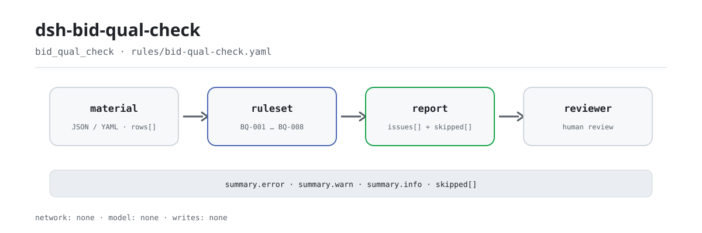

<div align="center">

<picture>
  <source media="(prefers-color-scheme: dark)" srcset="docs/assets/dsh-bid-qual-check-flow-dark.svg">
  
</picture>

# dsh-bid-qual-check

**निविदा प्रतिभागी की अर्हता शर्तों के रजिस्टर को पंक्ति-दर-पंक्ति जाँचें और ठीक उसी पंक्ति व कॉलम की ओर इशारा करें जहाँ चक्र पूरा नहीं होता।**

निविदा विशेषज्ञों, टेंडर एजेंटों और अर्हता समीक्षकों के लिए: JSON/YAML रजिस्टर दें और पंक्ति-दर-पंक्ति समीक्षा योग्य अंतर-सूची पाएँ; मूल कभी नहीं बदला जाता और अनुपालन का कोई निर्णय नहीं दिया जाता।

[इंस्टॉल](#तीन-चरणों-में-शुरुआत) · [कॉन्फ़िगरेशन](#कॉन्फ़िगरेशन) · [FAQ](#faq) · [简体中文](README.md) · [English](README.en.md) · [Español](README.es.md) · [Português](README.pt.md) · [हिन्दी](README.hi.md)

[](LICENSE)
[](#संगतता)
[](https://www.npmjs.com/package/dsh-bid-qual-check)
[](https://github.com/PerryLink/dsh-bid-qual-check/actions/workflows/ci.yml)
[](#संगतता)

[](https://github.com/PerryLink/dsh-bid-qual-check/stargazers)
[](https://www.npmjs.com/package/dsh-bid-qual-check)
[](https://dshfind.com/plugins/PerryLink/dsh-bid-qual-check?ref=badge)
[](https://securityscorecards.dev/viewer/?uri=github.com/PerryLink/dsh-bid-qual-check)
[](https://dsh.market/)
[](https://gitee.com/perrylink/dsh-bid-qual-check)

```sh
dsh plugin --profile <name> add dsh-bid-qual-check
```

</div>

<sub>सामुदायिक प्लगइन, DeepSeek से असंबद्ध। कैनोनिकल रिपॉज़िटरी: <https://github.com/PerryLink/dsh-bid-qual-check> (Gitee एक मिरर है)।</sub>

## यह क्या है

`dsh-bid-qual-check` निविदा प्रतिभागी की अर्हता शर्तों का एक **रजिस्टर** पढ़ता है — एक हेडर और प्रत्येक अर्हता शर्त की एक पंक्ति — और उसी रजिस्टर का आंतरिक बंद-चक्र जाँचता है: क्या प्रत्येक शर्त अपनी आवश्यकता दर्ज करती है, क्या प्रतिभागी की वास्तविक स्थिति दर्ज है, क्या प्रमाण संलग्न है, क्या निर्णय आपकी शब्दावली से आता है, क्या निर्णायक मद में स्थिति, प्रमाण और निर्णय तीनों साथ दर्ज हैं, क्या रजिस्टर अपना परियोजना-नाम और प्रतिभागी बताता है, क्या शर्तों के क्रमांक अद्वितीय हैं, और क्या आवश्यकता कॉलम में कोई अपूरित प्लेसहोल्डर बचा नहीं है। आउटपुट अंतरों की सूची है: कौन-सी पंक्ति, कौन-सा कॉलम, क्या छूटा और कैसे सुधारें।

यह अनुपालन, अर्हता या मूल दस्तावेज़ों की वैधता का निर्णय नहीं करता; केवल वे अंतर सूचीबद्ध करता है जिन्हें समीक्षक सामग्री में इंगित कर सके, और निष्कर्ष उसी समीक्षक पर छोड़ता है।

रिपॉज़िटरी में एक मिनट की नमूना शामिल है: बिल्ड के बाद `node samples/quickstart/run.mjs` चलाएँ। इनपुट `samples/quickstart/input/` में और अपेक्षित परिणाम `samples/quickstart/expected/result.json` में है।

## तीन चरणों में शुरुआत

1. **इंस्टॉल करें** (एक चैनल चुनें):

   ```sh
   # git चैनल (नवीनतम main; git+https://github.com/PerryLink/dsh-bid-qual-check.git के बराबर)
   dsh plugin --profile <name> add github:PerryLink/dsh-bid-qual-check
   # npm चैनल (प्रकाशित संस्करण 0.2.12)
   dsh plugin --profile <name> add dsh-bid-qual-check
   # tarball चैनल: इस रिपॉज़िटरी में pnpm pack के बाद
   dsh plugin --profile <name> add ./dsh-bid-qual-check-<version>.tgz
   ```

   npm पैकेज में बिल्ट `lib/` पहले से है; स्रोत से चलाने पर पहले `pnpm install && pnpm run build` चलाएँ।

   यह जाँच WorkBuddy / Coze पर «Tender Compliance Suite» का हिस्सा भी है (उपलब्धता सूची के अनुसार)।

2. **न्यूनतम कॉन्फ़िगरेशन** (डिफ़ॉल्ट काम करते हैं; नियम-पैक पैकेज के साथ आता है):

   ```yaml
   - insert:
       - id: dsh-bid-qual-check
         name: dsh-bid-qual-check
   ```

   नियम-समुच्चय सीमित करने या पैक बदलने के लिए कॉन्फ़िगरेशन अनुभाग के अनुसार `onlyRules`, `disabledRules` या `rulesFile` बदलें।

3. **जाँचें कि माउंट हुआ**:

   ```sh
   dsh --profile <name> --dump-config | grep 'dsh-bid-qual-check'
   ```

   सत्र में `bid_qual_check` को `file` (सामग्री का पथ) या `material` (इनलाइन JSON/YAML) के साथ कॉल करें। या बंडल की गई नमूना चलाएँ:

   ```sh
   pnpm install && pnpm run build
   node samples/quickstart/run.mjs
   ```

   ```text
   bid_qual_check: 1 issue(s) — error 0, warn 1, info 0
   skipped: 1
   ```

   अपेक्षित परिणाम `samples/quickstart/expected/result.json` में है; `skipped: 1` वह `BQ-004` है (निर्णय-शब्दावली खाली आती है), जो अपेक्षित है।

**अनइंस्टॉल**: `dsh plugin --profile <name> remove dsh-bid-qual-check` (या प्रोफ़ाइल पैच से वह पंक्ति हटाएँ)।

## मुख्य क्षमताएँ

`dsh-bid-qual-check` एक ही काम करता है: रजिस्टर को नियम-पैक के सामने पंक्ति-दर-पंक्ति चलाकर स्थान-योग्य अंतर लौटाता है। आठ नियम उस बंद-चक्र को कवर करते हैं जिसे रजिस्टर स्वयं जाँच सकता है:

- **पंक्ति-दर-पंक्ति बंद-चक्र** — `BQ-001` से `BQ-008` आवश्यकता, वास्तविक स्थिति, प्रमाण, निर्णय-शब्दावली, निर्णायक मद का तीन-भागीय रिकॉर्ड, हेडर के पक्ष, अद्वितीय क्रमांक और बचे प्लेसहोल्डर को कवर करते हैं।
- **स्थान के साथ, अस्पष्ट नहीं** — हर अंतर में `ruleId`, `locator` (पंक्ति/फ़ील्ड), `found`, `expected` और `fix` होता है; रिपोर्ट उन्हें `error`, `warn` और `info` में समूहित करती है।
- **खाली परिणाम प्रमाणपत्र नहीं** — जो जाँच नहीं चल सकी, वह कारण के साथ `skipped` में सूचीबद्ध होती है; `disabledRules`, `onlyRules` और खाली `values` सभी रिपोर्ट में स्पष्ट दिखते हैं।
- **नियम-पैक डेटा है** — नियम `rules/bid-qual-check.yaml` में हैं; YAML बदलने से नियम-समुच्चय बदल जाता है, और लोड-समय सत्यापन अद्वितीय id तथा severity की ऊपरी सीमाएँ लागू करता है।
- **कोई गढ़ा उद्धरण नहीं** — हर नियम में `document`, `number`, `clause`, `excerpt`, `kind` और `source` होते हैं; केवल शब्दशः उद्धरण `direct` है, सिद्धांत-व्युत्पन्न जाँच `warn` तक सीमित है और स्थानीय सीमा `info` तक।
- **ऑफ़लाइन और केवल-पढ़ने** — कोई नेटवर्क नहीं, कोई मॉडल कॉल नहीं, कोई फ़ाइल लेखन नहीं; केवल आपके दिए `file` या `material` को पढ़ता है।

### नियम संदर्भ

| नियम | जाँच | गंभीरता | आधार प्रकार |
|---|---|---|---|
| `BQ-001` | प्रत्येक शर्त अपनी आवश्यकता दर्ज करती है | warn | प्रत्यक्ष |
| `BQ-002` | प्रत्येक शर्त प्रतिभागी की वास्तविक स्थिति दर्ज करती है | warn | प्रत्यक्ष |
| `BQ-003` | प्रत्येक शर्त प्रमाण संलग्न करती है | warn | प्रत्यक्ष |
| `BQ-004` | निर्णय आपकी शब्दावली से आता है | info | स्थानीय कॉन्फ़िगरेशन |
| `BQ-005` | निर्णायक मद स्थिति, प्रमाण और निर्णय दर्ज करती है | warn | सिद्धांत |
| `BQ-006` | रजिस्टर परियोजना और प्रतिभागी बताता है | warn | सिद्धांत |
| `BQ-007` | शर्तों के क्रमांक अद्वितीय हैं | warn | सिद्धांत |
| `BQ-008` | आवश्यकता कॉलम में अपूरित प्लेसहोल्डर नहीं है | warn | सिद्धांत |

### उदाहरण

यह नियम-पैक का अपने ही `BQ-001` फ़िक्स्चर पर वास्तविक आउटपुट है।

**इनपुट** (अंश; पूरा नमूना `samples/quickstart/input/BQ-001-unsafe.json` में है):

```json
{"project":"某某工程施工招标","bidder":"某某建设有限公司","rows":[{"序号":"1","资格条件":"","要求内容":"","投标人情况":"持有建筑工程施工总承包二级资质，证书在有效期内","证明材料":"资质证书复印件，资格文件第 12 页","核对结论":"符合","是否否决项":"是"}]}
```

**आउटपुट** (एक `warn` अंतर, अंश):

```json
{
  "id": "dsh-bid-qual-check.BQ-001.97d9cf2f",
  "ruleId": "BQ-001",
  "severity": "warn",
  "locator": {
    "column": "required",
    "row": 1
  },
  "found": "第 1 行 required、criterion 都为空",
  "expected": "required、criterion 至少应填写一项",
  "fix": "补填资格条件与要求内容；本条只核对是否填写，不判断该条件是否应当设置"
}
```

*स्रोत `tests/fixtures/BQ-001/BQ-001-unsafe.json; tests/fixtures/BQ-001/cases.json; rules/bid-qual-check.yaml; tests/index.test.ts`*

### नियमों पर प्रश्न

| आपका सवाल | इसका जवाब |
|---|---|
| एक पंक्ति में `criterion` और `required` दोनों कॉलम खाली हैं। क्या यह दर्ज होता है? | हाँ। `BQ-001` हर पंक्ति में इन दोनों में से कम से कम एक कॉलम भरे होने की अपेक्षा करता है और दोनों खाली होने पर उस पंक्ति को दर्ज करता है। यह देखता है कि कुछ लिखा गया है या नहीं, यह नहीं कि वह शर्त वैध है या उसे रखा ही जाना चाहिए था — वह निविदा दस्तावेज़ की अपनी समीक्षा है। |
| एक शर्त का `actual` कॉलम खाली है और `evidence` भी नहीं है। | दो प्रविष्टियाँ: `BQ-002` खाली वास्तविक स्थिति के लिए उस पंक्ति को दर्ज करता है और `BQ-003` खाली प्रमाण के लिए। दोनों केवल यह देखते हैं कि कोष्ठ भरा है या नहीं — यह नहीं कि स्थिति शर्त पूरी करती है, या दस्तावेज़ वैध, अवधि-मान्य या मूल के अनुरूप है; उसके लिए मूल दस्तावेज़ और समिति का निर्णय चाहिए। कॉलम मौजूद हो पर उसके सभी कोष्ठ खाली हों तो भी पंक्ति-दर-पंक्ति दर्ज होता है; सामग्री में वह कॉलम ही न हो तो नियम चुपचाप पास होने के बजाय `skipped` में चला जाता है। |
| एक पंक्ति में `verdict` कॉलम खाली है। क्या `BQ-004` इसे दर्ज करता है? | नहीं — `BQ-004` केवल लिखे गए मानों की जाँच करता है और खाली कोष्ठ छोड़ देता है। इसकी `values` सूची खाली आती है, इसलिए डिफ़ॉल्ट रूप से यह नियम स्वयं को `skipped` में बताता है; `values` में अपनी संस्था की निर्णय-शब्दावली कॉन्फ़िगर करने पर सूची से बाहर का मान पंक्ति-दर-पंक्ति दर्ज होता है। यह देखता है कि मान आपकी शब्दावली में है, यह नहीं कि निष्कर्ष सही है, और कोई मान निविदा को अमान्य नहीं करता। यह नियम `info` तक सीमित है, क्योंकि शब्दावली आपकी संस्था तय करती है। |
| एक पंक्ति को निर्णायक मद के रूप में चिह्नित किया गया है, पर उसकी वास्तविक स्थिति या प्रमाण नहीं भरा। | `BQ-005` अपेक्षा करता है कि जिस पंक्ति का निर्णायक-मद कोष्ठ कॉन्फ़िगर किए गए मानों (`Y`, `yes`, `true`, `√` और पैक में घोषित शेष डिफ़ॉल्ट) से मेल खाए, उसमें वास्तविक स्थिति, प्रमाण और निर्णय तीनों भरे हों, और जो छूटा हो उसे दर्ज करता है। कौन-सी शर्तें निर्णायक हैं, यह पूरी तरह निविदा दस्तावेज़ और उसी कॉलम पर निर्भर है, किसी अंतर्निहित सूची पर नहीं। कोई पंक्ति ऐसा चिह्न न रखती हो तो यह नियम पास होने के बजाय `skipped` बताता है, और यह कभी तय नहीं करता कि निविदा अस्वीकार होनी चाहिए। |
| रजिस्टर के हेडर में निविदा क्रमांक है, पर परियोजना-नाम और प्रतिभागी नहीं। | `BQ-006` हेडर की कमी एक बार दर्ज करता है और बताता है कि `project` (परियोजना-नाम) या `bidder` (प्रतिभागी) में क्या छूटा। यह केवल देखता है कि हेडर इन दो पक्षों को घोषित करता है: निविदा क्रमांक या जाँच की तारीख की जाँच नहीं करता, और इस नियम में निष्कर्ष-शब्दावली जोड़ने से लाभ नहीं होगा, क्योंकि उसे `BQ-004` की `values` नियंत्रित करती है। |
| यह रजिस्टर टेम्पलेट से उतारा गया है: दो पंक्तियों का क्रमांक `3` एक ही है, और एक आवश्यकता कोष्ठ में अब भी `XXX` लिखा है। | `BQ-007` दोहराया गया `seq` दर्ज करता है (तुलना में खाली स्थान छोड़े जाते हैं, इसलिए `3` और ` 3 ` एक ही क्रमांक हैं) और यदि किसी पंक्ति में क्रमांक ही न हो तो पास होने के बजाय `skipped` बताता है। `BQ-008` `required` में बचा प्लेसहोल्डर दर्ज करता है — `【`, `】`, `{{`, `}}`, `XXX`, `TBD` और उसकी `terms` सूची के शेष शब्द, जिसे आप छोटा कर सकते हैं। दोनों जाँचें शाब्दिक हैं: कोई भी यह नहीं आँकती कि आवश्यकता स्वयं सही है, और शब्दशः उतारी गई आवश्यकता में `XXX` हो तो वह भी दर्ज होती है। |

रजिस्टर के चीनी कॉलम नाम विहित फ़ील्ड में मैप होते हैं (aliases `src/model.ts` में घोषित हैं):

```text
序号 → seq · 资格条件 → criterion · 类别 → category · 要求内容 → required
投标人情况 → actual · 证明材料 → evidence · 核对结论 → verdict
是否否决项 → isPassFail · 核对人 → checkedBy · 备注 → note
project · tenderNo · bidder · checkedAt · verdicts   (हेडर फ़ील्ड)
```

## यह किन मानकों पर आधारित है

| दस्तावेज़ | संख्यांक | इन्हें उद्धृत करने वाले नियम |
|---|---|---|
| चीन जनवादी गणराज्य का निविदा एवं बोली कानून | 30 अगस्त 1999 को पारित; 27 दिसंबर 2017 को राष्ट्रीय जन कांग्रेस की स्थायी समिति के उस निर्णय से संशोधित जो निविदा एवं बोली कानून और माप-विज्ञान कानून को संशोधित करता है; 1 जनवरी 2000 से प्रभावी | BQ-001, BQ-002, BQ-003, BQ-004, BQ-006, BQ-007, BQ-008 |
| चीन जनवादी गणराज्य के निविदा एवं बोली कानून का क्रियान्वयन विनियम | राज्य परिषद आदेश संख्या 613 (20 दिसंबर 2011 को जारी; 1 मार्च 2017 को संशोधित; 1 फरवरी 2012 से प्रभावी) | BQ-005 |

**सीमा:** यह प्लगइन **निविदा प्रतिभागी की अर्हता शर्तों के रजिस्टर** की उस बंद-चक्र की जाँच करता है जो एक चेकलिस्ट स्वयं से अपेक्षा कर सकती है — कि हर शर्त अपनी आवश्यकता और प्रतिभागी की वास्तविक स्थिति दर्ज करे, प्रमाण संलग्न हो, निर्णय आपकी शब्दावली से आए, **निर्णायक मद** तीनों दर्ज करे, तालिका परियोजना और प्रतिभागी बताए, क्रमांक अद्वितीय हों और कोई प्लेसहोल्डर न बचे। यह **नहीं** तय करता कि प्रतिभागी अर्ह है, अर्हता विफल है या निविदा अस्वीकार होनी चाहिए। **वह अर्हता समिति का निर्णय है, जो प्रमाण के मूल दस्तावेज़ों और निविदा दस्तावेज़ की शर्तों के आधार पर लिया जाता है।**

> **रिपोर्ट के किसी उद्धरण पर भरोसा करने से पहले यह पढ़ें।**
>
> **`excerpt` की स्थिति प्रत्येक नियम में अलग है, एकसमान नहीं।** कुछ नियम धारा को शब्दशः उद्धृत करते हैं (`kind: direct`), कुछ उद्धृत अनुच्छेदों के सिद्धांत से व्युत्पन्न हैं (`kind: derived-from-principle`, अधिकतम `warn`), और कुछ आपकी संस्था द्वारा कॉन्फ़िगर की गई सीमाएँ प्रयोग करते हैं (`kind: institutional-configuration`, अधिकतम `info`)। पैक कभी उद्धरण का पुनर्लेखन नहीं करता: जब पाठ नहीं मिला, `excerpt` स्वयं यह बताता है और तर्क `note` में रहता है; `check:citations` गेट हर `excerpt` खंड को `rules/evidence/` के रिकॉर्ड तक ट्रेस करता है (बेसलाइन खाली है)। **जो नियम अभी भी "पाठ नहीं मिला" के रूप में चिह्नित हैं, उनके लिए पाठ हाथ में आने पर `excerpt` को वास्तविक धारा से बदलें और `kind` को `direct` तक बढ़ाएँ।**
>
> निष्कर्ष समीक्षक का है: यह प्लगइन सामग्री में इंगित करने योग्य अंतर सूचीबद्ध करता है, तथ्य या अनुपालन का निर्णय नहीं करता।

नियम-डेटा कोड से अलग है। लोड-समय सत्यापन अपेक्षा करता है कि हर नियम में `document`, `number`, `clause`, `excerpt`, `kind` और `source` हों, `excerpt` कम से कम आठ अक्षरों का हो, नियम id अद्वितीय हों, और `severity` अपने आधार-प्रकार की अनुमत सीमा से अधिक न हो (`direct` से `error` तक, `derived-from-principle` से `warn` तक, `institutional-configuration` से `info` तक)। लंबाई-जाँच उद्धरण और पुनर्कथन में भेद नहीं कर सकती, इसलिए शब्दशःता `rules/evidence/` के सत्यापन-रिकॉर्ड और परीक्षणों से सहारा पाती है: कोई `direct` नियम यह दावा नहीं कर सकता कि उसका पाठ नहीं मिला, और हर संदर्भित evidence फ़ाइल का अस्तित्व अनिवार्य है। पैक हेडर और प्रत्येक नियम का `note` भी उद्धरण की स्थिति और अंतराल बताते हैं; सत्यापित सीमाएँ और जान-बूझकर न निकाले गए निष्कर्ष `rules/evidence/` में दर्ज हैं।

## कॉन्फ़िगरेशन

सभी समायोज्य पैरामीटर `src/config.ts` की Schemastery स्कीमा में हैं, इसलिए `cordis.yml` कोड बदले बिना उन्हें बदलता है; प्रति-नियम सीमाएँ `rules/` के नियम-पैक में हैं।

| कुंजी | प्रकार | डिफ़ॉल्ट | विवरण |
|---|---|---|---|
| `rulesFile` | string | `rules/bid-qual-check.yaml` | नियम-पैक का पथ, पैकेज रूट के सापेक्ष |
| `disabledRules` | string[] | `[]` | बंद करने वाले नियम id; प्रत्येक `skipped` में दिखता है |
| `onlyRules` | string[] | `[]` | केवल ये नियम चलाएँ; खाली होने पर सभी नियम चलते हैं |
| `skipNotes` | string | `""` | हर `skipped` कारण के आगे जोड़ी जाने वाली टिप्पणी |
| `timeoutMs` | number | `120000` | उपकरण का सहकारी समय-सीमा बजट |

### प्रति-नियम पैरामीटर

ये नियम-पैक YAML के `params` में रहते हैं, plugin `Config` कुंजियों में नहीं:

- `BQ-004` `values` — आपकी संस्था की निर्णय-शब्दावली; डिफ़ॉल्ट खाली, और कॉन्फ़िगर होने तक नियम स्वयं को `skipped` बताता है।
- `BQ-005` `conditionValues` — निर्णायक-मद कॉलम के वे मान जो मद को निर्णायक चिह्नित करते हैं; डिफ़ॉल्ट पैक में घोषित हैं।
- `BQ-008` `terms` — खोजे जाने वाले प्लेसहोल्डर; डिफ़ॉल्ट सूची पैक में घोषित है और छोटी की जा सकती है।

इन तीन पैरामीटर के डिफ़ॉल्ट, `rules/bid-qual-check.yaml` से उद्धृत:

```text
BQ-004 values: []
BQ-005 conditionValues: [是, Y, yes, true, 否决项, √]
BQ-008 terms: ['【', '】', '{{', '}}', 'XXX', 'xxx', '待填', '待补充', 'TBD', 'todo', '示例']
```

### सामग्री प्रारूप

JSON या YAML। रूट `rows` के अंतर्गत पंक्तियाँ सूचीबद्ध करता है (साथ ही `items` और `criteria`); हेडर फ़ील्ड `project`, `tenderNo`, `bidder` और `checkedAt` चीनी aliases भी स्वीकार करते हैं। कॉलम नाम बड़े/छोटे अक्षरों में भेद के बिना और रिक्त स्थान (पूर्ण-चौड़ाई सहित), अंडरस्कोर तथा हाइफ़न छोड़कर मिलाए जाते हैं; रजिस्टर के अपने कॉलम नाम सुरक्षित रहते हैं, इसलिए अंतर उसी कॉलम का नाम लेता है जिसे पढ़ा गया:

```yaml
project: 某某工程施工招标
tenderNo: ZB-2026-018
bidder: 某某建设有限公司
rows:
  - { 序号: '1', 资格条件: 施工资质等级, 要求内容: 建筑工程施工总承包二级及以上,
      投标人情况: 持有建筑工程施工总承包二级资质，证书在有效期内,
      证明材料: 资质证书复印件，资格文件第 12 页, 核对结论: 符合, 是否否决项: 是, 核对人: 李工 }
```

फ़ील्ड पढ़ने की परत में वैकल्पिक हैं और जाँच इंजन उन्हें सत्यापित करता है, इसलिए आंशिक निर्यात पर क्रैश के बजाय "अनुपस्थित फ़ील्ड" श्रेणी के अंतर मिलते हैं। खाली सामग्री, खाली पंक्ति-सूची, या ऐसी सामग्री जिसमें कोई पहचानने योग्य फ़ील्ड नहीं, पाठक-त्रुटि देती है जो देखे गए कॉलम बताती है — गलत कॉलम के साथ कभी आगे नहीं बढ़ती।

## FAQ

<details>
<summary>क्या सामग्री अपलोड या संग्रहीत होती है?</summary>

नहीं। यह ऑफ़लाइन जाँचकर्ता है: आपके दिए `file` या `material` को पढ़ता है, कोई नेटवर्क अनुरोध, मॉडल कॉल या फ़ाइल लेखन नहीं करता और सामग्री की प्रति नहीं रखता (देखें `SECURITY.md`)।

</details>

<details>
<summary>रिपोर्ट खाली है — क्या इसका मतलब रजिस्टर स्वच्छ है?</summary>

नहीं। खाली परिणाम का अर्थ केवल यह है कि **जो जाँचें चलीं** उन्हें कोई अंतर नहीं मिला; जो नहीं चल सकीं वे नियम id और कारण के साथ `skipped` में सूचीबद्ध हैं। `issueCount` और `skippedCount` साथ पढ़ें। इसके अलावा, खाली सामग्री, खाली पंक्ति-सूची या बिना पहचाने फ़ील्ड वाली सामग्री त्रुटि देती है, खाली रिपोर्ट नहीं।

</details>

<details>
<summary>`BQ-004` या `BQ-005` हमेशा `skipped` क्यों रहते हैं?</summary>

`BQ-004` की `values` खाली आती है, इसलिए जब तक आप अपनी संस्था की निर्णय-शब्दावली कॉन्फ़िगर नहीं करते, यह नहीं चलता। `BQ-005` तभी चलता है जब कम से कम एक निर्णायक-मद कोष्ठ `conditionValues` से मेल खाता हो। दोनों आपकी परियोजना और संस्था पर निर्भर हैं; प्लगइन अनुमान नहीं लगाता। कॉन्फ़िगर करके फिर चलाएँ।

</details>

<details>
<summary>क्या Excel या Word समर्थित है?</summary>

केवल JSON या YAML। Excel को पहले JSON/YAML में बदलें (चैट में भी किया जा सकता है) और Word/PDF से पहले तालिका-संरचना निकालें; प्लगइन बाइनरी दस्तावेज़ नहीं पढ़ता और OCR नहीं करता।

</details>

<details>
<summary>प्रदर्शन पर कितना भार है?</summary>

जाँच मेमोरी में तालिका-परिभ्रमण है: कोई नेटवर्क, मॉडल कॉल या नियम-पैक के अतिरिक्त फ़ाइल पढ़ना नहीं; लागत पंक्तियों × आठ नियमों के साथ बढ़ती है और सामान्यतः नगण्य है। `timeoutMs` डिफ़ॉल्ट 120000 है और होस्ट इसे सहकारी समय-सीमा के रूप में लागू करता है; उपकरण स्वयं को concurrency-safe घोषित करता है, इसलिए कई सामग्रियाँ समानांतर जाँची जा सकती हैं।

</details>

## सुरक्षा सीमाएँ

- **ऑफ़लाइन और केवल-पढ़ने।** कोई नेटवर्क अनुरोध, मॉडल कॉल या फ़ाइल लेखन नहीं; केवल `file` या `material` पढ़ता है। `SECURITY.md` भी यही कहता है: एक ऑफ़लाइन जाँचकर्ता जो नेटवर्क या मॉडल कॉल नहीं करता और कुछ संग्रहीत नहीं करता।
- **कोई निर्णायक फ़ैसला नहीं।** सामग्री में इंगित करने योग्य शाब्दिक अंतर सूचीबद्ध करता है; अर्हता, अस्वीकृति या मूल दस्तावेज़ों की वैधता तय नहीं करता। निष्कर्ष अर्हता समिति और समीक्षक का है, और हर रिपोर्ट अस्वीकरण के साथ समाप्त होती है।
- **कोई गढ़ा उद्धरण नहीं।** हर नियम का `excerpt` या तो शब्दशः उद्धरण है या `kind` और `note` से स्पष्ट रूप से चिह्नित अंतराल; `derived-from-principle` अधिकतम `warn` और `institutional-configuration` अधिकतम `info`; इन सीमाओं को पार करने वाला पैक लोड पर विफल होता है।
- **ज़ोर से विफल।** नियम-पैक फ़ाइल न मिलने पर समाधान पूर्ण पथ, मॉड्यूल के पूर्वज और कार्यशील निर्देशिका क्रम से खोजता है, फिर हर प्रयास किया गया स्थान बताकर त्रुटि देता है — कभी चुपचाप दूसरे पैक पर नहीं लौटता। सामग्री पार्स त्रुटि, खाली पंक्ति-सूची और अज्ञात नियम id भी त्रुटि देते हैं।
- **पंजीकरण एक effect है।** `ctx.tools.register` disposer लौटाता है, इसलिए प्लगइन रोकने या हॉट-रीलोड करने पर `bid_qual_check` उपकरण हट जाता है।

## ज्ञात सीमाएँ

- **केवल JSON/YAML।** Excel/Word/PDF पार्सिंग और OCR नहीं; सामग्री पहले बदलें।
- **केवल रजिस्टर का अपना बंद-चक्र।** यह नहीं तय करता कि अर्हता शर्त वैध है, प्रतिभागी उसे पूरा करता है, प्रमाण प्रामाणिक या वैध अवधि का है, या निविदा अस्वीकार होनी चाहिए।
- **`BQ-004` डिफ़ॉल्ट रूप से बंद।** खाली `values` का अर्थ डिज़ाइन से `skipped` है: निर्णय-शब्दावली आपकी संस्था की है और प्लगइन कोई सूची हार्डकोड नहीं करता।
- **`BQ-005` रजिस्टर के चिह्नों पर निर्भर।** कौन-सी शर्तें निर्णायक हैं, यह पूरी तरह निविदा दस्तावेज़ और निर्णायक-मद कॉलम पर निर्भर है; प्लगइन कोई सूची नहीं देता और कोई पंक्ति चिह्नित न होने पर स्वयं को `skipped` बताता है।
- **`BQ-008` शाब्दिक है।** जिस आवश्यकता में वास्तव में `XXX` या `TBD` है, वह भी दर्ज होती है; अपनी संस्था के टेम्पलेट के अनुसार `terms` छोटा करें, पर केवल रिपोर्ट हरी करने के लिए शब्द न हटाएँ।
- **कॉलम नाम alias होने चाहिए।** मिलान बड़े/छोटे अक्षर, रिक्त स्थान, अंडरस्कोर और हाइफ़न छोड़ता है, पर अर्थ-आधारित नहीं है; पूरी तरह अलग नाम अनुपस्थित कॉलम माना जाता है और `skipped` या पाठक-त्रुटि की ओर ले जाता है।
- **नियम-पैक संस्करण कोड संस्करण से अलग है।** `rulesFile` किसी भी पैक पर इंगित कर सकता है और रिपोर्ट में `rulesetVersion` YAML के `version` से आता है; दूसरा पैक दूसरा नियम-समुच्चय देता है।

## अन्य DSH प्लगइनों के साथ इंटरऑपरेबिलिटी

प्लगइन ठीक एक उपकरण पंजीकृत करता है और `inject` में केवल `tools` घोषित करता है; इसके अलावा कुछ नहीं करता:

- **उपकरण-नाम टकराव नहीं।** उपकरण id `bid_qual_check` है, केवल तब पंजीकृत होता है जब `tools` सेवा मौजूद हो; किसी अंतर्निहित या तृतीय-पक्ष उपकरण का नाम नहीं लेता।
- **सेवा-कुंजी टकराव नहीं।** कोई सेवा-कुंजी प्रदान नहीं करता।
- **slot या HTTP रूट टकराव नहीं।** कोई client निर्देशिका नहीं, कोई client slot पंजीकरण नहीं, कोई `webServer` उपसर्ग नहीं।
- **साझा इवेंट श्रवण नहीं।** `agent/pre-step` या `tools/post-execute` जैसे साझा इवेंट नहीं सुनता, इसलिए उन श्रवण-श्रृंखलाओं में भाग नहीं लेता।
- **patch-परत टकराव नहीं।** बंडल patch केवल अपनी पंक्ति `insert` करता है; किसी अंतर्निहित पंक्ति या अन्य प्लगइन का `config` कभी नहीं लिखता।
- **वैश्विक रूपांतरण नहीं।** प्रोटोटाइप नहीं बदलता, `process.env` नहीं लिखता और वैश्विक fetch नहीं बदलता।

ऊपर की सभी बातें `src/index.ts` और `cordis.patch.yml` में सीधे जाँची जा सकती हैं; कोई अनजाँचा संगतता-दावा नहीं किया गया है।

## संगतता

| सतह | स्थिति |
|---|---|
| Harness | peer रेंज `>=0.1.2-rc.1 <0.2.0 \|\| >=0.2.0-0 <0.3.0` — `0.2.0-rc.2` और `0.2.1-rc.2` दोनों को स्वीकार करने के लिए सत्यापित। `engines.dsh` `>=0.2.1-0 <0.3.0` के रूप में घोषित है और 0.2.1 से होस्ट इसे लागू करता है |
| Node | `^22.19.0 \|\| >=24.0.0` |
| प्लेटफ़ॉर्म | सभी (शुद्ध ESM; कोई नेटिव कोड नहीं, कोई नेटवर्क नहीं, कोई मॉडल कॉल नहीं) |
| टूल मोड | `native` और `ptc` में काम करता है; पूरे फ़ोल्डर के लिए `ptc` चुनें, जिससे schema लागत एक बार चुकाई जाए |

## समस्या निवारण

- **प्लगइन इंस्टॉल हो गया पर टूल दिखता नहीं।** जाँचें कि `main` `lib/index.mjs` पर जाता है और `pnpm run build` ने उसे बनाया है; गलत `main` लोडर को प्रविष्टि चुपचाप छोड़ने देता है।
- **`dsh plugin add` असंगत बताकर मना करता है।** peer रेंज `0.1.x` और `0.2.x` दोनों को कवर करती है; बाहर होने पर स्पष्ट छूट दें: `dsh plugin --profile <name> allow-version dsh-bid-qual-check@0.2.12 --dsh-version <runtime> --accept-risk`।
- **कोई नियम नहीं चला।** `skipped` सरणी देखें; वह नियम id और कारण बताती है।
- **`check` में `manifest-peers` विफल दिखता है।** यह स्थिर जाँचकर्ता 0.2 लाइन से पहले के हार्डकोडेड peer रेंज से तुलना करता है; रनटाइम इंस्टॉल के समय अनुकूलता लागू करता है, इसलिए घोषित रेंज सही है; यह `dsh-plugin-dev` की ज्ञात अपस्ट्रीम समस्या है।
- **`BQ-002` ऐसी शर्त पर भी दिखता है जो मुझे स्पष्ट लगती है।** खाली वास्तविक-स्थिति कोष्ठ का अर्थ "जाँचा नहीं गया" है — अर्हता रजिस्टर की वह एकमात्र अवस्था जो कभी नहीं होनी चाहिए। स्थिति दर्ज करें, भले ही स्पष्ट हो।
- **`BQ-005` प्रमाण के बिना निर्णायक मद पर भी दिखता है।** यही जाँच है: तीनों रिकॉर्ड के बिना निर्णायक मद का बाद में बचाव नहीं किया जा सकता।
- **`BQ-008` शब्दशः उतारी गई आवश्यकता पर भी दिखता है।** कोष्ठ में वास्तव में `XXX` या `TBD` है; `terms` छोटा करें या रजिस्टर सुधारें।
- **`file` पथ पढ़ा नहीं जा सकता।** यह वर्तमान कार्यशील निर्देशिका के सापेक्ष हल होता है; `ENOENT` पर पूर्ण पथ दें या सामग्री को `material` के रूप में इनलाइन भेजें।

## इकोसिस्टम और गुणवत्ता

- [Gitee मिरर](https://gitee.com/perrylink/dsh-bid-qual-check) (सिंक मिरर; GitHub कैनोनिकल है)
- [dshfind प्लगइन पृष्ठ](https://dshfind.com/plugins/PerryLink/dsh-bid-qual-check) (इंस्टॉल और रैंकिंग)
- [OpenSSF Scorecard रिपोर्ट](https://securityscorecards.dev/viewer/?uri=github.com/PerryLink/dsh-bid-qual-check) ([.github/workflows/scorecard.yml](.github/workflows/scorecard.yml) द्वारा संचालित)
- [DSH Market](https://dsh.market/) (सूचीबद्ध)

## डेवलपमेंट

```sh
pnpm install
pnpm run typecheck   # tsc --noEmit
pnpm test            # vitest, साझा तालिका सूट और प्रति-नियम युग्मित फ़िक्स्चर
pnpm run build       # tsdown -> lib/index.mjs + lib/index.d.mts
pnpm run check:readmes
node ../scripts/sync-shared.mjs dsh-bid-qual-check   # ../_shared से src/shared ताज़ा करें
```

प्लगइन **डेटा-चालित** है: `src/model.ts` तालिका का आकार घोषित करता है, साझा किट पाठक और जाँच इंजन देता है, और नियम-पैक हर जाँच घोषित करता है। README की छवियाँ [`scripts/gen-readme-assets.py`](scripts/gen-readme-assets.py) से प्रोग्रामेटिक रूप से बनती हैं (Python 3 मानक लाइब्रेरी, सीधे SVG लिखता है) और दोबारा चलाई जा सकती हैं।

Topics: `dsh`, `dsh-plugin`, `deepseek-harness`, `deepseek`, `cordis`, `bid`, `qual`

## परिवार और आभार

यह परियोजना [PerryLink](https://github.com/PerryLink) की DeepSeek Harness प्लगइन परिवार का हिस्सा है (सभी Apache-2.0)। अगर यह उपयोगी हो, **एक स्टार अगले व्यक्ति को इसे खोजने में मदद करता है** — इसके पीछे कुछ भी बंद नहीं है। पूरी सूची: [सामग्री के अनुसार जाँचकर्ता चुनें](https://perrylink.github.io/zh/checkers/choose/) और [सभी प्लगइन](https://github.com/PerryLink)।

- [@PerryLink](https://github.com/PerryLink) — निर्माता और अनुरक्षक: नियम-पैक, बंद-चक्र जाँचें और पाँच-भाषा दस्तावेज़।

<details>
<summary>सभी प्लगइन विस्तारित करें</summary>

| प्लगइन | स्थिति |
|---|---|
| **[dsh-aqua-input-check](https://github.com/PerryLink/dsh-aqua-input-check)** |  |
| **[dsh-archive-check](https://github.com/PerryLink/dsh-archive-check)** |  |
| **[dsh-auto-review](https://github.com/PerryLink/dsh-auto-review)** |  |
| **[dsh-autotier](https://github.com/PerryLink/dsh-autotier)** | 🧊 फ़्रोज़न — रेपो README देखें |
| **[dsh-bid-ca-precheck](https://github.com/PerryLink/dsh-bid-ca-precheck)** |  |
| **[dsh-bid-qual-check](https://github.com/PerryLink/dsh-bid-qual-check)** |  |
| **[dsh-cert-mcp](https://github.com/PerryLink/dsh-cert-mcp)** | 🧊 फ़्रोज़न — रेपो README देखें |
| **[dsh-checkpoint-rewind](https://github.com/PerryLink/dsh-checkpoint-rewind)** |  |
| **[dsh-click](https://github.com/PerryLink/dsh-click)** |  |
| **[dsh-composer-history](https://github.com/PerryLink/dsh-composer-history)** |  |
| **[dsh-contract-stance](https://github.com/PerryLink/dsh-contract-stance)** |  |
| **[dsh-customs-doc-check](https://github.com/PerryLink/dsh-customs-doc-check)** |  |
| **[dsh-data-quality](https://github.com/PerryLink/dsh-data-quality)** | 🧊 फ़्रोज़न — रेपो README देखें |
| **[dsh-demurrage-ledger](https://github.com/PerryLink/dsh-demurrage-ledger)** |  |
| **[dsh-doublecheck](https://github.com/PerryLink/dsh-doublecheck)** |  |
| **[dsh-drill-script-check](https://github.com/PerryLink/dsh-drill-script-check)** |  |
| **[dsh-eia-guide-check](https://github.com/PerryLink/dsh-eia-guide-check)** |  |
| **[dsh-emergency-plan](https://github.com/PerryLink/dsh-emergency-plan)** |  |
| **[dsh-essay-rubric-check](https://github.com/PerryLink/dsh-essay-rubric-check)** |  |
| **[dsh-evidence-check](https://github.com/PerryLink/dsh-evidence-check)** |  |
| **[dsh-export-ctl-check](https://github.com/PerryLink/dsh-export-ctl-check)** |  |
| **[dsh-fast](https://github.com/PerryLink/dsh-fast)** |  |
| **[dsh-fmea-table-check](https://github.com/PerryLink/dsh-fmea-table-check)** |  |
| **[dsh-forecast-penalty](https://github.com/PerryLink/dsh-forecast-penalty)** |  |
| **[dsh-fund-research](https://github.com/PerryLink/dsh-fund-research)** |  |
| **[dsh-github](https://github.com/PerryLink/dsh-github)** |  |
| **[dsh-gongwen-flow-check](https://github.com/PerryLink/dsh-gongwen-flow-check)** |  |
| **[dsh-gongwen-word-check](https://github.com/PerryLink/dsh-gongwen-word-check)** |  |
| **[dsh-guard-plan-qc](https://github.com/PerryLink/dsh-guard-plan-qc)** |  |
| **[dsh-hazchem-check](https://github.com/PerryLink/dsh-hazchem-check)** |  |
| **[dsh-hazplan-check](https://github.com/PerryLink/dsh-hazplan-check)** |  |
| **[dsh-hidden-risk-map](https://github.com/PerryLink/dsh-hidden-risk-map)** |  |
| **[dsh-hs-classify](https://github.com/PerryLink/dsh-hs-classify)** |  |
| **[dsh-icd-rule-check](https://github.com/PerryLink/dsh-icd-rule-check)** |  |
| **[dsh-industry-research](https://github.com/PerryLink/dsh-industry-research)** |  |
| **[dsh-lawcite-adapter](https://github.com/PerryLink/dsh-lawcite-adapter)** |  |
| **[dsh-laya](https://github.com/PerryLink/dsh-laya)** |  |
| **[dsh-lc-doc-check](https://github.com/PerryLink/dsh-lc-doc-check)** |  |
| **[dsh-learning-gap-check](https://github.com/PerryLink/dsh-learning-gap-check)** |  |
| **[dsh-library](https://github.com/PerryLink/dsh-library)** |  |
| **[dsh-local-ai](https://github.com/PerryLink/dsh-local-ai)** |  |
| **[dsh-lsp-actions](https://github.com/PerryLink/dsh-lsp-actions)** |  |
| **[dsh-mask](https://github.com/PerryLink/dsh-mask)** |  |
| **[dsh-mcp-panel](https://github.com/PerryLink/dsh-mcp-panel)** |  |
| **[dsh-medrec-qc](https://github.com/PerryLink/dsh-medrec-qc)** |  |
| **[dsh-memento](https://github.com/PerryLink/dsh-memento)** | 🧊 फ़्रोज़न — रेपो README देखें |
| **[dsh-nsfc-form-check](https://github.com/PerryLink/dsh-nsfc-form-check)** |  |
| **[dsh-nurse-record-check](https://github.com/PerryLink/dsh-nurse-record-check)** |  |
| **[dsh-observe](https://github.com/PerryLink/dsh-observe)** |  |
| **[dsh-origin-rvc-check](https://github.com/PerryLink/dsh-origin-rvc-check)** |  |
| **[dsh-ota-review-check](https://github.com/PerryLink/dsh-ota-review-check)** |  |
| **[dsh-output-styles](https://github.com/PerryLink/dsh-output-styles)** |  |
| **[dsh-paper-doc-adapter](https://github.com/PerryLink/dsh-paper-doc-adapter)** |  |
| **[dsh-permission-rules](https://github.com/PerryLink/dsh-permission-rules)** |  |
| **[dsh-permit-report-check](https://github.com/PerryLink/dsh-permit-report-check)** |  |
| **[dsh-pipeline-check](https://github.com/PerryLink/dsh-pipeline-check)** |  |
| **[dsh-pleading-draft](https://github.com/PerryLink/dsh-pleading-draft)** |  |
| **[dsh-plugin-doctor](https://github.com/PerryLink/dsh-plugin-doctor)** | 🚫 रिटायर्ड (रेपो संग्रहीत) |
| **[dsh-plugin-guide](https://github.com/PerryLink/dsh-plugin-guide)** |  |
| **[dsh-plugin-kit](https://github.com/PerryLink/dsh-plugin-kit)** | 🚫 रिटायर्ड (रेपो संग्रहीत) |
| **[dsh-plugin-upgrade](https://github.com/PerryLink/dsh-plugin-upgrade)** | 🚫 रिटायर्ड (रेपो संग्रहीत) |
| **[dsh-policy-brief-draft](https://github.com/PerryLink/dsh-policy-brief-draft)** |  |
| **[dsh-power-loss-split](https://github.com/PerryLink/dsh-power-loss-split)** |  |
| **[dsh-power-ticket-check](https://github.com/PerryLink/dsh-power-ticket-check)** |  |
| **[dsh-ppap-check](https://github.com/PerryLink/dsh-ppap-check)** |  |
| **[dsh-protest-deadline](https://github.com/PerryLink/dsh-protest-deadline)** |  |
| **[dsh-railway-window](https://github.com/PerryLink/dsh-railway-window)** |  |
| **[dsh-repair-order-qc](https://github.com/PerryLink/dsh-repair-order-qc)** |  |
| **[dsh-research-report](https://github.com/PerryLink/dsh-research-report)** |  |
| **[dsh-review-reply-check](https://github.com/PerryLink/dsh-review-reply-check)** |  |
| **[dsh-rulefile-check](https://github.com/PerryLink/dsh-rulefile-check)** |  |
| **[dsh-safety-brief-check](https://github.com/PerryLink/dsh-safety-brief-check)** |  |
| **[dsh-score](https://github.com/PerryLink/dsh-score)** | 🧊 फ़्रोज़न — रेपो README देखें |
| **[dsh-session-sync](https://github.com/PerryLink/dsh-session-sync)** |  |
| **[dsh-site-log-check](https://github.com/PerryLink/dsh-site-log-check)** |  |
| **[dsh-skill-pack-security](https://github.com/PerryLink/dsh-skill-pack-security)** |  |
| **[dsh-soe-decision-check](https://github.com/PerryLink/dsh-soe-decision-check)** |  |
| **[dsh-soilwater-check](https://github.com/PerryLink/dsh-soilwater-check)** |  |
| **[dsh-sop-sync-check](https://github.com/PerryLink/dsh-sop-sync-check)** |  |
| **[dsh-spc-gbt-adapter](https://github.com/PerryLink/dsh-spc-gbt-adapter)** |  |
| **[dsh-talk](https://github.com/PerryLink/dsh-talk)** |  |
| **[dsh-tender-extract](https://github.com/PerryLink/dsh-tender-extract)** |  |
| **[dsh-tender-matrix](https://github.com/PerryLink/dsh-tender-matrix)** |  |
| **[dsh-test-drive](https://github.com/PerryLink/dsh-test-drive)** |  |
| **[dsh-ticktick](https://github.com/PerryLink/dsh-ticktick)** | 🚫 रिटायर्ड (रेपो संग्रहीत) |
| **[dsh-translate](https://github.com/PerryLink/dsh-translate)** |  |
| **[dsh-warranty-calc](https://github.com/PerryLink/dsh-warranty-calc)** |  |
| **[dsh-budget](https://github.com/PerryLink/dsh-budget)** | 🧊 फ़्रोज़न — रेपो README देखें |
| **[dsh-claude-move](https://github.com/PerryLink/dsh-claude-move)** | 🧊 फ़्रोज़न — रेपो README देखें |
| **[dsh-defend](https://github.com/PerryLink/dsh-defend)** | 🧊 फ़्रोज़न — रेपो README देखें |
| **[dsh-draw](https://github.com/PerryLink/dsh-draw)** | 🧊 फ़्रोज़न — रेपो README देखें |
| **[dsh-reach](https://github.com/PerryLink/dsh-reach)** | 🧊 फ़्रोज़न — रेपो README देखें |
| **[dsh-background-agents](https://github.com/PerryLink/dsh-background-agents)** | 🚫 रिटायर्ड (रेपो संग्रहीत) |
| **[dsh-session-pin](https://github.com/PerryLink/dsh-session-pin)** | 🚫 रिटायर्ड (रेपो संग्रहीत) |
| **[dsh-team-rooms](https://github.com/PerryLink/dsh-team-rooms)** | 🚫 रिटायर्ड (रेपो संग्रहीत) |

</details>

## लाइसेंस

[LICENSE](LICENSE) (Apache License 2.0) © 2026 dsh-bid-qual-check contributors

<p align="center"><sub>Apache-2.0 · सामुदायिक प्लगइन, DeepSeek से असंबद्ध।</sub></p>
