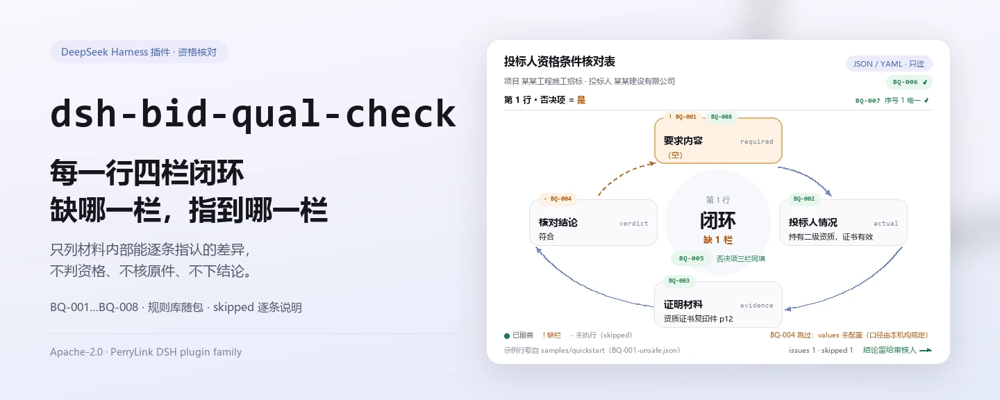
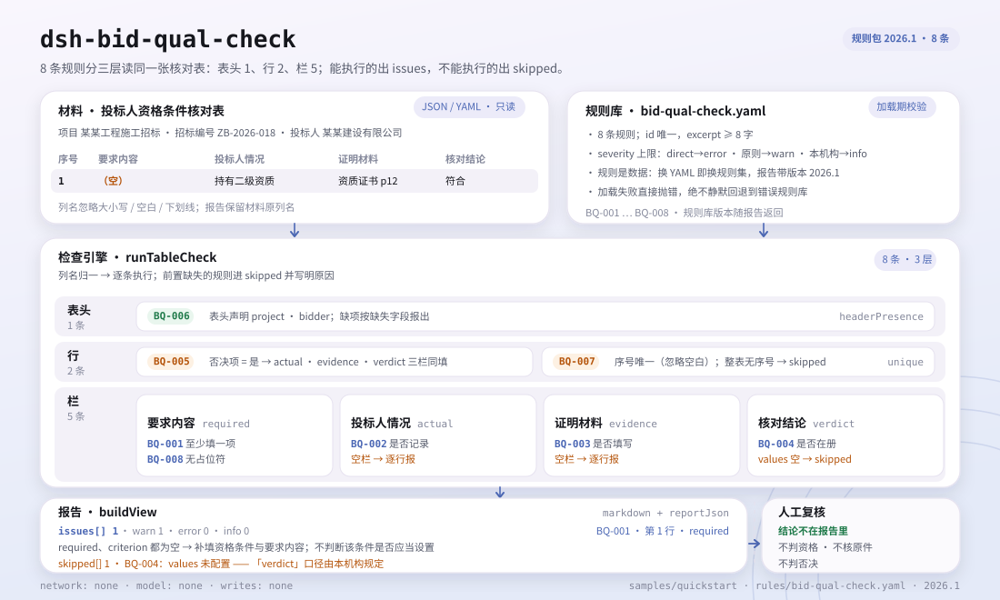

<div align="center">

<picture>
  <source media="(prefers-color-scheme: dark)" srcset="docs/assets/dsh-bid-qual-check-hero-zh-dark.webp">
  
</picture>

# dsh-bid-qual-check

**把投标人资格条件核对表逐行过一遍，指出哪一行、哪一栏没有闭环。**

面向投标专员、招标代理与资格审查辅助人员：输入一份 JSON/YAML 核对表，拿回一份能逐条复核的差异清单——不改原件、不判合规、不下结论。

[安装](#三步上手) · [配置](#配置) · [FAQ](#faq) · [简体中文](README.md) · [English](README.en.md)

[](LICENSE)
[](#兼容性)
[](https://www.npmjs.com/package/dsh-bid-qual-check)
[](https://github.com/PerryLink/dsh-bid-qual-check/actions/workflows/ci.yml)
[](#兼容性)

[](https://github.com/PerryLink/dsh-bid-qual-check/stargazers)
[](https://www.npmjs.com/package/dsh-bid-qual-check)
[](https://dshfind.com/plugins/PerryLink/dsh-bid-qual-check?ref=badge)
[](https://securityscorecards.dev/viewer/?uri=github.com/PerryLink/dsh-bid-qual-check)
[](https://dsh.market/)
[](https://gitee.com/perrylink/dsh-bid-qual-check)

```sh
dsh plugin --profile <name> add dsh-bid-qual-check
```

</div>

<sub>社区插件，与 DeepSeek 官方无关。唯一仓库：<https://github.com/PerryLink/dsh-bid-qual-check>（Gitee 为镜像）。</sub>

## 它是什么

`dsh-bid-qual-check` 读取一份**投标人资格条件核对表**——表头加每条资格条件一行——核对这张表自身的逐条闭环：每条资格条件是否填写了要求内容、是否记录了投标人实际情况、是否附了证明材料、核对结论是否使用本机构口径的取值、否决项是否同时记录三者、表头是否写明项目与投标人、序号是否唯一、要求内容是否残留模板占位符。输出是一份「哪一行、哪一栏、差什么、怎么补」的差异清单。

它不判合规、不认定资格、不核验原件，只列材料内部能逐条指认的差异——结论留给审核人。

本仓自带一份 1 分钟样例：构建后执行 `node samples/quickstart/run.mjs`，样例输入在 `samples/quickstart/input/`，期望结果在 `samples/quickstart/expected/result.json`。

<picture>
  <source media="(prefers-color-scheme: dark)" srcset="docs/assets/dsh-bid-qual-check-flow-v5-dark.svg">
  
</picture>

## 三步上手

1. **安装**（三选一）：

   ```sh
   # git 通道（最新 main；等价于 git+https://github.com/PerryLink/dsh-bid-qual-check.git）
   dsh plugin --profile <name> add github:PerryLink/dsh-bid-qual-check
   # npm 通道（已发布版本 0.2.12）
   dsh plugin --profile <name> add dsh-bid-qual-check
   # tarball 通道：本仓库 pnpm pack 后
   dsh plugin --profile <name> add ./dsh-bid-qual-check-<version>.tgz
   ```

   npm 包里已含构建产物 `lib/`；从源码使用时先 `pnpm install && pnpm run build`。

   也可以在 WorkBuddy / 扣子搜索「投标合规核对包」（本检查是其中一项；上架以商城为准）。

2. **最小配置**（默认即可用；规则库随包发布）：

   ```yaml
   - insert:
       - id: dsh-bid-qual-check
         name: dsh-bid-qual-check
   ```

   需要收窄规则集或换规则库时，再按「配置」一节覆盖 `onlyRules`、`disabledRules` 或 `rulesFile`。

3. **验证已生效**：

   ```sh
   dsh --profile <name> --dump-config | grep 'dsh-bid-qual-check'
   ```

   在会话里调用 `bid_qual_check`，用 `file` 传材料路径，或用 `material` 传内联 JSON/YAML。也可以直接跑仓内样例：

   ```sh
   pnpm install && pnpm run build
   node samples/quickstart/run.mjs
   ```

   ```text
   bid_qual_check: 1 issue(s) — error 0, warn 1, info 0
   skipped: 1
   ```

   期望结果见 `samples/quickstart/expected/result.json`；`skipped: 1` 是 `BQ-004`（结论口径出厂为空），属于预期行为。

**卸载**：`dsh plugin --profile <name> remove dsh-bid-qual-check`（或从 profile patch 删掉该行）。

## 核心能力

`dsh-bid-qual-check` 只做一件事：把核对表逐行对照规则库，输出可定位的差异。8 条规则覆盖核对表能自查的闭环：

- **逐条闭环** —— `BQ-001` 到 `BQ-008` 依次核对要求内容、实际情况、证明材料、结论口径、否决项三者、表头主体、序号唯一与占位符残留。
- **定位到行与栏** —— 每条差异带 `ruleId`、`locator`（行/字段）、`found`、`expected`、`fix`；报告按 `error`、`warn`、`info` 分组。
- **空结果不等于没问题** —— 无法执行的检查逐条进 `skipped` 并写明原因；`disabledRules`、`onlyRules` 与空 `values` 都会在报告里显式体现。
- **规则库即数据** —— 规则在 `rules/bid-qual-check.yaml`，替换 YAML 即可切换规则集；加载期校验 id 唯一与 severity 上限。
- **引文不伪造** —— 每条规则都带 `document`、`number`、`clause`、`excerpt`、`kind`、`source`；逐字引文才标 `direct`，原则推导封顶 `warn`，本机构口径封顶 `info`。
- **离线只读** —— 不联网、不调模型、不写任何文件；只读你给的 `file` 或 `material`。

### 规则一览

| 规则 | 检查 | 级别 | 依据类型 |
|---|---|---|---|
| `BQ-001` | 每条资格条件都填写要求内容 | warn | 直接条文 |
| `BQ-002` | 每条资格条件都记录投标人实际情况 | warn | 直接条文 |
| `BQ-003` | 每条资格条件都附证明材料 | warn | 直接条文 |
| `BQ-004` | 核对结论取自本机构口径的取值 | info | 本机构配置 |
| `BQ-005` | 否决项同时记录实际情况、证明材料与结论 | warn | 原则推导 |
| `BQ-006` | 核对表写明项目与投标人 | warn | 原则推导 |
| `BQ-007` | 资格条件序号唯一 | warn | 原则推导 |
| `BQ-008` | 要求内容不残留模板占位符 | warn | 原则推导 |

### 示例

以下为规则库对自己 `BQ-001` 测试夹具的真实输出。

**输入**（节选，完整样例在 `samples/quickstart/input/BQ-001-unsafe.json`）：

```json
{"project":"某某工程施工招标","bidder":"某某建设有限公司","rows":[{"序号":"1","资格条件":"","要求内容":"","投标人情况":"持有建筑工程施工总承包二级资质，证书在有效期内","证明材料":"资质证书复印件，资格文件第 12 页","核对结论":"符合","是否否决项":"是"}]}
```

**输出**（其中一条 `warn` 差异，节选）：

```json
{
  "id": "dsh-bid-qual-check.BQ-001.97d9cf2f",
  "ruleId": "BQ-001",
  "severity": "warn",
  "locator": {
    "column": "required",
    "row": 1
  },
  "found": "第 1 行 required、criterion 都为空",
  "expected": "required、criterion 至少应填写一项",
  "fix": "补填资格条件与要求内容；本条只核对是否填写，不判断该条件是否应当设置"
}
```

*Observed from `tests/fixtures/BQ-001/BQ-001-unsafe.json; tests/fixtures/BQ-001/cases.json; rules/bid-qual-check.yaml; tests/index.test.ts`*

### 规则问答

| 你会问 | 它怎么答 |
|---|---|
| 某一行的「资格条件」与「要求内容」两栏都是空的，会报出来吗？ | 会。`BQ-001` 要求每行在这两栏中至少填一栏，两栏皆空时逐行报出。它只核对是否填写，不判断该资格条件本身是否合法、是否应当设置——那是对招标文件本身的审查。 |
| 某条资格条件的「投标人情况」栏空着，「证明材料」栏也空着。 | 会报出两处：`BQ-002` 报出 `投标人情况`（`actual`）为空的行，`BQ-003` 报出 `证明材料`（`evidence`）为空的行。两条都只核对这一栏是否填写，既不判断实际情况是否满足要求，也不判断证明材料是否有效、是否过期、是否与原件一致——那需要核对原件，属于资格审查委员会的判断。栏位在册但整栏为空，仍会逐行报出；材料里根本没有这一栏时，这两条进入 `skipped` 并说明不适用，而不是静默通过。 |
| 「核对结论」栏空着，`BQ-004` 会报吗？ | 不会——`BQ-004` 只看已经填写的取值，空格跳过。本条规则的 `values` 出厂为空，因此默认它自己进入 `skipped`；把本机构的结论口径（如 `符合` / `不符合` / `需澄清`）配置进 `values` 之后，不在册的取值会逐行报出。它只核对取值是否在册，不判断结论是否正确，也不会因为出现某个取值就认定投标无效。本条封顶 `info`，因为结论口径由本机构规定。 |
| 某一行的「是否否决项」写的是 `是`，但「投标人情况」或「证明材料」没填。 | `BQ-005` 要求凡「是否否决项」栏命中配置判定值（默认 `是`、`Y`、`yes`、`true`、`否决项`、`√`）的行，必须同时填写 `投标人情况`、`证明材料` 与 `核对结论`，缺哪项就报出哪项。哪些条件属于否决项完全取决于本项目招标文件与这一栏，不来自任何内置清单。若没有任何一行带这类标记，本条报告不适用并进入 `skipped`，而不是静默通过；它只核对清单闭环，不判断该投标人是否应当被否决。 |
| 核对表表头写了招标编号，但没有项目名称和投标人。 | `BQ-006` 会报出一次表头缺失，并指出缺的是 `project`（项目名称）还是 `bidder`（投标人名称）。它只核对表头是否声明了这两个主体信息，不核对招标编号与核对日期；把结论口径加进这条规则的字段也不会有帮助——那由 `BQ-004` 的 `values` 控制。 |
| 这张核对表是照模板抄的：两行的序号都是 `3`，还有一处「要求内容」写着 `待填`。 | `BQ-007` 会报出重复的 `序号`（比对时忽略空白字符，`3` 与 ` 3 ` 视为同一个号）；若没有任何一行填了序号，本条进入 `skipped` 并说明不适用，而不是静默通过。`BQ-008` 会报出「要求内容」里残留的占位符——`【`、`】`、`{{`、`}}`、`XXX`、`待填`、`待补充`、`TBD`、`示例` 等 `terms` 词表，词表可按本机构模板收窄。两条都只做字面核对：都不判断要求内容本身是否正确，逐字抄录而恰好含有 `XXX` 的要求也会被报出。 |

## 依据的标准

| 文件 | 文号 | 引用它的规则 |
|---|---|---|
| 《中华人民共和国招标投标法》 | 1999年8月30日通过，2017年12月27日修正（全国人大常委会《关于修改〈中华人民共和国招标投标法〉、〈中华人民共和国计量法〉的决定》），本法自2000年1月1日起施行 | BQ-001, BQ-002, BQ-003, BQ-004, BQ-006, BQ-007, BQ-008 |
| 《中华人民共和国招标投标法实施条例》 | 国务院令第613号（2011 年 12 月 20 日公布，2017 年 3 月 1 日修订，自 2012 年 2 月 1 日起施行） | BQ-005 |

**边界：** 本插件核对一份 **投标人资格条件核对表** 在核对表层面可以要求到的闭环——每项条件是否记录了要求内容与投标人实际情况，是否附有证明材料，核对结论是否取自你的取值口径，**否决项**是否同时记录投标人实际情况、证明材料与核对结论，表格是否写明项目与投标人，编号是否唯一，以及是否残留占位符。它**不**判定投标人是否具备资格、资格审查是否不通过，也不判定投标是否应当被否决。**那是资格审查委员会的判断，须对照证明材料原件与招标文件规定的条件作出。**

> **在采信报告中的引文之前，请先读这一段。**
>
> **每条 `excerpt` 的状态逐条不同，不是统一的。** 有的规则引用逐字条文（`kind: direct`），有的按条文原则推导（`kind: derived-from-principle`，最高 `warn`），有的阈值由本机构配置（`kind: institutional-configuration`，最高 `info`）。规则包从不概括引文：取不到原文时，`excerpt` 会如实写明，推理写在 `note` 里；并有 `check:citations` 门禁把每段引文回溯到 `rules/evidence/` 的核查记录（当前基线为空）。**对仍标为「未取得原文」的规则，取得文本后必须把 `excerpt` 换成真实条款，并把 `kind` 提升为 `direct`。**
>
> 结论性判断留给审核人：本插件只列出材料内部可以逐条指认的差异，不判断事实真伪，也不评价合规性。

规则数据与代码分离。加载期强制：每条规则必须写全 `document` / `number` / `clause` / `excerpt` / `kind` / `source`，`excerpt` 不少于八个字符，规则 id 唯一，并且 `severity` 不得超过依据类型的上限（`direct` 到 `error`、`derived-from-principle` 到 `warn`、`institutional-configuration` 到 `info`）。长度校验无法区分「逐字引文」与「转述」，因此逐字性另由 `rules/evidence/` 的核查记录与测试兜底：有测试断言每条 `direct` 规则不得声称「未取得原文」，且引用的 evidence 文件真实存在。规则包头部与每条规则的 `note` 也分别说明引文状态与缺口；核验中确认的边界与刻意没有作出的结论记录在 `rules/evidence/`。

## 配置

全部可调参数都在 `src/config.ts` 的 Schemastery schema 中，只改 `cordis.yml` 即可生效，无需改代码；逐条阈值在 `rules/` 下的规则库文件里。

| 键 | 类型 | 默认值 | 说明 |
|---|---|---|---|
| `rulesFile` | string | `rules/bid-qual-check.yaml` | 规则库文件路径，相对插件包根目录 |
| `disabledRules` | string[] | `[]` | 要停用的规则 id 列表；每条都会出现在 `skipped` 中 |
| `onlyRules` | string[] | `[]` | 只执行这些规则 id；留空表示执行全部规则 |
| `skipNotes` | string | `""` | 附加到每条 `skipped` 说明后的备注 |
| `timeoutMs` | number | `120000` | 工具协作式超时预算（毫秒） |

### 规则级参数

以下参数写在规则库 YAML 的 `params` 下，不是插件 `Config` 的键：

- `BQ-004` `values` —— 本机构的结论口径，如 `[符合, 不符合, 需澄清]`；出厂为空，未配置时本条进入 `skipped`。
- `BQ-005` `conditionValues` —— 「是否否决项」栏中视为否决项的取值，默认 `[是, Y, yes, true, 否决项, √]`。
- `BQ-008` `terms` —— 要检出的占位符词表，默认 `['【', '】', '{{', '}}', 'XXX', 'xxx', '待填', '待补充', 'TBD', 'todo', '示例']`。

### 材料格式

接受 JSON 或 YAML。顶层用 `rows` 列出各行（也接受 `items`、`criteria`、`资格条件`）；表头字段 `project`、`tenderNo`、`bidder`、`checkedAt` 可用中文别名。列名匹配忽略大小写、空白（含全角空格）、下划线与连字符，报告保留你表里的原列名：

```yaml
project: 某某工程施工招标
tenderNo: ZB-2026-018
bidder: 某某建设有限公司
rows:
  - { 序号: '1', 资格条件: 施工资质等级, 要求内容: 建筑工程施工总承包二级及以上,
      投标人情况: 持有建筑工程施工总承包二级资质，证书在有效期内,
      证明材料: 资质证书复印件，资格文件第 12 页, 核对结论: 符合, 是否否决项: 是, 核对人: 李工 }
```

字段在读取层是可选的，由检查引擎校验，因此部分导出的材料会产生「缺项」类差异，而不是让程序崩溃。空材料、空行列表，或整份材料没有任何可识别字段时，读取层直接报错并列出识别到的列名——不会拿错列继续跑。

## FAQ

<details>
<summary>材料会被上传或保存吗？</summary>

不会。本插件是离线检查器：只读你给的 `file` 或 `material`，不发起网络请求、不调用模型、不写任何文件，也不保存材料副本（见 `SECURITY.md`）。

</details>

<details>
<summary>报告是空的，是不是代表核对表没问题？</summary>

不等于。空结果只说明**已经执行的**检查没有发现差异；无法执行的检查逐条列在 `skipped` 里，并写明规则 id 与原因。请同时看 `issueCount` 与 `skippedCount`。另外，空材料、空行列表或整份材料没有可识别字段会直接报错，而不是返回一份空报告。

</details>

<details>
<summary>为什么 `BQ-004` 或 `BQ-005` 总是 `skipped`？</summary>

`BQ-004` 的 `values` 出厂为空，未配置本机构结论口径时不执行；`BQ-005` 只在至少一行「是否否决项」命中 `conditionValues` 时执行。两者都取决于你的项目与机构规定，插件不猜。配置后重新运行即可。

</details>

<details>
<summary>支持 Excel 或 Word 吗？</summary>

只接受 JSON 或 YAML。Excel 可先转成 JSON/YAML（在对话里也可以代转），Word/PDF 需要先抽取成表格结构；本插件不解析二进制文档，也不做 OCR。

</details>

<details>
<summary>性能开销多大？</summary>

检查是纯内存的表遍历：不联网、不调模型、不读规则库以外的文件；成本随「行数 × 8 条规则」增长，通常可忽略。`timeoutMs` 默认 120000，由宿主按协作式超时执行；工具声明了并发安全，可并行处理多份材料。

</details>

## 安全边界

- **离线只读。** 不发起网络请求、不调用模型、不写文件；只读 `file` 或 `material`。`SECURITY.md` 同样声明：离线检查器，不发起网络调用、不调用模型、不保存任何内容。
- **不作出定性结论。** 只列材料内部可指认的字面差异；不判资格、不判否决、不核原件。结论留给资格审查委员会与审核人；每份报告的结尾都带免责声明。
- **引文不伪造。** 每条规则的 `excerpt` 必须是逐字引文，或由 `kind` 与 `note` 显式标注缺口；`derived-from-principle` 封顶 `warn`，`institutional-configuration` 封顶 `info`；超出上限的规则库在加载期失败。
- **失败响亮。** 规则库文件缺失时按绝对路径、模块祖先目录、工作目录依次查找，全找不到就抛错并列出尝试过的位置，绝不静默回退到错误的规则库；材料解析失败、空行列表、未知规则 id 同样直接报错。
- **注册即 effect。** `ctx.tools.register` 返回 disposer，停止或热重载插件即撤销 `bid_qual_check` 工具。

## 已知限制

- **只读 JSON/YAML。** 不解析 Excel/Word/PDF，也不做 OCR；先把材料转成 JSON/YAML。
- **只核对核对表自身的闭环。** 不判断资格条件设置是否合法、不判断投标人是否满足条件、不判断证明材料真伪或有效期、不判断是否应否决投标。
- **`BQ-004` 出厂不启用。** `values` 为空即 `skipped`；这是刻意设计，因为结论口径由本机构规定，插件不硬编码任何取值清单。
- **`BQ-005` 依赖表内标记。** 哪些条件属于否决项完全取决于招标文件与核对表自己的「是否否决项」栏，插件不内置清单；没有一行带标记时进入 `skipped`。
- **`BQ-008` 是字面匹配。** 逐字抄录且确实含 `XXX`、`待填` 的要求也会被报出；可按本机构模板收窄 `terms`，但不要为了让报告变绿而删掉词表。
- **列名需落在别名表内。** 匹配忽略大小写、空白、下划线与连字符，但不是语义匹配；完全不同的列名会被当作缺栏，进入 `skipped` 或触发读取错误。
- **规则库版本与代码版本解耦。** `rulesFile` 可以指向任意规则库，报告里的 `rulesetVersion` 来自 YAML 的 `version`；装错规则库就会得到另一套规则。

## 与其他 DSH 插件的互操作性

本插件只注册一个工具，`inject` 仅声明 `tools`；不做工具之外的事：

- **无工具名冲突。** 工具 id 是 `bid_qual_check`，只在 `tools` 服务存在时注册，不占用任何内置或第三方插件的裸名。
- **无服务键冲突。** 不提供任何服务键。
- **无 slot 与 HTTP 路由冲突。** 无 client 目录，不注册客户端 slot，也不注册 `webServer` 前缀。
- **无共享事件监听。** 不监听 `agent/pre-step`、`tools/post-execute` 等共享事件，因此不参与这些监听链的排序与短路。
- **无 patch 层冲突。** 组合包 patch 只 `insert` 自己那一行，不覆写内置行或其他插件的 `config`。
- **无全局改写。** 不改原型、不改写 `process.env`、不替换全局 fetch。

以上均可由 `src/index.ts` 与 `cordis.patch.yml` 直接核对；没有声称未实测的兼容性结论。

## 兼容性

| 项目 | 状态 |
|---|---|
| Harness | 对等版本范围 `>=0.1.2-rc.1 <0.2.0 \|\| >=0.2.0-0 <0.3.0` —— 已实测同时接受 `0.2.0-rc.2` 与 `0.2.1-rc.2`。**已声明 `engines.dsh`**：0.2.1 起由宿主单独裁决，范围为 `>=0.2.1-0 <0.3.0` |
| Node | `^22.19.0 \|\| >=24.0.0` |
| 平台 | 全平台（纯 ESM；无原生代码、无联网、不调用模型） |
| 工具模式 | `native` / `ptc` 均可；批量校验整个目录时建议 `ptc`，schema 成本只付一次 |

## 疑难排查

- **插件装上了但工具不出现。** 确认 `main` 指向 `lib/index.mjs` 且 `pnpm run build` 已生成该文件；`main` 写错会让加载器静默跳过该条目。
- **`dsh plugin add` 报版本不兼容。** peer 范围覆盖 `0.1.x` 与 `0.2.x`；若运行时在其之外，可显式豁免：`dsh plugin --profile <name> allow-version dsh-bid-qual-check@0.2.12 --dsh-version <runtime> --accept-risk`。
- **某条规则没有执行。** 查看 `skipped` 数组，其中写明了规则 id 与原因。
- **`check` 报 `manifest-peers` 失败。** 静态检查器比对的是一份早于 0.2 世代的硬编码 peer 范围；安装期的 peer 校验以运行时为准。这是 `dsh-plugin-dev` 的已知上游问题。
- **`BQ-002` 对看似显然的条件也报。** 空白「投标人情况」意味着「没核对」——这正是核对表最不该出现的状态；即使条件显而易见，也请把那句话写进栏里。
- **`BQ-005` 对缺证明材料的否决项也报。** 这正是它的职责：三项记录不齐的否决项，事后无法说明当时依据什么判断。
- **`BQ-008` 对逐字抄录的要求也报。** 单元格里确实含有 `XXX` 或 `待填`；收窄 `terms` 或修正核对表，二选一。
- **`file` 路径读不到。** `file` 会先按当前工作目录解析；报 `ENOENT` 时改用绝对路径，或把内容直接放进 `material`。

## 生态与质量

- [Gitee 镜像](https://gitee.com/perrylink/dsh-bid-qual-check)（同步镜像，以 GitHub 为准）
- [dshfind 插件页](https://dshfind.com/plugins/PerryLink/dsh-bid-qual-check)（安装量与排名）
- [OpenSSF Scorecard 报告](https://securityscorecards.dev/viewer/?uri=github.com/PerryLink/dsh-bid-qual-check)（由 [.github/workflows/scorecard.yml](.github/workflows/scorecard.yml) 驱动）
- [DSH Market](https://dsh.market/)（已上架）

## 开发

```sh
pnpm install
pnpm run typecheck   # tsc --noEmit
pnpm test            # vitest，共享表格套件 + 每条规则的成对夹具
pnpm run build       # tsdown -> lib/index.mjs + lib/index.d.mts
pnpm run check:readmes
node ../scripts/sync-shared.mjs dsh-bid-qual-check   # 从 ../_shared 刷新 src/shared
```

插件是**数据驱动**的：`src/model.ts` 声明表格形状，共享套件提供读取与检查引擎，规则包声明每条检查。配图由 [`scripts/gen-readme-assets.py`](scripts/gen-readme-assets.py) 程序化生成（Python 3 + Pillow 渲染 hero WebP，SVG 结构图直接手写），可重复执行。

Topics：`dsh`, `dsh-plugin`, `deepseek-harness`, `deepseek`, `cordis`, `bid`, `qual`

## 家族与致谢

本项目是 [PerryLink](https://github.com/PerryLink) 维护的 DeepSeek Harness 插件家族成员（全部 Apache-2.0）。如果这个插件帮到了你，**给个 star**——它不解锁任何功能，但会让下一个人更容易找到它。完整清单见 [按材料选核查器](https://perrylink.github.io/zh/checkers/choose/) 与 [全部插件](https://github.com/PerryLink)。

- [@PerryLink](https://github.com/PerryLink) —— 创建者与维护者：规则库、逐条闭环检查、五语文档。

<details>
<summary>展开全部插件</summary>

| 插件 | 状态 |
|---|---|
| **[dsh-aqua-input-check](https://github.com/PerryLink/dsh-aqua-input-check)** |  |
| **[dsh-archive-check](https://github.com/PerryLink/dsh-archive-check)** |  |
| **[dsh-auto-review](https://github.com/PerryLink/dsh-auto-review)** |  |
| **[dsh-autotier](https://github.com/PerryLink/dsh-autotier)** | 🧊 已冻结 — 见仓库 README |
| **[dsh-bid-ca-precheck](https://github.com/PerryLink/dsh-bid-ca-precheck)** |  |
| **[dsh-bid-qual-check](https://github.com/PerryLink/dsh-bid-qual-check)** |  |
| **[dsh-cert-mcp](https://github.com/PerryLink/dsh-cert-mcp)** | 🧊 已冻结 — 见仓库 README |
| **[dsh-checkpoint-rewind](https://github.com/PerryLink/dsh-checkpoint-rewind)** |  |
| **[dsh-click](https://github.com/PerryLink/dsh-click)** |  |
| **[dsh-composer-history](https://github.com/PerryLink/dsh-composer-history)** |  |
| **[dsh-contract-stance](https://github.com/PerryLink/dsh-contract-stance)** |  |
| **[dsh-customs-doc-check](https://github.com/PerryLink/dsh-customs-doc-check)** |  |
| **[dsh-data-quality](https://github.com/PerryLink/dsh-data-quality)** | 🧊 已冻结 — 见仓库 README |
| **[dsh-demurrage-ledger](https://github.com/PerryLink/dsh-demurrage-ledger)** |  |
| **[dsh-doublecheck](https://github.com/PerryLink/dsh-doublecheck)** |  |
| **[dsh-drill-script-check](https://github.com/PerryLink/dsh-drill-script-check)** |  |
| **[dsh-eia-guide-check](https://github.com/PerryLink/dsh-eia-guide-check)** |  |
| **[dsh-emergency-plan](https://github.com/PerryLink/dsh-emergency-plan)** |  |
| **[dsh-essay-rubric-check](https://github.com/PerryLink/dsh-essay-rubric-check)** |  |
| **[dsh-evidence-check](https://github.com/PerryLink/dsh-evidence-check)** |  |
| **[dsh-export-ctl-check](https://github.com/PerryLink/dsh-export-ctl-check)** |  |
| **[dsh-fast](https://github.com/PerryLink/dsh-fast)** |  |
| **[dsh-fmea-table-check](https://github.com/PerryLink/dsh-fmea-table-check)** |  |
| **[dsh-forecast-penalty](https://github.com/PerryLink/dsh-forecast-penalty)** |  |
| **[dsh-fund-research](https://github.com/PerryLink/dsh-fund-research)** |  |
| **[dsh-github](https://github.com/PerryLink/dsh-github)** |  |
| **[dsh-gongwen-flow-check](https://github.com/PerryLink/dsh-gongwen-flow-check)** |  |
| **[dsh-gongwen-word-check](https://github.com/PerryLink/dsh-gongwen-word-check)** |  |
| **[dsh-guard-plan-qc](https://github.com/PerryLink/dsh-guard-plan-qc)** |  |
| **[dsh-hazchem-check](https://github.com/PerryLink/dsh-hazchem-check)** |  |
| **[dsh-hazplan-check](https://github.com/PerryLink/dsh-hazplan-check)** |  |
| **[dsh-hidden-risk-map](https://github.com/PerryLink/dsh-hidden-risk-map)** |  |
| **[dsh-hs-classify](https://github.com/PerryLink/dsh-hs-classify)** |  |
| **[dsh-icd-rule-check](https://github.com/PerryLink/dsh-icd-rule-check)** |  |
| **[dsh-industry-research](https://github.com/PerryLink/dsh-industry-research)** |  |
| **[dsh-lawcite-adapter](https://github.com/PerryLink/dsh-lawcite-adapter)** |  |
| **[dsh-laya](https://github.com/PerryLink/dsh-laya)** |  |
| **[dsh-lc-doc-check](https://github.com/PerryLink/dsh-lc-doc-check)** |  |
| **[dsh-learning-gap-check](https://github.com/PerryLink/dsh-learning-gap-check)** |  |
| **[dsh-library](https://github.com/PerryLink/dsh-library)** |  |
| **[dsh-local-ai](https://github.com/PerryLink/dsh-local-ai)** |  |
| **[dsh-lsp-actions](https://github.com/PerryLink/dsh-lsp-actions)** |  |
| **[dsh-mask](https://github.com/PerryLink/dsh-mask)** |  |
| **[dsh-mcp-panel](https://github.com/PerryLink/dsh-mcp-panel)** |  |
| **[dsh-medrec-qc](https://github.com/PerryLink/dsh-medrec-qc)** |  |
| **[dsh-memento](https://github.com/PerryLink/dsh-memento)** | 🧊 已冻结 — 见仓库 README |
| **[dsh-nsfc-form-check](https://github.com/PerryLink/dsh-nsfc-form-check)** |  |
| **[dsh-nurse-record-check](https://github.com/PerryLink/dsh-nurse-record-check)** |  |
| **[dsh-observe](https://github.com/PerryLink/dsh-observe)** |  |
| **[dsh-origin-rvc-check](https://github.com/PerryLink/dsh-origin-rvc-check)** |  |
| **[dsh-ota-review-check](https://github.com/PerryLink/dsh-ota-review-check)** |  |
| **[dsh-output-styles](https://github.com/PerryLink/dsh-output-styles)** |  |
| **[dsh-paper-doc-adapter](https://github.com/PerryLink/dsh-paper-doc-adapter)** |  |
| **[dsh-permission-rules](https://github.com/PerryLink/dsh-permission-rules)** |  |
| **[dsh-permit-report-check](https://github.com/PerryLink/dsh-permit-report-check)** |  |
| **[dsh-pipeline-check](https://github.com/PerryLink/dsh-pipeline-check)** |  |
| **[dsh-pleading-draft](https://github.com/PerryLink/dsh-pleading-draft)** |  |
| **[dsh-plugin-doctor](https://github.com/PerryLink/dsh-plugin-doctor)** | 🚫 已退役（仓库已归档） |
| **[dsh-plugin-guide](https://github.com/PerryLink/dsh-plugin-guide)** |  |
| **[dsh-plugin-kit](https://github.com/PerryLink/dsh-plugin-kit)** | 🚫 已退役（仓库已归档） |
| **[dsh-plugin-upgrade](https://github.com/PerryLink/dsh-plugin-upgrade)** | 🚫 已退役（仓库已归档） |
| **[dsh-policy-brief-draft](https://github.com/PerryLink/dsh-policy-brief-draft)** |  |
| **[dsh-power-loss-split](https://github.com/PerryLink/dsh-power-loss-split)** |  |
| **[dsh-power-ticket-check](https://github.com/PerryLink/dsh-power-ticket-check)** |  |
| **[dsh-ppap-check](https://github.com/PerryLink/dsh-ppap-check)** |  |
| **[dsh-protest-deadline](https://github.com/PerryLink/dsh-protest-deadline)** |  |
| **[dsh-railway-window](https://github.com/PerryLink/dsh-railway-window)** |  |
| **[dsh-repair-order-qc](https://github.com/PerryLink/dsh-repair-order-qc)** |  |
| **[dsh-research-report](https://github.com/PerryLink/dsh-research-report)** |  |
| **[dsh-review-reply-check](https://github.com/PerryLink/dsh-review-reply-check)** |  |
| **[dsh-rulefile-check](https://github.com/PerryLink/dsh-rulefile-check)** |  |
| **[dsh-safety-brief-check](https://github.com/PerryLink/dsh-safety-brief-check)** |  |
| **[dsh-score](https://github.com/PerryLink/dsh-score)** | 🧊 已冻结 — 见仓库 README |
| **[dsh-session-sync](https://github.com/PerryLink/dsh-session-sync)** |  |
| **[dsh-site-log-check](https://github.com/PerryLink/dsh-site-log-check)** |  |
| **[dsh-skill-pack-security](https://github.com/PerryLink/dsh-skill-pack-security)** |  |
| **[dsh-soe-decision-check](https://github.com/PerryLink/dsh-soe-decision-check)** |  |
| **[dsh-soilwater-check](https://github.com/PerryLink/dsh-soilwater-check)** |  |
| **[dsh-sop-sync-check](https://github.com/PerryLink/dsh-sop-sync-check)** |  |
| **[dsh-spc-gbt-adapter](https://github.com/PerryLink/dsh-spc-gbt-adapter)** |  |
| **[dsh-talk](https://github.com/PerryLink/dsh-talk)** |  |
| **[dsh-tender-extract](https://github.com/PerryLink/dsh-tender-extract)** |  |
| **[dsh-tender-matrix](https://github.com/PerryLink/dsh-tender-matrix)** |  |
| **[dsh-test-drive](https://github.com/PerryLink/dsh-test-drive)** |  |
| **[dsh-ticktick](https://github.com/PerryLink/dsh-ticktick)** | 🚫 已退役（仓库已归档） |
| **[dsh-translate](https://github.com/PerryLink/dsh-translate)** |  |
| **[dsh-warranty-calc](https://github.com/PerryLink/dsh-warranty-calc)** |  |
| **[dsh-budget](https://github.com/PerryLink/dsh-budget)** | 🧊 已冻结 — 见仓库 README |
| **[dsh-claude-move](https://github.com/PerryLink/dsh-claude-move)** | 🧊 已冻结 — 见仓库 README |
| **[dsh-defend](https://github.com/PerryLink/dsh-defend)** | 🧊 已冻结 — 见仓库 README |
| **[dsh-draw](https://github.com/PerryLink/dsh-draw)** | 🧊 已冻结 — 见仓库 README |
| **[dsh-reach](https://github.com/PerryLink/dsh-reach)** | 🧊 已冻结 — 见仓库 README |
| **[dsh-background-agents](https://github.com/PerryLink/dsh-background-agents)** | 🚫 已退役（仓库已归档） |
| **[dsh-session-pin](https://github.com/PerryLink/dsh-session-pin)** | 🚫 已退役（仓库已归档） |
| **[dsh-team-rooms](https://github.com/PerryLink/dsh-team-rooms)** | 🚫 已退役（仓库已归档） |

</details>

## License

[LICENSE](LICENSE)（Apache License 2.0）© 2026 dsh-bid-qual-check contributors

<p align="center"><sub>Apache-2.0 · 社区插件，与 DeepSeek 无关。</sub></p>
