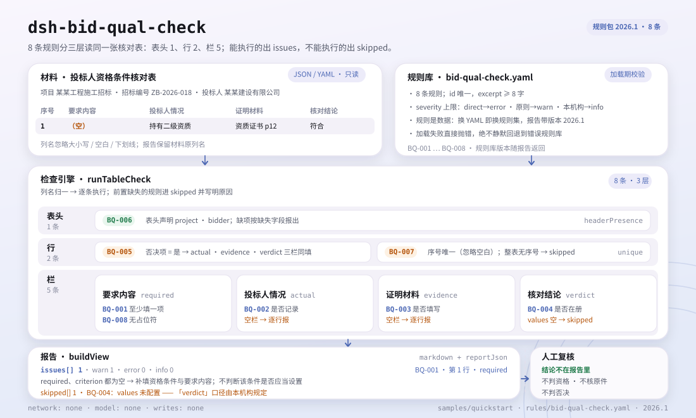

<div align="center">

<picture>
  <source media="(prefers-color-scheme: dark)" srcset="docs/assets/dsh-bid-qual-check-hero-en-dark.webp">
  
</picture>

# dsh-bid-qual-check

**Percorra um registo de condições de qualificação do concorrente linha a linha e aponte exatamente qual linha e qual coluna não fecham o circuito.**

Para especialistas em concursos, agentes de contratação e revisores de qualificação: entregue um registo JSON/YAML e receba uma lista de diferenças revisável linha a linha; o original nunca é alterado e nenhum veredicto de conformidade é emitido.

[Instalação](#instalação-em-três-passos) · [Configuração](#configuração) · [FAQ](#faq) · [简体中文](README.md) · [English](README.en.md) · [Español](README.es.md) · [Português](README.pt.md) · [हिन्दी](README.hi.md)

[](LICENSE)
[](#compatibilidade)
[](https://www.npmjs.com/package/dsh-bid-qual-check)
[](https://github.com/PerryLink/dsh-bid-qual-check/actions/workflows/ci.yml)
[](#compatibilidade)

[](https://github.com/PerryLink/dsh-bid-qual-check/stargazers)
[](https://www.npmjs.com/package/dsh-bid-qual-check)
[](https://dshfind.com/plugins/PerryLink/dsh-bid-qual-check?ref=badge)
[](https://securityscorecards.dev/viewer/?uri=github.com/PerryLink/dsh-bid-qual-check)
[](https://dsh.market/)
[](https://gitee.com/perrylink/dsh-bid-qual-check)

```sh
dsh plugin --profile <name> add dsh-bid-qual-check
```

</div>

<sub>Plugin da comunidade, sem afiliação com a DeepSeek. Repositório canónico: <https://github.com/PerryLink/dsh-bid-qual-check> (o Gitee é um espelho).</sub>

## O que é

`dsh-bid-qual-check` lê um **registo de condições de qualificação do concorrente** — um cabeçalho mais uma linha por condição — e verifica o fecho interno desse próprio registo: se cada condição regista o seu requisito, se fica registada a situação real do concorrente, se a prova documental é anexada, se o veredicto vem do seu vocabulário, se uma partida eliminatória regista em conjunto situação, prova e veredicto, se o registo indica o seu projeto e o seu concorrente, se os números de condição são únicos e se não resta nenhum marcador de modelo por substituir na coluna do requisito. A saída é uma lista de diferenças: qual linha, qual coluna, o que falta e como corrigir.

Não decide conformidade, qualificação ou validade dos originais; apenas lista diferenças que um revisor consegue apontar no material e deixa a conclusão para esse revisor.

O repositório inclui uma amostra de um minuto: após construir, execute `node samples/quickstart/run.mjs`. A entrada está em `samples/quickstart/input/` e o resultado esperado em `samples/quickstart/expected/result.json`.

<picture>
  <source media="(prefers-color-scheme: dark)" srcset="docs/assets/dsh-bid-qual-check-flow-v5-dark.svg">
  
</picture>

## Instalação em três passos

1. **Instalar** (escolha um canal):

   ```sh
   # canal git (último main; equivale a git+https://github.com/PerryLink/dsh-bid-qual-check.git)
   dsh plugin --profile <name> add github:PerryLink/dsh-bid-qual-check
   # canal npm (versão publicada 0.2.12)
   dsh plugin --profile <name> add dsh-bid-qual-check
   # canal tarball: após pnpm pack neste repositório
   dsh plugin --profile <name> add ./dsh-bid-qual-check-<version>.tgz
   ```

   O pacote npm já inclui `lib/` compilado; a partir do código-fonte execute antes `pnpm install && pnpm run build`.

   A verificação também faz parte da «Tender Compliance Suite» no WorkBuddy / Coze (disponibilidade conforme o catálogo).

2. **Configuração mínima** (os padrões funcionam; o pacote de regras vem com o plugin):

   ```yaml
   - insert:
       - id: dsh-bid-qual-check
         name: dsh-bid-qual-check
   ```

   Para restringir o conjunto de regras ou trocar o pacote, substitua `onlyRules`, `disabledRules` ou `rulesFile` como indicado em Configuração.

3. **Confirmar que monta**:

   ```sh
   dsh --profile <name> --dump-config | grep 'dsh-bid-qual-check'
   ```

   Numa sessão, invoque `bid_qual_check` com `file` (caminho do material) ou `material` (JSON/YAML em linha). Ou execute a amostra do repositório:

   ```sh
   pnpm install && pnpm run build
   node samples/quickstart/run.mjs
   ```

   ```text
   bid_qual_check: 1 issue(s) — error 0, warn 1, info 0
   skipped: 1
   ```

   O resultado esperado está em `samples/quickstart/expected/result.json`; `skipped: 1` é o `BQ-004` (o vocabulário de veredictos vem vazio), o que é esperado.

**Desinstalar**: `dsh plugin --profile <name> remove dsh-bid-qual-check` (ou remova a linha do patch do perfil).

## Capacidades principais

`dsh-bid-qual-check` faz uma só coisa: percorre o registo linha a linha contra o pacote de regras e devolve diferenças localizáveis. Oito regras cobrem o circuito que um registo consegue verificar sozinho:

- **Fecho linha a linha** — `BQ-001` a `BQ-008` cobrem requisito, situação real, prova documental, vocabulário do veredicto, registo tripartido da partida eliminatória, partes do cabeçalho, unicidade dos números e marcadores residuais.
- **Localizado, não vago** — cada achado traz `ruleId`, `locator` (linha/campo), `found`, `expected` e `fix`; o relatório agrupa-os em `error`, `warn` e `info`.
- **Resultado vazio não é certificado** — toda verificação que não pode correr é listada em `skipped` com o motivo; `disabledRules`, `onlyRules` e um `values` vazio aparecem explicitamente no relatório.
- **O pacote de regras é dado** — as regras vivem em `rules/bid-qual-check.yaml`; trocar o YAML troca o conjunto, e a validação de carga exige ids únicos e tetos de severidade.
- **Sem citações inventadas** — cada regra leva `document`, `number`, `clause`, `excerpt`, `kind` e `source`; só uma citação literal é `direct`, uma verificação derivada de princípios fica limitada a `warn` e um limiar local a `info`.
- **Offline e só leitura** — sem rede, sem chamada ao modelo e sem escritas; lê apenas o `file` ou `material` que você fornece.

### Referência de regras

| Regra | Verificação | Severidade | Tipo de base |
|---|---|---|---|
| `BQ-001` | cada condição registra o seu requisito | warn | direta |
| `BQ-002` | cada condição registra a situação real do concorrente | warn | direta |
| `BQ-003` | cada condição anexa prova documental | warn | direta |
| `BQ-004` | o veredicto vem do seu vocabulário | info | configuração local |
| `BQ-005` | a partida eliminatória registra situação, prova e veredicto | warn | princípio |
| `BQ-006` | o registo nomeia projeto e concorrente | warn | princípio |
| `BQ-007` | os números de condição são únicos | warn | princípio |
| `BQ-008` | a coluna do requisito não tem marcadores por substituir | warn | princípio |

### Exemplo

Esta é a saída real do pacote de regras sobre o seu próprio fixture `BQ-001`.

**Entrada** (excerto; a amostra completa está em `samples/quickstart/input/BQ-001-unsafe.json`):

```json
{"project":"某某工程施工招标","bidder":"某某建设有限公司","rows":[{"序号":"1","资格条件":"","要求内容":"","投标人情况":"持有建筑工程施工总承包二级资质，证书在有效期内","证明材料":"资质证书复印件，资格文件第 12 页","核对结论":"符合","是否否决项":"是"}]}
```

**Saída** (um achado `warn`, excerto):

```json
{
  "id": "dsh-bid-qual-check.BQ-001.97d9cf2f",
  "ruleId": "BQ-001",
  "severity": "warn",
  "locator": {
    "column": "required",
    "row": 1
  },
  "found": "第 1 行 required、criterion 都为空",
  "expected": "required、criterion 至少应填写一项",
  "fix": "补填资格条件与要求内容；本条只核对是否填写，不判断该条件是否应当设置"
}
```

*Observado em `tests/fixtures/BQ-001/BQ-001-unsafe.json; tests/fixtures/BQ-001/cases.json; rules/bid-qual-check.yaml; tests/index.test.ts`*

### Perguntas sobre as regras

| Você pergunta | O que ele responde |
|---|---|
| Uma linha tem vazias tanto a coluna `criterion` como a `required`. Isso é reportado? | Sim. `BQ-001` exige que cada linha traga pelo menos uma dessas duas colunas e assinala a linha quando ambas estão vazias. Verifica que algo foi escrito, não se essa condição é lícita ou se deveria ter sido estabelecida — isso é uma análise do próprio caderno de encargos. |
| Uma condição tem a coluna `actual` vazia e também não traz `evidence`. | Dois achados: `BQ-002` assinala a linha pela situação real vazia e `BQ-003` pela prova vazia. Ambas verificam apenas que a célula está preenchida, não que a situação satisfaça a condição nem que o documento seja válido, esteja em vigor ou coincida com o original, o que exige os originais e a decisão da comissão. Uma coluna presente com todas as células vazias continua a ser assinalada linha a linha; se o material não tiver essa coluna, a regra passa a `skipped` em vez de passar em silêncio. |
| A coluna `verdict` está vazia numa linha. O `BQ-004` reporta isso? | Não: o `BQ-004` só examina os valores escritos e ignora as células vazias. A sua lista `values` vem vazia, por isso de fábrica a regra declara-se em `skipped`; depois de configurar em `values` o vocabulário da sua instituição, cada valor fora dessa lista é assinalado linha a linha. Verifica que o valor está no seu vocabulário, não que a conclusão esteja correta, e nenhum valor invalida uma proposta. A regra está limitada a `info`, porque o vocabulário é fixado pela sua instituição. |
| Uma linha está marcada como partida eliminatória, mas falta-lhe a situação real ou a prova. | O `BQ-005` exige que toda a linha cuja célula de partida eliminatória coincida com os valores configurados (`Y`, `yes`, `true`, `√` e os restantes padrões do pacote) preencha em conjunto situação real, prova e veredicto, e assinala o que faltar. Que condições são eliminatórias depende inteiramente do caderno de encargos e dessa coluna, nunca de uma lista incorporada. Se nenhuma linha tiver essa marca, a regra declara-se em `skipped` em vez de passar, e nunca decide se a proposta deve ser rejeitada. |
| O cabeçalho do registo traz o número do concurso, mas não o projeto nem o concorrente. | O `BQ-006` reporta o cabeçalho uma vez e indica o que falta: `project` (o nome do projeto) ou `bidder` (o nome do concorrente). Verifica apenas que o cabeçalho declara essas duas partes; não revê o número do concurso nem a data da verificação, e acrescentar o vocabulário das conclusões a esta regra não ajudaria, porque quem o controla é o `values` do `BQ-004`. |
| Este registo foi copiado de um modelo: duas linhas partilham o número `3` e uma célula de requisito ainda diz `XXX`. | O `BQ-007` assinala o `seq` repetido (a comparação ignora espaços, pelo que `3` e ` 3 ` são o mesmo número) e, se nenhuma linha tiver número, declara-se em `skipped` em vez de passar. O `BQ-008` assinala o marcador residual em `required` —`【`, `】`, `{{`, `}}`, `XXX`, `TBD` e o resto da sua lista `terms`, que pode restringir. Ambas as verificações são literais: nenhuma julga se o requisito está correto, e um requisito copiado à letra que contenha `XXX` também é assinalado. |

Os nomes chineses de coluna mapeiam para campos canónicos (os aliases estão declarados em `src/model.ts`):

```text
序号 → seq · 资格条件 → criterion · 类别 → category · 要求内容 → required
投标人情况 → actual · 证明材料 → evidence · 核对结论 → verdict
是否否决项 → isPassFail · 核对人 → checkedBy · 备注 → note
project · tenderNo · bidder · checkedAt · verdicts   (campos de cabeçalho)
```

## Normas que segue

| Documento | Número | Regras que o citam |
|---|---|---|
| Lei de Licitação e Contratação da República Popular da China | Aprovada em 30 de agosto de 1999; alterada em 27 de dezembro de 2017 pela Decisão do Comité Permanente da Assembleia Popular Nacional que altera a Lei de Licitação e Contratação e a Lei de Metrologia; em vigor desde 1 de janeiro de 2000 | BQ-001, BQ-002, BQ-003, BQ-004, BQ-006, BQ-007, BQ-008 |
| Regulamento de Aplicação da Lei de Licitação e Contratação da República Popular da China | Ordem do Conselho de Estado n.º 613 (promulgada em 20 de dezembro de 2011; alterada em 1 de março de 2017; em vigor desde 1 de fevereiro de 2012) | BQ-005 |

**Limite:** este plugin verifica um **registo de condições de qualificação do concorrente** quanto ao circuito que uma lista de verificação pode exigir de si mesma: que cada condição registe o seu requisito e a situação real do concorrente, que a prova seja anexada, que os veredictos venham do seu vocabulário, que uma **partida eliminatória** registe os três elementos, que a tabela nomeie projeto e concorrente, que os números sejam únicos e que nenhum marcador sobreviva. **Não** decide se um concorrente está qualificado, se a qualificação falha ou se uma proposta deve ser rejeitada. **Essa é a decisão da comissão de qualificação, tomada contra os originais da prova e as condições do caderno de encargos.**

> **Leia isto antes de confiar numa citação do relatório.**
>
> **O estado de `excerpt` é por regra, não uniforme.** Algumas regras citam a cláusula literalmente (`kind: direct`), outras derivam do princípio dos artigos citados (`kind: derived-from-principle`, teto `warn`) e outras usam limiares configurados pela sua instituição (`kind: institutional-configuration`, teto `info`). O pacote nunca parafraseia uma citação: quando o texto não foi obtido, o campo `excerpt` diz isso e o raciocínio fica em `note`; a porta `check:citations` rastreia cada segmento do `excerpt` até os registos em `rules/evidence/` (a linha de base está vazia). **Para qualquer regra ainda marcada como não obtida, substitua o `excerpt` pela cláusula real e eleve `kind` para `direct` quando tiver o texto.**
>
> A conclusão é do revisor: este plugin lista diferenças apontáveis no material e não decide factos nem conformidade.

Os dados das regras estão separados do código. A validação de carga exige que cada regra traga `document`, `number`, `clause`, `excerpt`, `kind` e `source`, um `excerpt` de pelo menos oito caracteres, ids únicos e uma `severity` não mais forte do que o seu tipo de base permite (`direct` até `error`, `derived-from-principle` até `warn`, `institutional-configuration` até `info`). A verificação de comprimento não distingue uma citação de uma paráfrase, por isso a literalidade é sustentada pelos registos de verificação em `rules/evidence/` e por testes: nenhuma regra `direct` pode afirmar que o seu texto não foi obtido, e todo arquivo de evidência referenciado deve existir. O cabeçalho do pacote e o `note` de cada regra também declaram o estado da citação e a sua lacuna; os limites verificados e as conclusões deliberadamente não tiradas ficam registados em `rules/evidence/`.

## Configuração

Todos os parâmetros ajustáveis ficam no esquema Schemastery de `src/config.ts`, portanto `cordis.yml` altera-os sem tocar no código; os limiares por regra ficam no pacote em `rules/`.

| Chave | Tipo | Padrão | Descrição |
|---|---|---|---|
| `rulesFile` | string | `rules/bid-qual-check.yaml` | Caminho do pacote de regras, relativo à raiz do pacote |
| `disabledRules` | string[] | `[]` | Ids de regras a desativar; cada uma aparece em `skipped` |
| `onlyRules` | string[] | `[]` | Executar apenas estas regras; vazio executa todas |
| `skipNotes` | string | `""` | Nota acrescentada a cada motivo de `skipped` |
| `timeoutMs` | number | `120000` | Orçamento de tempo limite cooperativo da ferramenta |

### Parâmetros por regra

Ficam em `params` no YAML do pacote, não entre as chaves de `Config` do plugin:

- `BQ-004` `values` — o vocabulário de veredictos da sua instituição; vazio por padrão, e a regra declara-se em `skipped` até ser configurado.
- `BQ-005` `conditionValues` — os valores da coluna de partida eliminatória que marcam uma partida como tal; os padrões estão declarados no pacote.
- `BQ-008` `terms` — os marcadores procurados; a lista padrão está declarada no pacote e pode ser restringida.

Padrões desses três parâmetros, citados de `rules/bid-qual-check.yaml`:

```text
BQ-004 values: []
BQ-005 conditionValues: [是, Y, yes, true, 否决项, √]
BQ-008 terms: ['【', '】', '{{', '}}', 'XXX', 'xxx', '待填', '待补充', 'TBD', 'todo', '示例']
```

### Formato do material

JSON ou YAML. A raiz lista as linhas em `rows` (também `items` e `criteria`); os campos de cabeçalho `project`, `tenderNo`, `bidder` e `checkedAt` aceitam aliases chineses. Os nomes de coluna são comparados sem distinguir maiúsculas e ignorando espaços (incluindo o espaço de largura total), sublinhados e hífenes; os nomes do próprio registo são preservados, de modo que um achado nomeia a coluna que leu:

```yaml
project: 某某工程施工招标
tenderNo: ZB-2026-018
bidder: 某某建设有限公司
rows:
  - { 序号: '1', 资格条件: 施工资质等级, 要求内容: 建筑工程施工总承包二级及以上,
      投标人情况: 持有建筑工程施工总承包二级资质，证书在有效期内,
      证明材料: 资质证书复印件，资格文件第 12 页, 核对结论: 符合, 是否否决项: 是, 核对人: 李工 }
```

Os campos são opcionais na camada de leitura e validados pelo motor, de modo que uma exportação parcial gera achados de «campo ausente» em vez de falhar. Material vazio, lista de linhas vazia ou material sem nenhum campo reconhecível provoca um erro do leitor que nomeia as colunas vistas; nunca continua com as colunas erradas.

## FAQ

<details>
<summary>O material é enviado ou guardado?</summary>

Não. É um verificador offline: lê o `file` ou `material` que você fornece, não faz pedidos de rede, não chama nenhum modelo, não escreve arquivos e não guarda cópia do material (ver `SECURITY.md`).

</details>

<details>
<summary>O relatório vem vazio — isso significa que o registo está limpo?</summary>

Não. Um resultado vazio só significa que as verificações **que correram** não encontraram diferenças; toda verificação que não pôde correr é listada em `skipped` com o id e o motivo. Leia `issueCount` e `skippedCount` juntos. Além disso, material vazio, lista de linhas vazia ou material sem campos reconhecíveis gera erro, não um relatório vazio.

</details>

<details>
<summary>Por que `BQ-004` ou `BQ-005` aparecem sempre em `skipped`?</summary>

`BQ-004` vem com `values` vazio, por isso não corre até você configurar o vocabulário de veredictos da sua instituição. `BQ-005` só corre quando pelo menos uma célula de partida eliminatória coincide com `conditionValues`. Ambos dependem do seu projeto e da sua instituição; o plugin não adivinha. Configure-os e execute novamente.

</details>

<details>
<summary>Suporta Excel ou Word?</summary>

Apenas JSON ou YAML. Converta Excel para JSON/YAML primeiro (pode ser feito no chat) e extraia uma estrutura de tabela de Word/PDF; o plugin não analisa documentos binários e não faz OCR.

</details>

<details>
<summary>Qual é a sobrecarga de desempenho?</summary>

A verificação é uma passagem de tabela em memória: sem rede, sem chamada ao modelo e sem leituras além do pacote de regras; o custo cresce com linhas × oito regras e costuma ser desprezível. `timeoutMs` vale 120000 por padrão e o host o aplica como tempo limite cooperativo; a ferramenta declara-se segura para concorrência, então vários materiais podem ser verificados em paralelo.

</details>

## Limites de segurança

- **Offline e só leitura.** Sem pedidos de rede, sem chamadas ao modelo e sem escritas; lê apenas `file` ou `material`. `SECURITY.md` diz o mesmo: um verificador offline que não faz chamadas de rede nem ao modelo e não guarda nada.
- **Sem veredicto qualificador.** Lista diferenças literais apontáveis no material; não decide qualificação, rejeição ou validade de originais. A conclusão pertence à comissão de qualificação e ao revisor, e todo relatório termina com o aviso legal.
- **Sem citações inventadas.** O `excerpt` de cada regra é uma citação literal ou uma lacuna explícita marcada por `kind` e `note`; `derived-from-principle` fica limitado a `warn` e `institutional-configuration` a `info`; um pacote que exceda esses tetos falha ao carregar.
- **Falha ruidosa.** Se faltar o arquivo do pacote, a resolução percorre o caminho absoluto, os ancestrais do módulo e o diretório de trabalho, e então lança erro enumerando cada local tentado; nunca recorre em silêncio a outro pacote. Erros de análise do material, lista de linhas vazia e id de regra desconhecido também lançam erro.
- **O registo é um efeito.** `ctx.tools.register` devolve um disposer, então parar ou recarregar a quente o plugin remove a ferramenta `bid_qual_check`.

## Limitações conhecidas

- **Apenas JSON/YAML.** Sem análise de Excel/Word/PDF e sem OCR; converta o material primeiro.
- **Apenas o circuito do próprio registo.** Não julga se uma condição de qualificação é lícita, se o concorrente a cumpre, se a prova é autêntica ou está em vigor, nem se a proposta deve ser rejeitada.
- **`BQ-004` vem desativada.** Um `values` vazio significa `skipped` por design: o vocabulário de veredictos pertence à sua instituição e o plugin não codifica nenhuma lista.
- **`BQ-005` depende das marcas do registo.** Que condições são eliminatórias depende inteiramente do caderno de encargos e da coluna de partida eliminatória; o plugin não inclui lista e declara-se em `skipped` quando nenhuma linha traz marca.
- **`BQ-008` é literal.** Um requisito que contenha de facto `XXX` ou `TBD` também é assinalado; restrinja `terms` conforme o modelo da sua instituição, mas não apague termos só para deixar o relatório verde.
- **Os nomes de coluna devem ser aliases.** A comparação ignora maiúsculas, espaços, sublinhados e hífenes, mas não é semântica; um nome completamente diferente conta como coluna ausente e leva a `skipped` ou a um erro do leitor.
- **A versão do pacote está desacoplada da versão do código.** `rulesFile` pode apontar para qualquer pacote e `rulesetVersion` no relatório vem do `version` do YAML; apontar para outro pacote dá outro conjunto de regras.

## Interoperabilidade com outros plugins DSH

O plugin registra exatamente uma ferramenta e declara apenas `tools` em `inject`; não faz mais nada:

- **Sem colisão de nomes de ferramenta.** O id é `bid_qual_check`, registrado só quando o serviço `tools` existe; não ocupa nenhum nome de ferramenta integrada ou de terceiros.
- **Sem colisão de chaves de serviço.** Não fornece nenhuma chave de serviço.
- **Sem colisão de slots ou rotas HTTP.** Não há diretório de cliente, nem registro de slots de cliente, nem prefixo `webServer`.
- **Sem escuta de eventos partilhados.** Não escuta `agent/pre-step` nem `tools/post-execute`, portanto não participa nessas cadeias de escuta.
- **Sem colisão de camadas de patch.** O patch do bundle apenas faz `insert` da sua própria linha; nunca sobrescreve o `config` de uma linha integrada ou de outro plugin.
- **Sem mutação global.** Não altera protótipos, não reescreve `process.env` e não substitui o fetch global.

Tudo isso pode ser verificado diretamente em `src/index.ts` e `cordis.patch.yml`; nenhuma compatibilidade não testada é afirmada.

## Compatibilidade

| Superfície | Estado |
|---|---|
| Harness | Faixa de peers `>=0.1.2-rc.1 <0.2.0 \|\| >=0.2.0-0 <0.3.0` — verificada para aceitar tanto `0.2.0-rc.2` quanto `0.2.1-rc.2`. `engines.dsh` é declarado como `>=0.2.1-0 <0.3.0` e o host o aplica desde 0.2.1 |
| Node | `^22.19.0 \|\| >=24.0.0` |
| Plataformas | Todas (ESM puro; sem código nativo, sem rede, sem chamada ao modelo) |
| Modo de ferramenta | Funciona em `native` e `ptc`; para um diretório inteiro use `ptc`, assim o custo do esquema é pago uma vez |

## Solução de problemas

- **O plugin instala mas a ferramenta não aparece.** Confirme que `main` resolve para `lib/index.mjs` e que `pnpm run build` o gerou; um `main` errado faz o carregador ignorar a entrada em silêncio.
- **`dsh plugin add` recusa o pacote como incompatível.** A faixa de peers cobre `0.1.x` e `0.2.x`; se o seu runtime estiver fora, conceda isenção explícita: `dsh plugin --profile <name> allow-version dsh-bid-qual-check@0.2.12 --dsh-version <runtime> --accept-risk`.
- **Uma regra não executou.** Leia o arranjo `skipped`; ele nomeia o id e o motivo.
- **`check` informa `manifest-peers` como falha.** O verificador estático compara com uma faixa de peers fixa anterior à linha 0.2. O runtime aplica a compatibilidade na instalação, então a faixa declarada é a correta; é um problema conhecido do `dsh-plugin-dev`.
- **`BQ-002` dispara numa condição que considero óbvia.** Uma célula de situação real vazia significa «não verificado», o único estado que um registo de qualificação não deve ter. Registre a situação, mesmo que seja óbvia.
- **`BQ-005` dispara numa partida eliminatória sem prova.** Essa é a verificação: uma partida eliminatória sem os três registos não pode ser defendida a posteriori.
- **`BQ-008` dispara num requisito copiado à letra.** A célula contém mesmo `XXX` ou `TBD`; restrinja `terms` ou corrija o registo.
- **O caminho de `file` não pode ser lido.** É resolvido contra o diretório de trabalho atual; em `ENOENT`, use um caminho absoluto ou passe o conteúdo em linha como `material`.

## Ecossistema e qualidade

- [Espelho no Gitee](https://gitee.com/perrylink/dsh-bid-qual-check) (espelho sincronizado; o GitHub é canónico)
- [Página do plugin no dshfind](https://dshfind.com/plugins/PerryLink/dsh-bid-qual-check) (instalações e classificação)
- [Relatório do OpenSSF Scorecard](https://securityscorecards.dev/viewer/?uri=github.com/PerryLink/dsh-bid-qual-check) (gerado por [.github/workflows/scorecard.yml](.github/workflows/scorecard.yml))
- [DSH Market](https://dsh.market/) (publicado)

## Desenvolvimento

```sh
pnpm install
pnpm run typecheck   # tsc --noEmit
pnpm test            # vitest, a suíte compartilhada de tabelas mais fixtures emparelhados por regra
pnpm run build       # tsdown -> lib/index.mjs + lib/index.d.mts
pnpm run check:readmes
node ../scripts/sync-shared.mjs dsh-bid-qual-check   # atualiza src/shared a partir de ../_shared
```

O plugin é **orientado a dados**: `src/model.ts` declara a forma da tabela, o kit compartilhado fornece o leitor e o motor de verificação, e o pacote de regras declara cada verificação. As imagens do README são geradas por [`scripts/gen-readme-assets.py`](scripts/gen-readme-assets.py) (Python 3 + Pillow para o hero WebP; o diagrama SVG é escrito diretamente) e podem ser executadas novamente.

Topics: `dsh`, `dsh-plugin`, `deepseek-harness`, `deepseek`, `cordis`, `bid`, `qual`

## Família e agradecimentos

Este projeto faz parte da família de plugins DeepSeek Harness da [PerryLink](https://github.com/PerryLink) (todos Apache-2.0). Se for útil, **uma estrela ajuda a próxima pessoa a encontrá-lo** — nada fica bloqueado por isso. Índice completo: [escolher um verificador por material](https://perrylink.github.io/zh/checkers/choose/) e [todos os plugins](https://github.com/PerryLink).

- [@PerryLink](https://github.com/PerryLink) — criador e mantenedor: o pacote de regras, as verificações de circuito e a documentação em cinco idiomas.

<details>
<summary>Expandir todos os plugins</summary>

| Plugin | Estado |
|---|---|
| **[dsh-aqua-input-check](https://github.com/PerryLink/dsh-aqua-input-check)** |  |
| **[dsh-archive-check](https://github.com/PerryLink/dsh-archive-check)** |  |
| **[dsh-auto-review](https://github.com/PerryLink/dsh-auto-review)** |  |
| **[dsh-autotier](https://github.com/PerryLink/dsh-autotier)** | 🧊 CONGELADO — ver o README do repo |
| **[dsh-bid-ca-precheck](https://github.com/PerryLink/dsh-bid-ca-precheck)** |  |
| **[dsh-bid-qual-check](https://github.com/PerryLink/dsh-bid-qual-check)** |  |
| **[dsh-cert-mcp](https://github.com/PerryLink/dsh-cert-mcp)** | 🧊 CONGELADO — ver o README do repo |
| **[dsh-checkpoint-rewind](https://github.com/PerryLink/dsh-checkpoint-rewind)** |  |
| **[dsh-click](https://github.com/PerryLink/dsh-click)** |  |
| **[dsh-composer-history](https://github.com/PerryLink/dsh-composer-history)** |  |
| **[dsh-contract-stance](https://github.com/PerryLink/dsh-contract-stance)** |  |
| **[dsh-customs-doc-check](https://github.com/PerryLink/dsh-customs-doc-check)** |  |
| **[dsh-data-quality](https://github.com/PerryLink/dsh-data-quality)** | 🧊 CONGELADO — ver o README do repo |
| **[dsh-demurrage-ledger](https://github.com/PerryLink/dsh-demurrage-ledger)** |  |
| **[dsh-doublecheck](https://github.com/PerryLink/dsh-doublecheck)** |  |
| **[dsh-drill-script-check](https://github.com/PerryLink/dsh-drill-script-check)** |  |
| **[dsh-eia-guide-check](https://github.com/PerryLink/dsh-eia-guide-check)** |  |
| **[dsh-emergency-plan](https://github.com/PerryLink/dsh-emergency-plan)** |  |
| **[dsh-essay-rubric-check](https://github.com/PerryLink/dsh-essay-rubric-check)** |  |
| **[dsh-evidence-check](https://github.com/PerryLink/dsh-evidence-check)** |  |
| **[dsh-export-ctl-check](https://github.com/PerryLink/dsh-export-ctl-check)** |  |
| **[dsh-fast](https://github.com/PerryLink/dsh-fast)** |  |
| **[dsh-fmea-table-check](https://github.com/PerryLink/dsh-fmea-table-check)** |  |
| **[dsh-forecast-penalty](https://github.com/PerryLink/dsh-forecast-penalty)** |  |
| **[dsh-fund-research](https://github.com/PerryLink/dsh-fund-research)** |  |
| **[dsh-github](https://github.com/PerryLink/dsh-github)** |  |
| **[dsh-gongwen-flow-check](https://github.com/PerryLink/dsh-gongwen-flow-check)** |  |
| **[dsh-gongwen-word-check](https://github.com/PerryLink/dsh-gongwen-word-check)** |  |
| **[dsh-guard-plan-qc](https://github.com/PerryLink/dsh-guard-plan-qc)** |  |
| **[dsh-hazchem-check](https://github.com/PerryLink/dsh-hazchem-check)** |  |
| **[dsh-hazplan-check](https://github.com/PerryLink/dsh-hazplan-check)** |  |
| **[dsh-hidden-risk-map](https://github.com/PerryLink/dsh-hidden-risk-map)** |  |
| **[dsh-hs-classify](https://github.com/PerryLink/dsh-hs-classify)** |  |
| **[dsh-icd-rule-check](https://github.com/PerryLink/dsh-icd-rule-check)** |  |
| **[dsh-industry-research](https://github.com/PerryLink/dsh-industry-research)** |  |
| **[dsh-lawcite-adapter](https://github.com/PerryLink/dsh-lawcite-adapter)** |  |
| **[dsh-laya](https://github.com/PerryLink/dsh-laya)** |  |
| **[dsh-lc-doc-check](https://github.com/PerryLink/dsh-lc-doc-check)** |  |
| **[dsh-learning-gap-check](https://github.com/PerryLink/dsh-learning-gap-check)** |  |
| **[dsh-library](https://github.com/PerryLink/dsh-library)** |  |
| **[dsh-local-ai](https://github.com/PerryLink/dsh-local-ai)** |  |
| **[dsh-lsp-actions](https://github.com/PerryLink/dsh-lsp-actions)** |  |
| **[dsh-mask](https://github.com/PerryLink/dsh-mask)** |  |
| **[dsh-mcp-panel](https://github.com/PerryLink/dsh-mcp-panel)** |  |
| **[dsh-medrec-qc](https://github.com/PerryLink/dsh-medrec-qc)** |  |
| **[dsh-memento](https://github.com/PerryLink/dsh-memento)** | 🧊 CONGELADO — ver o README do repo |
| **[dsh-nsfc-form-check](https://github.com/PerryLink/dsh-nsfc-form-check)** |  |
| **[dsh-nurse-record-check](https://github.com/PerryLink/dsh-nurse-record-check)** |  |
| **[dsh-observe](https://github.com/PerryLink/dsh-observe)** |  |
| **[dsh-origin-rvc-check](https://github.com/PerryLink/dsh-origin-rvc-check)** |  |
| **[dsh-ota-review-check](https://github.com/PerryLink/dsh-ota-review-check)** |  |
| **[dsh-output-styles](https://github.com/PerryLink/dsh-output-styles)** |  |
| **[dsh-paper-doc-adapter](https://github.com/PerryLink/dsh-paper-doc-adapter)** |  |
| **[dsh-permission-rules](https://github.com/PerryLink/dsh-permission-rules)** |  |
| **[dsh-permit-report-check](https://github.com/PerryLink/dsh-permit-report-check)** |  |
| **[dsh-pipeline-check](https://github.com/PerryLink/dsh-pipeline-check)** |  |
| **[dsh-pleading-draft](https://github.com/PerryLink/dsh-pleading-draft)** |  |
| **[dsh-plugin-doctor](https://github.com/PerryLink/dsh-plugin-doctor)** | 🚫 APOSENTADO (repo arquivado) |
| **[dsh-plugin-guide](https://github.com/PerryLink/dsh-plugin-guide)** |  |
| **[dsh-plugin-kit](https://github.com/PerryLink/dsh-plugin-kit)** | 🚫 APOSENTADO (repo arquivado) |
| **[dsh-plugin-upgrade](https://github.com/PerryLink/dsh-plugin-upgrade)** | 🚫 APOSENTADO (repo arquivado) |
| **[dsh-policy-brief-draft](https://github.com/PerryLink/dsh-policy-brief-draft)** |  |
| **[dsh-power-loss-split](https://github.com/PerryLink/dsh-power-loss-split)** |  |
| **[dsh-power-ticket-check](https://github.com/PerryLink/dsh-power-ticket-check)** |  |
| **[dsh-ppap-check](https://github.com/PerryLink/dsh-ppap-check)** |  |
| **[dsh-protest-deadline](https://github.com/PerryLink/dsh-protest-deadline)** |  |
| **[dsh-railway-window](https://github.com/PerryLink/dsh-railway-window)** |  |
| **[dsh-repair-order-qc](https://github.com/PerryLink/dsh-repair-order-qc)** |  |
| **[dsh-research-report](https://github.com/PerryLink/dsh-research-report)** |  |
| **[dsh-review-reply-check](https://github.com/PerryLink/dsh-review-reply-check)** |  |
| **[dsh-rulefile-check](https://github.com/PerryLink/dsh-rulefile-check)** |  |
| **[dsh-safety-brief-check](https://github.com/PerryLink/dsh-safety-brief-check)** |  |
| **[dsh-score](https://github.com/PerryLink/dsh-score)** | 🧊 CONGELADO — ver o README do repo |
| **[dsh-session-sync](https://github.com/PerryLink/dsh-session-sync)** |  |
| **[dsh-site-log-check](https://github.com/PerryLink/dsh-site-log-check)** |  |
| **[dsh-skill-pack-security](https://github.com/PerryLink/dsh-skill-pack-security)** |  |
| **[dsh-soe-decision-check](https://github.com/PerryLink/dsh-soe-decision-check)** |  |
| **[dsh-soilwater-check](https://github.com/PerryLink/dsh-soilwater-check)** |  |
| **[dsh-sop-sync-check](https://github.com/PerryLink/dsh-sop-sync-check)** |  |
| **[dsh-spc-gbt-adapter](https://github.com/PerryLink/dsh-spc-gbt-adapter)** |  |
| **[dsh-talk](https://github.com/PerryLink/dsh-talk)** |  |
| **[dsh-tender-extract](https://github.com/PerryLink/dsh-tender-extract)** |  |
| **[dsh-tender-matrix](https://github.com/PerryLink/dsh-tender-matrix)** |  |
| **[dsh-test-drive](https://github.com/PerryLink/dsh-test-drive)** |  |
| **[dsh-ticktick](https://github.com/PerryLink/dsh-ticktick)** | 🚫 APOSENTADO (repo arquivado) |
| **[dsh-translate](https://github.com/PerryLink/dsh-translate)** |  |
| **[dsh-warranty-calc](https://github.com/PerryLink/dsh-warranty-calc)** |  |
| **[dsh-budget](https://github.com/PerryLink/dsh-budget)** | 🧊 CONGELADO — ver o README do repo |
| **[dsh-claude-move](https://github.com/PerryLink/dsh-claude-move)** | 🧊 CONGELADO — ver o README do repo |
| **[dsh-defend](https://github.com/PerryLink/dsh-defend)** | 🧊 CONGELADO — ver o README do repo |
| **[dsh-draw](https://github.com/PerryLink/dsh-draw)** | 🧊 CONGELADO — ver o README do repo |
| **[dsh-reach](https://github.com/PerryLink/dsh-reach)** | 🧊 CONGELADO — ver o README do repo |
| **[dsh-background-agents](https://github.com/PerryLink/dsh-background-agents)** | 🚫 APOSENTADO (repo arquivado) |
| **[dsh-session-pin](https://github.com/PerryLink/dsh-session-pin)** | 🚫 APOSENTADO (repo arquivado) |
| **[dsh-team-rooms](https://github.com/PerryLink/dsh-team-rooms)** | 🚫 APOSENTADO (repo arquivado) |

</details>

## Licença

[LICENSE](LICENSE) (Apache License 2.0) © 2026 dsh-bid-qual-check contributors

<p align="center"><sub>Apache-2.0 · Plugin da comunidade, sem afiliação com a DeepSeek.</sub></p>
